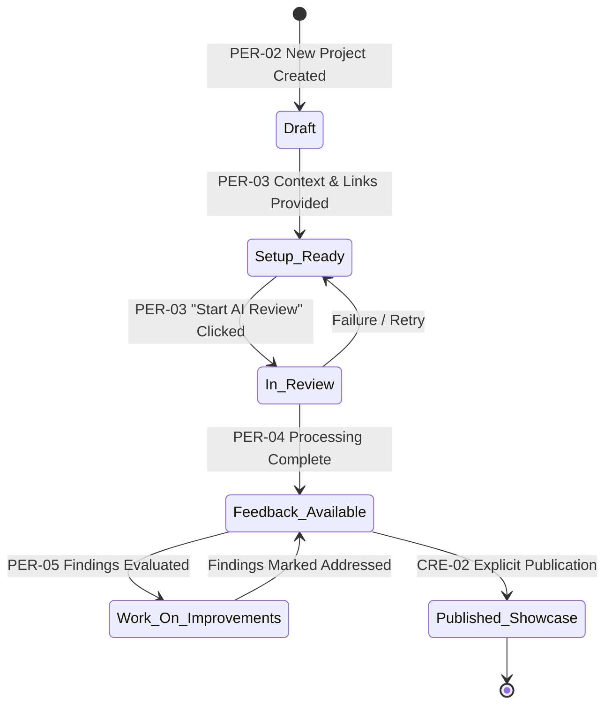
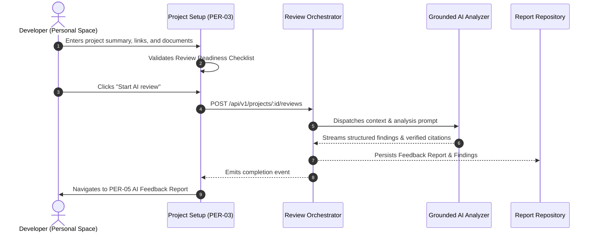

# Product Vision: AI Project Feedback Platform

> **Document Type**: Phase 0 Core Deliverable  
> **Status**: `CONFIRMED BASELINE`  
> **Version**: 1.0.0  
> **Date**: November 2, 2026  
> **Audience**: Product Management, Engineering, Design, Security, QA  

---

## 1. Product Vision Statement

The **AI Project Feedback Platform** is an intelligent, honest, and workflow-oriented workbench designed for software developers, indie makers, and product architects. It provides grounded, multi-dimensional, AI-assisted feedback on software projects, enabling creators to understand structural vulnerabilities, usability friction, performance bottlenecks, and architectural weaknesses—and methodically resolve them before launching to the world.

---

## 2. Core Purpose

The central purpose of the product is to replace superficial vanity metrics (upvotes, likes, generic praise) with **rigorous, transparent, and actionable technical and design feedback**.

The platform is designed around a single guiding philosophy:
> **"ONE SCREEN = ONE MEANING = ONE GOAL = ONE DOMINANT ACTION."**  
> AI feedback must be an unvarnished mirror of product quality: no fabricated scores, no pseudo-scientific confidence numbers, and no hollow praise. Every observation must point to verifiable evidence, and every recommendation must offer a clear next step.

---

## 3. Primary User Problem

Builders developing digital products today suffer from three critical feedback failures:

1. **The Politeness & Echo-Chamber Trap**: Feedback from social media and launch communities is overwhelmingly superficial ("Looks great! Upvoted!"), uncritical, and devoid of actionable technical scrutiny.
2. **Context Disconnect in General LLMs**: Generic chatbots (e.g., prompting ChatGPT in an empty chat) lack structured project context, fail to track multi-file project specifications, cannot organize findings into an ongoing improvement workflow, and hallucinate advice without citing code or documentation.
3. **Fragmented Workflow**: Developers must manually copy code, context, and requirements between scattered tools, receiving ephemeral advice that is lost the moment the chat window is closed, with no tracking of which issues have been addressed.

---

## 4. Target User Groups

| Persona | Description | Primary Need | Core Space |
|---|---|---|---|
| **The Solo Developer / Indie Maker** | Building micro-SaaS, tools, or open-source libraries alone without a peer review team. | Objective pre-launch review of security, UX edge-cases, and architecture before releasing publicly. | **Personal** |
| **The Early-Stage Technical Founder** | Preparing an MVP for public demonstration, angel investment, or early user cohorts. | Validating product messaging clarity, readiness checklist compliance, and competitive positioning. | **Personal & Creator** |
| **The Open-Source Contributor / Maker** | Maintaining public repositories and gathering community scrutiny. | Sharing project prototypes, publishing technical showcases, and receiving structured bug/UX reports. | **Public & Creator** |
| **The Community Reviewer / Visitor** | Browsing innovative projects, evaluating technical architectures, and offering insights. | Discovering genuine product launches, inspecting technical breakdown reports, and contributing observations. | **Public** |

---

## 5. Core Product Value

1. **Honest, Evidence-Grounded AI Analysis**: Every finding links to specific user-provided code, descriptions, or requirements. No hallucinated critique.
2. **Structural Improvement Workflow**: Feedback is not a fleeting chat thread; it is a prioritized backlog of concrete findings (Blocker, High, Medium, Low) that developers can mark as addressed, revisit, or export.
3. **Rigorous Three-Space Separation**: A clear, inviolable boundary between private development work (**Personal**), public community exploration (**Public**), and portfolio showcase preparation (**Creator**). Space switching changes the view context only and never silently exposes private work.
4. **Focused, Clutter-Free Ergonomics**: Maximizing the work surface. Controls are contextual and discoverable; secondary metrics collapse cleanly.

---

## 6. What the Product Does vs. What It Does NOT Do

### What the Product DOES:
- Provides a private workspace for organizing software project context (name, summary, repository URLs, documentation, technical stack).
- Validates project completeness using a **Review Readiness Checklist** before initiating AI review.
- Executes multi-model, multi-agent AI evaluations assessing Usability (UX), Performance, Security/Auth, Architecture, and Correctness.
- Produces structured **AI Feedback Reports** containing actionable findings categorized by explicit severity shapes, icons, and text (never color alone).
- Provides an interactive **Contextual Inspector** for inspecting deep citations, recommendations, and evidence quotes.
- Enables developers to track the status of improvements (Open, In Progress, Addressed).
- Allows explicit, intentional publication of projects and showcases to the Public space when approved by the creator.

### What the Product DOES NOT Do:
- **NO Fabricated Scores or Grades**: The platform never assigns arbitrary numbers (e.g., "78/100 AI Score" or "94% Confidence") that lack statistical or scientific backing.
- **NO Fake Progress Spinners**: Progress indicators reflect real server events and stream processing; fake animated counters are prohibited.
- **NO Automated Stealth Publishing**: Work created in Personal space remains private by default. Entering Public or Creator space never changes permissions or publishes data.
- **NO Code Execution Sandbox (MVP)**: The MVP analyzes submitted text, repository links, documentation, and architecture diagrams; it does not compile or run untrusted binary code in arbitrary runtimes.
- **NO Unvetted Community Upvote Manipulation**: Public voting mechanisms enforce server-side integrity and do not substitute for technical review.

---

## 7. Main Project Lifecycle

---

## 8. AI Feedback Lifecycle

---

## 9. MVP Boundaries vs. Future Expansion

### Confirmed MVP Scope:
- **Core User Journey**: Sign In → Personal Home → New Project Wizard → Project Setup & Readiness Checklist → AI Review Execution → Grounded Feedback Report → Finding Detail / Action Tracking.
- **3-Space Application Shell**: Public, Personal, Creator switcher with space-aware sidebar and collapsible contextual inspector.
- **Public Explore & Project Detail**: Community discovery of intentionally public projects and discussions.
- **Light, Dark, and System Themes**: Zero-flash theme switching with WCAG 2.2 AA compliant contrast.

### Future Expansion Possibilities (`CONDITIONAL` / Post-MVP):
- GitHub / GitLab App Integration for automated Pull Request feedback.
- Team & Organization multi-tenant workspaces.
- Real-time collaborative peer reviews alongside AI reviews.
- Continuous CI/CD automated review triggers.
- Creator monetization, tips, and sponsored launches.
