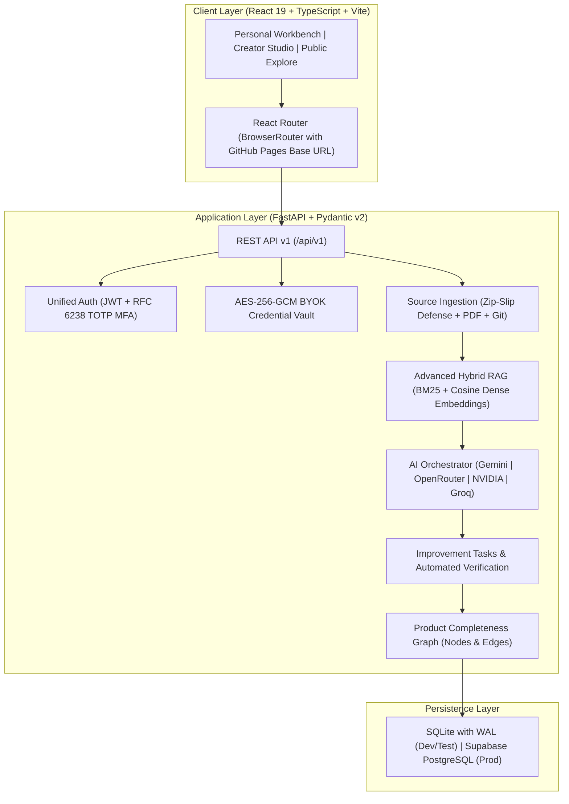

# AI Project Feedback

[](https://github.com/karthikeyakolli/aifeedback-web-app/actions/workflows/deploy-pages.yml)
[](https://github.com/karthikeyakolli/aifeedback-web-app/actions/workflows/ci.yml)
[](LICENSE)
[](frontend/)
[](backend/)

> **Integrated AI-Powered Product Development and Auditing Platform**  
> *Empowering software creators with multi-model architectural auditing, verifiable RAG evidence traceability, and interactive product completeness mapping.*

🌐 **Live Website Deployment**: [https://karthikeyakolli.github.io/aifeedback-web-app/](https://karthikeyakolli.github.io/aifeedback-web-app/)

---

## 1. Executive Overview

**AI Project Feedback** is an integrated platform combining four major capabilities:

1. **AI Product Architect**: Synthesizes product vision, feature decomposition, user journeys, and architectural patterns.
2. **AI Product Auditor**: Detects missing requirements, ambiguous specifications, and functional contradictions.
3. **AI Technical & Code Auditor**: Evaluates code quality, API security (OWASP), concurrency, database integrity, and reliability.
4. **AI Project Assistant**: Conversational assistant grounded in your private project knowledge base, providing verified technical answers and actionable code solutions.

---

## 2. Platform Spaces

```
┌────────────────────────────────────────────────────────────────────────┐
│                        AI PROJECT FEEDBACK PLATFORM                    │
├─────────────────────┬──────────────────────┬───────────────────────────┤
│   Personal Space    │    Creator Space     │       Public Space        │
│ (Private Workbench) │ (Multi-Project Hub)  │  (Read-Only Exploration)  │
├─────────────────────┼──────────────────────┼───────────────────────────┤
│ • Private Projects  │ • Creator Portfolio  │ • Published Showcase      │
│ • Source Ingestion  │ • Readiness Scores   │ • Verified AI Findings    │
│ • RAG Knowledge     │ • Cross-Project Gaps │ • Zero Private Leakage    │
│ • Completeness Map  │ • Launch Checklists  │ • Pure Static Discovery   │
│ • Review Engine     │ • Studio Metrics     │                           │
│ • Task Verification │                      │                           │
└─────────────────────┴──────────────────────┴───────────────────────────┘
```

- **Personal Space**: Private engineering workbench for managing technical context, uploading source files or archives, inspecting RAG evidence chunks, tracking completeness knowledge graphs, and executing AI audits.
- **Creator Space**: Launchpad for managing multiple projects, evaluating launch readiness, and reviewing aggregated blockers.
- **Public Space**: Controlled, read-only showcase displaying only explicitly published projects and verified audit reports with zero private credential or user metadata leakage.

---

## 3. Core Architecture



---

## 4. Repository Structure

```
.
├── .github/
│   ├── workflows/
│   │   ├── deploy-pages.yml         # Automated GitHub Pages CI/CD deployment
│   │   └── ci.yml                   # Automated test & typecheck quality gate
│   ├── ISSUE_TEMPLATE/              # Bug report and feature request templates
│   └── pull_request_template.md     # Standard PR checklist
├── frontend/                        # React 19 + TypeScript + Vite client application
│   ├── public/                      # Static assets & .nojekyll GitHub Pages flag
│   ├── src/
│   │   ├── components/              # Modular UI components (product, common, layout)
│   │   ├── pages/                   # Application route views (personal, creator, public)
│   │   ├── services/                # Typed API client and Supabase connector
│   │   └── types/                   # TypeScript domain models and schemas
│   └── package.json                 # Frontend scripts and dependencies
├── backend/                         # FastAPI backend application
│   ├── app/
│   │   ├── api/v1/                  # REST route controllers
│   │   ├── db/                      # Repository layer and database manager
│   │   ├── schemas/                 # Pydantic v2 request/response schemas
│   │   └── services/                # RAG engine, AI orchestrator, Vault, Ingestion
│   └── tests/                       # 63 automated unit & integration tests
├── docs/                            # Architectural documentation
│   └── specifications/              # Canonical design specifications & UX rules
├── supabase/                        # Database migrations (00001 through 00011)
├── package.json                     # Monorepo convenience scripts
├── CONTRIBUTING.md                  # Development setup & contribution guide
├── CODE_OF_CONDUCT.md              # Contributor Covenant Code of Conduct
└── LICENSE                          # MIT License
```

---

## 5. Getting Started

### Prerequisites
- **Node.js**: v20 or later
- **Python**: v3.11 or later
- **Git**

### Installation

1. **Clone the repository**:
   ```bash
   git clone https://github.com/karthikeyakolli/aifeedback-web-app.git
   cd aifeedback-web-app
   ```

2. **Frontend Setup**:
   ```bash
   npm --prefix frontend install
   npm run dev
   ```
   Access the frontend at `http://localhost:5173/`.

3. **Backend Setup**:
   ```bash
   python -m venv .venv
   # Windows:
   .venv\Scripts\activate
   # Linux/macOS:
   source .venv/bin/activate

   pip install -r backend/requirements.txt
   npm run server   # Or: uvicorn backend.app.main:app --reload --port 8000
   ```
   Interactive OpenAPI documentation is available at `http://localhost:8000/docs`.

---

## 6. Running Tests & Quality Gates

Run the complete backend test suite across concurrency, encryption, RAG, and AI lifecycle:
```bash
npm run test:backend
# Or directly with pytest:
python -m pytest backend/tests -v
```

Execute the production frontend build and typecheck:
```bash
npm run build
```

---

## 7. Deployment to GitHub Pages

The frontend is deployed to GitHub Pages using GitHub Actions:
- **Workflow File**: [`.github/workflows/deploy-pages.yml`](.github/workflows/deploy-pages.yml)
- **Base URL**: `/aifeedback-web-app/` configured in `vite.config.ts` and `App.tsx`
- **SPA Fallback**: `404.html` duplicate generated on build for client-side routing
- **Jekyll Disabled**: `.nojekyll` included in build artifact

To publish:
1. Ensure GitHub Pages in your repository settings is set to **Build and deployment: GitHub Actions**.
2. Push your commits to `main`.
3. The workflow builds the static client and deploys to `https://<username>.github.io/<repo-name>/`.

---

## 8. License

This project is licensed under the [MIT License](LICENSE).
