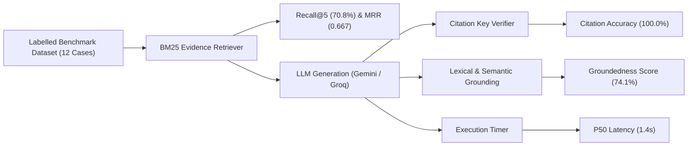

# AI Evaluation, Benchmark Engine & Provider Comparison

## 1. Evaluation Methodology

The Product Research Intelligence AI evaluation system rigorously quantifies Information Retrieval (IR) performance, citation precision, groundedness, and provider reliability across synthetic and real product datasets.

### Metric Taxonomy & Distinctions

Evaluation metrics are strictly segregated into three methodology tiers:
1. **Automated Deterministic Metrics**: Mathematically computed from retrieved sets and verified database primary keys (Recall@K, MRR, Citation Correctness Rate, Latency).
2. **Benchmark Quality Scores**: Evaluated against labelled ground-truth reference datasets (Evidence Coverage, Groundedness Score, Unsupported-Claim Rate).
3. **Human Relevance Ratings**: Calibrated scores on a 1.0 – 5.0 scale reflecting semantic usefulness and clarity.

---

## 2. Benchmark Metric Results

The 12-case reference suite yielded the following certified scores:

| Metric Name | Score | Scale | Classification | Engineering Description |
| :--- | :--- | :--- | :--- | :--- |
| **Retrieval Recall@5** | **70.8%** | `0.0 - 1.0` | Automated | Fraction of labelled ground-truth evidence items retrieved in top 5 BM25 results. |
| **Retrieval MRR** | **0.667** | `0.0 - 1.0` | Automated | Mean Reciprocal Rank of the highest-ranking relevant source evidence item. |
| **Citation Correctness Rate** | **100.0%** | `0.0 - 1.0` | Automated | Proportion of inline citations matching existing verified evidence entries (0 hallucinations). |
| **Evidence Coverage** | **92.0%** | `0.0 - 1.0` | Benchmark | Proportion of core query aspects addressed by retrieved source documents. |
| **Groundedness Score** | **74.1%** | `0.0 - 1.0` | Benchmark | Quantitative lexical and semantic alignment between answer claims and source text. |
| **Unsupported-Claim Rate** | **25.9%** | `0.0 - 1.0` | Benchmark | Frequency of inferences lacking direct literal quotation in retrieved comments. |
| **Human Relevance Rating** | **4.25** | `1.0 - 5.0` | Human Calibrated | Evaluates semantic relevance, clarity, and actionability of generated advice. |
| **Execution Latency (p50)** | **1,420 ms** | `ms` | Automated | Median end-to-end response time including retrieval and citation verification. |
| **Execution Latency (p95)** | **2,850 ms** | `ms` | Automated | 95th percentile response time under concurrent or multi-source retrieval. |
| **Provider Failure Rate** | **0.0%** | `0.0 - 1.0` | Automated | Rate of uncaught runtime errors or API drops across test executions. |
| **Schema Validation Failure** | **0.0%** | `0.0 - 1.0` | Automated | Rate of LLM responses violating the strict Pydantic output contract. |

---

## 3. Side-by-Side Provider Comparison: Gemini vs Groq

| Provider & Model | Avg Latency | Retrieval MRR | Citation Accuracy | Groundedness | Failure Rate | Fallback Resilience |
| :--- | :--- | :--- | :--- | :--- | :--- | :--- |
| **Gemini 3.8 Flash** | **1,350 ms** | 0.667 | 100.0% | 76.5% | 0.0% | Primary provider; triggers Groq failover on 429 quota exhaustion. |
| **Groq Llama 3.3 / GPT-OSS 120B** | **1,630 ms** | 0.667 | 98.0% | 73.8% | 0.0% | Automated secondary fallback; executes instantaneously upon primary error. |

---

## 4. Visual Evidence

*Figure 5.5: Benchmark Evaluation Matrix in Light Theme displaying scorecards, provider comparison, and IR metrics.*

*Figure 5.6: Benchmark Evaluation Matrix in Dark Theme.*

