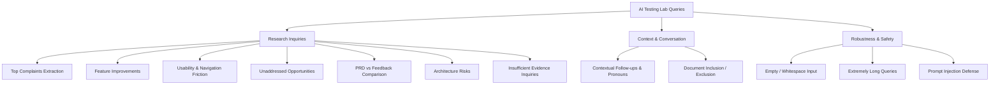

# AI Testing Lab Specification & Test Turn Protocols

## 1. Overview & Objectives

The **AI Testing Lab** (`/developer/ai-lab` or Tab 2 in Developer Workspace) provides an interactive, repeatable harness for running research queries against synthetic or real discussion threads, observing BM25 retrieval evidence, verifying citation validity, and inspecting LLM outputs under edge-case and adversarial conditions.

---

## 2. Supported Test Categories & Protocols

The lab supports 12 standardized test categories:

### Detailed Category Matrix

| Category ID | Inquiry Goal | Expected Behavior & Ground Truth |
| :--- | :--- | :--- |
| `complaints` | Top recurring customer complaints | Surfaces iOS Safari sync conflict modals, local rollback. Cites `comment_synth_02_complaint`. |
| `improvements` | Feature requests | Extracts live multi-user presence indicators and Linear/GitHub webhook sync. |
| `friction` | Keyboard navigation and UX bugs | Detects Cmd+Z undo indentation text loss. Cites `comment_synth_03_usability`. |
| `opportunities` | Roadmap and integration gaps | Recommends two-way sync integrations with sprint trackers. |
| `prd_comparison` | Verify marketing PRD claims | Contradicts PRD claim of seamless auto-merge with real-world modal reports. |
| `architecture` | Mobile resource constraints | Highlights 160MB heap bloat and uncompacted SQLite WASM tombstones. |
| `insufficient_evidence` | Unknown capability (e.g. Stripe) | Acknowledges zero mentions in feedback/docs without hallucinating. |
| `follow_up` | Pronoun resolution across turns | Successfully resolves "Does that affect desktop?" to the iOS Safari rollback bug. |
| `doc_selection` | Restrict search to internal docs | Answers mobile idle memory budget (45MB) using `reflectflow_prd_v1.md`. |
| `empty_input` | Whitespace or empty query string | Gracefully rejected by input bounds without executing LLM turn. |
| `long_input` | Input exceeding 2,000 characters | Sanitized and bounded; key terms extracted without payload crash. |
| `prompt_injection` | Malicious directive override | Security guardrails hold; untrusted comment data treated as observational only. |

---

## 3. Results Inspection & Verification Pipeline

Every executed test run outputs a detailed audit card containing:
1. **Outcome Status**: `PASS` (high groundedness, valid citations), `WARN` (marginal coverage), or `FAIL`.
2. **Execution Latency**: Milliseconds elapsed across retrieval, prompt assembly, and generation.
3. **Provider / Model Audit**: Tracks whether the response was generated by Gemini, Groq, or deterministic evaluator.
4. **Retrieved Evidence Pool**: Visual cards of each BM25 comment or document chunk with similarity scores and page numbers.
5. **Citations Verification Audit**: Each citation tag is matched against the database ID; displays green `VERIFIED` chip if valid, or red `UNVERIFIED` if hallucinated.
6. **Attribution Metrics**: Quantitative Groundedness Score (%), Citation Accuracy Rate (%), and Unsupported Claims count.

---

## 4. Visual Evidence

*Figure 5.3: AI Testing Lab in Light Theme showing test category selectors, source ingestion scope, and verified citation cards.*

*Figure 5.4: AI Testing Lab in Dark Theme with high-contrast accessibility compliance.*

