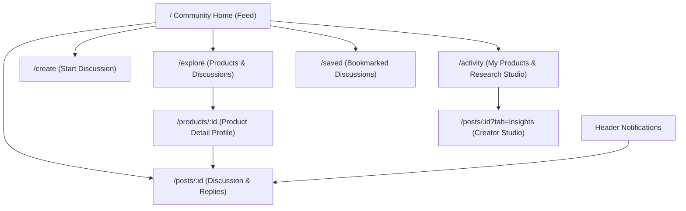

# ResearchIntel Community UX Architecture

This document details the community information architecture, social translucence rules, new-member onboarding, and content-first interaction patterns established in Phase 2 for **ResearchIntel**.

---

## 1. Information Architecture Overview

The community experience is organized around eight coherent routes that separate public discovery from authenticated private workflows:

### Route Index:
* `/`: **Community Home**: Content-first feed with sorting (Popular, Recent, Most Discussed), intent filters (Reviews, Critiques, Discovery), and desktop contextual discovery panel.
* `/explore`: **Product Discovery**: Dual-view catalog for Products and Discussions, category selector, tag cloud, and real persisted counts.
* `/products/:id`: **Product Detail Page**: Product hero, overview, key feature specs, community activity metrics, and discussions list.
* `/posts/:id` (or `/discussions/:id`): **Discussion Detail Page**: Product breadcrumb, original post, tactile voting/sharing, and bounded threaded comments.
* `/create`: **Discussion Composer**: Accessible composer with draft preservation, live preview, duplicate discussion suggestions, and anonymity options.
* `/activity`: **My Activity**: Authored products, bookmarked discussions, upvoted threads, reputation statistics, and owner link to Research Studio.
* `/saved`: **Saved Discussions**: Persisted bookmarks across devices.
* `/notifications`: Real-time notification popover with type categorization (`reply`, `comment`, `ai_ready`, `moderation`).

---

## 2. Social Translucence & Author Accountability (Erickson & Kellogg, 2000)

Online peer-review communities require mutual awareness and accountable feedback to prevent superficial praise or drive-by toxicity:

1. **Role Badges**:
   * **`Product Owner` (OP)**: Highlighted on comments and discussion cards to signal that the creator is responding to peer feedback.
   * **`Anonymous Reviewer`**: When reviewers select anonymity, their personal username and avatar are shielded, but their verified status and reputation tier are preserved to ensure constructive contributions.
   * **`Helpful Review` Badge**: Community-voted critique contributions carry a green badge with a checkmark, highlighting actionable feedback for the creator.
2. **Reputation Scores**:
   * Every non-anonymous contributor displays a verified reputation badge (`★ 47 rep`) reflecting community upvotes received on previous critiques.
3. **Discussion Status Visibility**:
   * Posts clearly indicate status: `Active Review`, `Locked Discussion` (by moderator), or `Grounded Evidence` (AI analysis available).

---

## 3. First-Time Member Experience (Cho & Wash, 2021)

New visitors require immediate clarity regarding the community's purpose before participating:

* **Unvarnished Community Banner**: A dismissible welcome banner surfaces the three core pillars:
  1. *Candid Feedback*: Honest, constructive review without fear of retaliation.
  2. *Bounded Threading*: Max depth 2 replies to prevent endless horizontal rabbit holes and mobile collapse.
  3. *Creator Personal Workspace*: Project owners can synthesize feedback into grounded PRDs using uploaded specs.
* **Persistent Recovery**: Once dismissed, a discreet help button (`?`) in the header allows visitors to reopen the introduction at any time.
* **Frictionless Browsing**: Full read-only access to all products, discussions, and comments without requiring an upfront account.

---

## 4. Tactile Neomorphic & Modern Styling

In accordance with user experience goals, interactive components feature a balanced blend of **neomorphism** (soft dual shadows and extruded/inset surfaces) with crisp, accessible typography:

* **Extruded Cards (`.neomorph-card`)**:
  * Light Mode: `3px 3px 10px rgba(23, 32, 51, 0.05), -3px -3px 10px rgba(255, 255, 255, 0.95)`
  * Dark Mode: `3px 3px 12px rgba(0, 0, 0, 0.4), -2px -2px 8px rgba(35, 48, 74, 0.3)`
* **Recessed Wells (`.neomorph-inset`)**:
  * Used for active segmented tabs, pressed voting buttons, and search inputs to provide immediate tactile depth.
* **Strict WCAG 2.2 AA Contrast**: All text remains rendered with high-contrast semantic tokens (`--text-primary` at > 12:1 ratio), ensuring that tactile shadows never impair readability.
