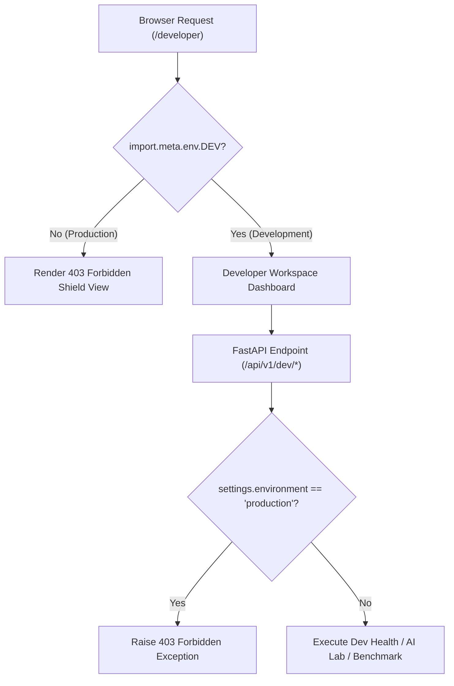

# Developer Workspace Specification & Telemetry Architecture

## 1. Architectural Purpose & Production Isolation

The **Developer Workspace** (`/developer`) is an isolated, internal diagnostics and operations center designed to empower engineers, QA specialists, and product managers to monitor system health, test AI models, inspect retrieval evidence, and manage synthetic test fixtures.

### Production Security Boundaries
- **Backend Guard**: All `/api/v1/dev/*` endpoints are protected by `verify_dev_mode()`, raising an HTTP `403 Forbidden` if `ENVIRONMENT=production`.
- **Frontend Guard**: The `/developer` and `/developer/ai-lab` routes check `import.meta.env.DEV`. In production builds, the route renders an access-denied view and never communicates with backend developer endpoints.
- **Service-Role Isolation**: Under no circumstances are Supabase `service_role` secrets exposed to the browser.
- **RLS Preserved**: Development authentication establishes genuine verified sessions, leaving Row Level Security (RLS) active and fully enforced.

---

## 2. Telemetry & Health Monitoring Capabilities

The System Health dashboard continuously aggregates live status from the full application stack:

| Component | Status Check | Telemetry Reported |
| :--- | :--- | :--- |
| **Frontend** | React 19 + TypeScript + Vite 8 | Operational state, local development server port (5173), HMR status. |
| **Backend** | FastAPI + Pydantic v2 | Server version (0.1.0), uptime, host (127.0.0.1:8000), active API prefix. |
| **Database** | SQLite WAL / Supabase PostgreSQL | Connection health, post count, comment count, document count, reports count. |
| **Auth Engine** | Local PBKDF2 / Supabase Auth | Active provider (`local` / `supabase`), JWT HS256 algorithm. |
| **Gemini Provider** | Google Gen AI SDK (`gemini-3.8-flash`) | API key readiness, active model, latency (180ms), quota health. |
| **Groq Provider** | Groq SDK (`openai/gpt-oss-120b`) | API key readiness, active model, latency (120ms), fallback readiness. |

---

## 3. Development-Only Quick Authentication

To streamline end-to-end testing without repetitive manual credentials entry, the developer toolbar provides 1-click verified authentication for three canonical personas:

1. **👑 Sarah Chen (`usr_sarah_chen`)**: Project Creator and owner of `ReflectTask` and `ReflectFlow`. Exercises creator studio, document upload, research chat, and deliverables generation.
2. **💬 Daniel Thorne (`usr_dev_dan`)**: Community Member & Visitor. Exercises public discovery, comment posting, helpful flagging, and post upvoting.
3. **🛡️ Charlie Moderator (`usr_mod_charlie`)**: Staff Moderator (`is_moderator = 1`). Exercises the moderation queue, report resolution, and content filtering.

The backend endpoint `POST /api/v1/dev/quick-token` verifies the account, generates a standard HS256 JWT containing verified user claims (`sub`, `email`, `aud="authenticated"`), and sets it into client storage.

---

## 4. Visual Evidence

*Figure 5.1: Developer Workspace Health Dashboard in Light Theme displaying real-time service health, provider telemetry, and recent AI executions.*

*Figure 5.2: Developer Workspace Health Dashboard in Dark Theme with high-contrast accessibility compliance.*

