# Document Management & Ingestion Architecture

## Executive Overview

The **Creator Research Studio** allows verified project creators to upload internal strategic documentation (e.g. system design specifications, PRDs, roadmaps, customer interview notes) to ground conversational research alongside public community feedback.

This document defines the ingestion pipeline, size constraints, page preservation rules, state machine transitions, and context selection mechanics.

---

## 1. Supported Formats & File Constraints

| Format | Extension | Max File Size | Parsing Strategy | Boundary Preservation |
| :--- | :--- | :--- | :--- | :--- |
| **PDF** | `.pdf` | 10 MB | `pypdf.PdfReader` with stream buffer | Explicit page boundary extraction: `--- [Page {N}] ---` |
| **Markdown** | `.md` | 10 MB | UTF-8 decode (Latin-1 fallback) | Heading extraction (`#`, `##`, `###`) for section mapping |
| **Plain Text** | `.txt` | 10 MB | UTF-8 decode (Latin-1 fallback) | Paragraph boundary chunking (`\n\n`) |

### Enforcement Points
1. **Client-Side Gate (`AIInsightsView.tsx`)**:
   - Inspects `file.size <= 10 * 1024 * 1024`. If exceeded, triggers immediate inline error without network round-trip.
   - Inspects file extension against `.pdf`, `.md`, `.txt`.
2. **Backend Route Gate (`backend/app/api/v1/posts.py`)**:
   - Verifies `len(content_bytes) <= MAX_DOCUMENT_SIZE`. Rejects oversized files with `HTTP 400 Bad Request`.
   - Validates MIME type and filename extension.

---

## 2. Page Boundary Preservation Without Fabrication

A critical tenet of the research assistant is **truthful source attribution**:
- **PDF Documents**:
  - In `upload_post_document`, each page extracted by `pypdf` is tagged with a delimiter:
    ```python
    pages_text = []
    for i, page in enumerate(reader.pages):
        extracted = page.extract_text()
        if extracted and extracted.strip():
            pages_text.append(f"--- [Page {i + 1}] ---\n{extracted.strip()}")
    content_text = "\n\n".join(pages_text).strip()
    ```
  - During BM25 chunking in `retrieval_service.py`, regex `r"^---\s*\[Page\s+(\d+)\]\s*---"` records genuine page numbers (`pageNumber: 1, 2, ...`).
- **Markdown & Plain Text**:
  - Page numbers are **NEVER fabricated** for Markdown or TXT documents.
  - Instead, Markdown headings (`r"^#{1,4}\s+(.+)"`) are parsed into `section: "Storage Engine"`, and `pageNumber` is explicitly stored as `null`.
  - The UI Evidence Inspector reflects this distinction truthfully: PDFs display `Page 2`, whereas Markdown specs display `§ Storage Engine`.

---

## 3. Document Lifecycle State Machine

```mermaid
stateDiagram-v2
    [*] --> Uploading: Creator selects file or drops onto upload zone
    Uploading --> Extracting: Client validates 10 MB limit & sends multipart/form-data
    Extracting --> Indexing: Backend parses PDF pages or decodes Markdown
    Indexing --> Ready: BM25 keyword tokens & character counts persisted
    Extracting --> Failed: Parsing error (corrupted PDF or invalid encoding)
    Indexing --> Failed: Empty extracted text (< 10 characters)
    Failed --> Uploading: Creator clicks Reprocess / Retry
    Ready --> Deleted: Creator confirms document removal
    Deleted --> [*]: Document purged from DB; removed from active context
```



### State Definitions
- **Uploading**: File is being transferred from browser memory to FastAPI server.
- **Extracting**: `pypdf` or text decoder unpacks text streams and isolates page markers.
- **Indexing**: Full-text content is saved in SQLite / Supabase `post_documents` table with character counts and token weights.
- **Ready**: Document is available in the Left Pane with active inclusion checkbox enabled.
- **Failed**: Inline alert displays parsing error reason with a one-click retry trigger.
- **Deleted**: Atomic deletion from `post_documents` table and immediate removal from active session context.

---

## 4. Context Inclusion & Exclusion Controls

Creators can selectively control which evidence sources inform the research assistant:

```
[✓] Community Reviews (28 comments)        <-- Toggle community grounding
[✓] quantumdb_spec.md (12 KB, Markdown)    <-- Included in active retrieval
[ ] legacy_v1_notes.txt (4 KB, Text)       <-- Excluded from active retrieval
```

### Retrieval Integration
- The frontend passes `activeDocIds: string[]` and `includeCommunity: boolean` in the payload of `POST /api/v1/ai/chat/sessions/{id}/messages`.
- In `retrieval_service.py`:
  - When `includeCommunity=False`, community comments are skipped during index construction.
  - When `included_doc_ids` is specified, only documents matching those IDs are split and scored.
  - Results in the Evidence Inspector reflect only active, verified sources.

---

## 5. Safe Document Preview & Deletion

- **Document Preview Modal (`DocumentPreviewModal.tsx`)**:
  - Fetches complete content via `GET /api/v1/posts/{post_id}/documents/{doc_id}`.
  - Renders multi-page PDFs with visual page break separators (`Page 1`, `Page 2`).
  - Provides a one-click clipboard copy of extracted text.
- **Safe Deletion (`DELETE /api/v1/posts/{post_id}/documents/{doc_id}`)**:
  - Enforces verified creator ownership before deletion.
  - Cascades cleanly without leaving orphaned index tokens.

