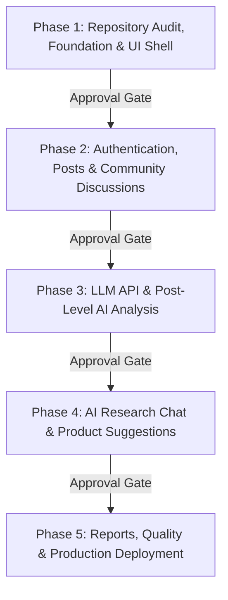

# Master Plan: Product Research Intelligence

**Anonymous Feedback Community with AI-Powered Research Intelligence**

---

## 1. Executive Summary & Vision

**Product Research Intelligence** is a community-driven product review, feedback, and discussion platform coupled with an evidence-grounded AI research assistant.

The platform harmonizes two tightly coupled subsystems:
1. **Community Intelligence**:
   - Creators (students, developers, founders, product designers) post products, apps, websites, ideas, and review requests.
   - Community members engage by providing structured anonymous reviews, raising usability issues, proposing concrete improvements, asking questions, debating trade-offs, and upvoting high-signal contributions.
   - Genuine discussion threads accumulate over time.
2. **AI Research Intelligence**:
   - Analyzes real community contributions without hallucinating opinions or inventing feedback.
   - Extracts recurring themes, categorizes feedback (complaints, praise, feature requests, workflow friction), and detects disagreements.
   - Grounds every finding in real comment citations with verifiable provenance.
   - Generates actionable research reports, PRD drafts, and validation questions.
   - Operates strictly as an analytical co-pilot: **The community is the source of truth; AI is the analysis assistant.**

---

## 2. Core Architectural Principles

1. **Source of Truth Integrity**: Every AI observation or recommendation traces directly to concrete user comments. No synthetic consensus, fake metrics, or ungrounded claims.
2. **Deterministic Computation First**: Metrics, counts, vote totals, frequency scores, and keyword statistics are calculated deterministically in Python/SQL. The LLM is never trusted to calculate arithmetic, counts, or citation validity.
3. **Graceful Degradation**: The entire community platform (browsing, posting, commenting, voting, bookmarking) operates seamlessly even if the AI service is offline, rate-limited, or unconfigured.
4. **Principled Anonymity**: Public anonymous posting hides author identity from public viewers and API payloads while maintaining internal authentication, moderation accountability, and abuse prevention.
5. **Strict Security Boundaries**:
   - Untrusted community input is strictly sanitized and isolated from system prompts (prompt-injection defense).
   - Zero sensitive credentials (service-role keys, LLM API keys) in the browser or version control.
   - Server-side authorization verification for every mutation (never trust frontend role claims).

---

## 3. Technology Stack Specification

| Subsystem | Selected Technology | Purpose & Rationale |
| :--- | :--- | :--- |
| **Frontend Framework** | React 18+ & TypeScript | Robust component hierarchy, strict type safety, industry standard |
| **Build & Tooling** | Vite | Instant HMR, fast production bundling |
| **Styling & Design** | Tailwind CSS + Lucide React | Utility-first design tokens, high-density layout, accessible iconography |
| **Routing** | React Router v6 | Declarative client-side routing, nested layouts |
| **State & Data Fetching** | TanStack Query & Clean API Service Layer | Predictable caching, mutation management, clean abstraction over fixtures/HTTP |
| **Backend Framework** | FastAPI (Python 3.12) | High-performance async ASGI framework, automatic OpenAPI specs |
| **Data Validation** | Pydantic v2 | Strict request/response schemas, parsing, and type enforcement |
| **Database & Auth** | Supabase (PostgreSQL + Auth + Storage) | Production-grade relational persistence, RLS policies, secure JWT auth |
| **AI Provider Layer** | Google Gemini (REST API adapter) | High-speed, structured JSON outputs, generous tier for research analysis |
| **Deterministic Analytics** | Scikit-learn, Sentence-Transformers, NumPy | Cluster quality metrics, cosine similarity semantic retrieval, TF-IDF |
| **Testing** | Pytest (Backend) + Vitest/Vite Build (Frontend) | Automated verification of units, API contracts, and builds |

---

## 4. Phased Delivery Roadmap

The project strictly follows a five-phase sequential roadmap:

- **Phase 1 (Current)**: Local repository audit, documentation suite, full React + Vite UI shell with complete routing, design system, responsive layouts, realistic test fixtures, FastAPI backend foundation with health checks and CORS.
- **Phase 2**: Supabase integration, authentication flows, public anonymous identity masking, post/comment CRUD, threaded discussions, voting constraints, moderation and bookmarking.
- **Phase 3**: Gemini provider integration, structured post-level intelligence schema, deterministic metric calculations, evidence citation verification, versioned analysis run storage.
- **Phase 4**: Discussion-scoped RAG research chat, semantic retrieval, prompt-injection defense, explainable opportunity scoring, PRD/validation generators.
- **Phase 5**: Multi-format exports (Markdown, PRD, Executive Brief), end-to-end benchmark evaluation, production hardening, deployment guides.

---

## 5. Audit Baseline Summary

- **Existing Repository**: `c:\Users\OMEN\.gemini\antigravity-ide\scratch\ai feedback project`
- **Baseline Test Suite**: 24 test modules, 157 passing tests (0 failures, 2 non-fatal sklearn convergence warnings).
- **Reusable Core Components**:
  - `src/clustering.py`: TF-IDF and Sentence Transformers clustering engines.
  - `src/recommendations.py` & `src/applicability.py`: Rule-based recommendation ranking and applicability filtering.
  - `src/data_processing.py`: Clean ingestion, normalization, and deduplication logic.
  - `src/llm_engine.py`: Baseline Gemini REST adapter with citation verification and anti-hallucination checks.
  - `src/analytics/`: Comprehensive review metrics, keyword extraction, and visualization specs.
- **Preservation Policy**: Existing Streamlit code and SQLite fixtures remain completely intact and untouched. The new full-stack system lives cleanly separated in `ai web application`.
