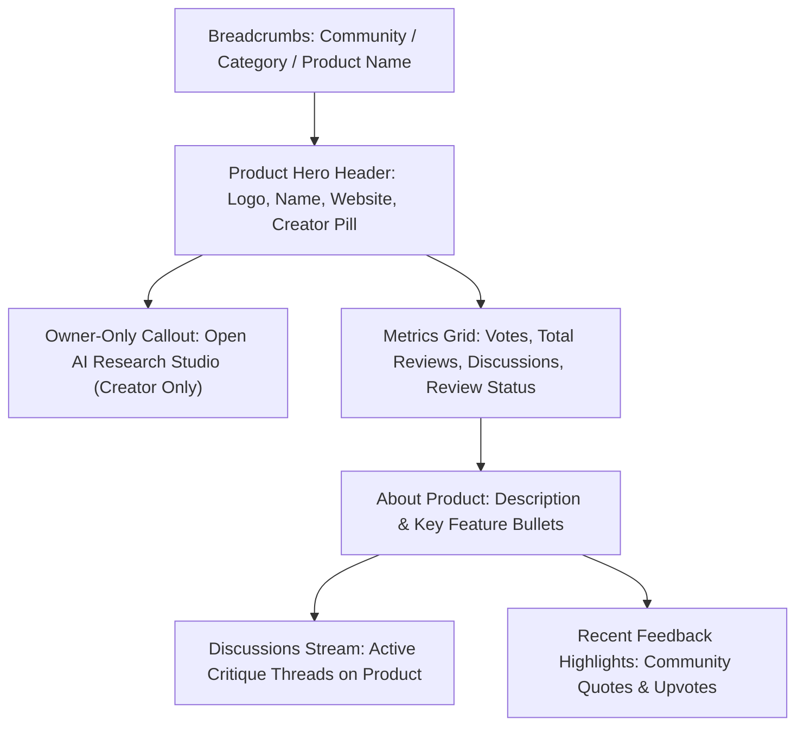

# ResearchIntel Product Discovery & Catalog UX

This document details the product exploration catalog, product profile architecture, owner privacy boundaries, and responsive discovery patterns established in Phase 2.

---

## 1. Product Discovery Architecture (`/explore`)

The Explore route serves as the central hub for discovering software products and open-source tools seeking feedback.

### 1.1 Dual-View Discovery Switcher
Users can toggle between two exploration paradigms via a tactile segmented control:
* **`Products Catalog`**: Focuses on the products themselves, displaying brand identity, website links, key capabilities, and cumulative review counts.
* **`Discussions Stream`**: Focuses on individual critique threads, reviewer questions, and specific architectural problems.

### 1.2 Category & Topic Filtering
* **Category Pills**: Six standardized product categories (`Productivity`, `Developer Tools`, `AI & Machine Learning`, `Design & UX`, `SaaS & B2B`, `Mobile Apps`) plus `All`.
* **Dynamic Tag Cloud**: Displays top community topic tags (`#SQLite`, `#Local-First`, `#Onboarding`, etc.) with one-click filtering.
* **Sorting Capabilities**:
  * `Popular`: Ordered by total community upvotes.
  * `Most Reviews`: Ordered by total community feedback comments.
  * `Recent`: Chronological order of submission.

---

## 2. Product Card Design (`ProductCard.tsx`)

Product cards are visually distinct from discussion cards to maintain clear mental models:

| Component Area | Product Card Affordance | Discussion Card Contrast |
| :--- | :--- | :--- |
| **Identity** | Prominent brand logo with dynamic gradient + website domain badge | Author avatar + Discussion title |
| **Content** | Structured tagline + 2-3 key capability pills | Full discussion problem statement snippet |
| **Metrics** | Cumulative votes, total reviews, and discussion thread count | Single thread comment count and upvotes |
| **Actions** | "View Profile" link + External website visit button | Upvote button + Bookmark + Reply jump |

---

## 3. Product Detail Page (`ProductDetailPage.tsx`)

Accessible at `/products/:id`, the product profile provides a comprehensive overview of the software tool under review:

### 3.1 Key Sections
1. **Product Hero Header**: Large branded icon with soft neomorphic bevel, product name, website link, category badge, and creator attribution with reputation tier.
2. **Owner-Only Workspace Banner**:
   * *Creator View*: Prominently displays: *"You are the verified owner of this product"* with a direct CTA: *"Open AI Research Studio"*.
   * *Public Visitor View*: Completely omitted. Public visitors cannot access or view internal PRD drafts, research transcripts, or uploaded proprietary specs.
3. **Community Metrics Grid**: Real persisted metrics showing Community Votes, Total Reviews, and Active Discussions.
4. **Key Capabilities & Architecture**: Structured list of features extracted from product specifications.
5. **Community Discussions List**: All discussions posted for this product, with a direct CTA to *"Start a Discussion on this Product"*.
6. **Recent Feedback Highlights**: Direct quotes from community reviewers with upvote counters, providing quick sentiment scanning.

