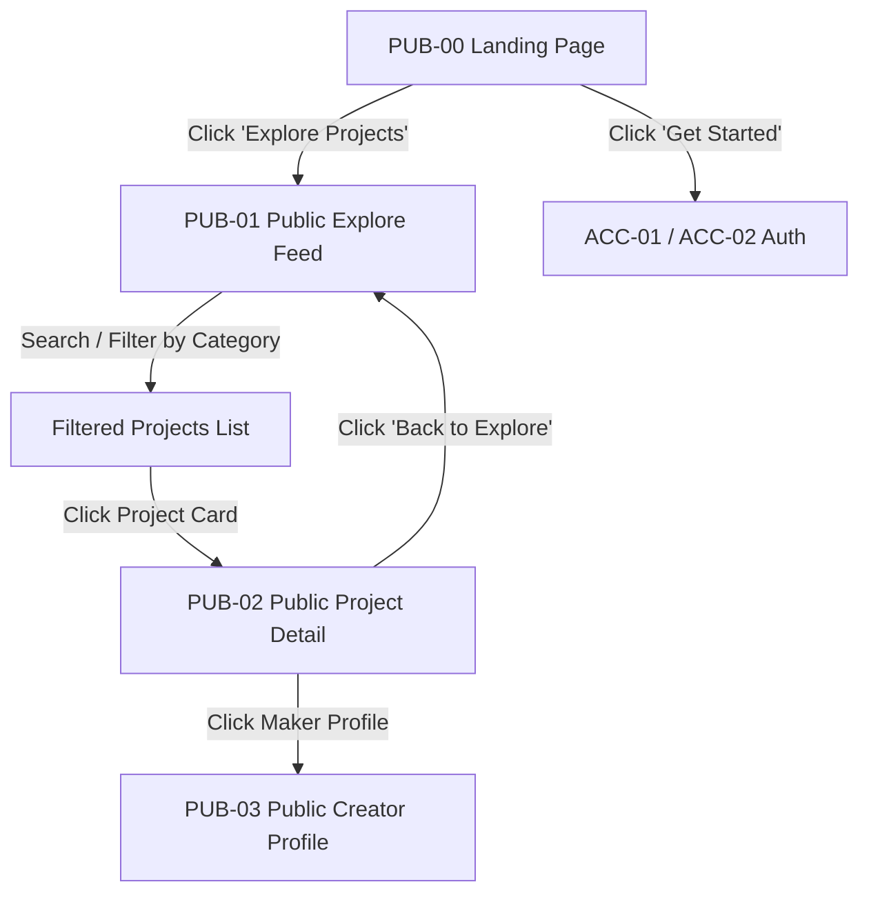
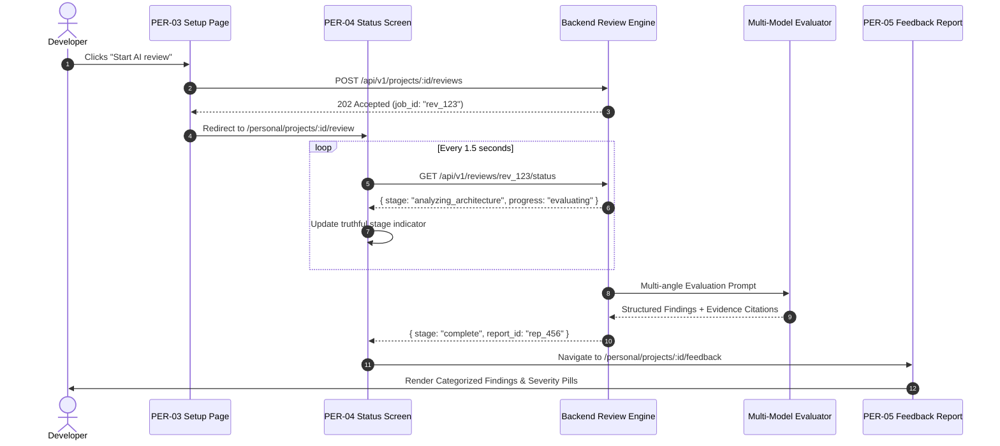
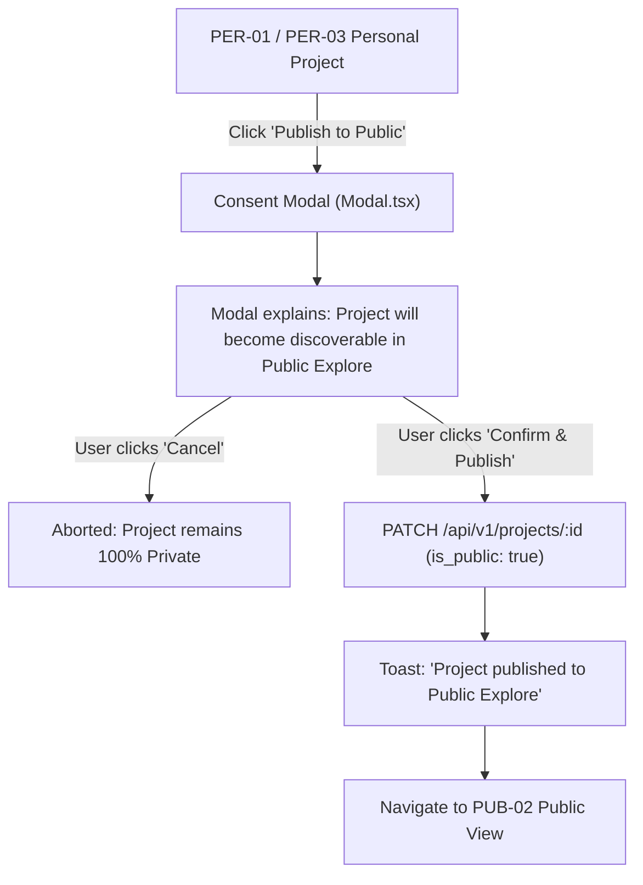

# Core User Flows Specification

> **Document Type**: Phase 0 Core Deliverable  
> **Status**: `CONFIRMED / ACTIONABLE`  
> **Version**: 1.0.0  
> **Date**: November 2, 2026  
> **Audience**: UX Designers, Frontend Engineers, QA  

---

## 1. Primary User Journeys Overview

The application architecture supports five distinct end-to-end user flows across the three spaces:

1. **Flow 1**: Visitor Discovery & Public Exploration (`PUB-00` → `PUB-01` → `PUB-02`)
2. **Flow 2**: Project Creation & Context Setup (`PER-01` → `PER-02` → `PER-03`)
3. **Flow 3**: AI Review Execution & Feedback Exploration (`PER-03` → `PER-04` → `PER-05` → `PER-06`)
4. **Flow 4**: Finding Resolution & Backlog Tracking (`PER-05` → `Inspector` → `Addressed`)
5. **Flow 5**: Intentional Public Launch / Showcase (`PER-01` → Confirmation Guard → `PUB-02`)

---

## 2. Flow 1: Visitor Discovery & Public Exploration



- **Dominant Actions**:
  - `PUB-00`: `Get Started` (Navigates to Sign In / Sign Up).
  - `PUB-01`: Click Project Card (Opens `PUB-02`).
  - `PUB-02`: Read project breakdown & community reviews.
- **Boundary Condition**: Visitors cannot edit or post without authenticating. Filter state and scroll position are preserved when navigating back from `PUB-02` to `PUB-01`.

---

## 3. Flow 2: Project Creation & Context Setup

```mermaid
flowchart TD
    A["PER-01 Personal Home"] -->|Click 'New Project'| B["PER-02 New Project Wizard"]
    B -->|Enter Name, Summary, Category| C{"Form Valid?"}
    C -- No --> B
    C -- Yes -->|Click 'Continue'| D["Create Project Draft (POST /api/v1/projects)"]
    D --> E["PER-03 Project Setup & Context"]
    E -->|Enter Links, Description, Files| F["Auto-save Draft (PATCH /api/v1/projects/:id)"]
    F --> G{"Readiness Checklist Pass?"}
    G -- No --> H["Show Missing Items in Checklist Side Panel"]
    G -- Yes --> I["Enable 'Start AI review' CTA"]
```

- **Draft Recovery**: If the user reloads or navigates away while on `PER-03`, all input is preserved via local storage and periodic auto-save.
- **Readiness Checklist**: Validates description depth (>= 50 words), category selection, and valid URLs before activating the review trigger.

---

## 4. Flow 3: AI Review Execution & Feedback Exploration



- **Error Recovery Path**: If the review fails due to network or provider error, `PER-04` renders an explicit failure card with error reason and an active `Retry Review` button. The original project context is never lost.

---

## 5. Flow 4: Finding Resolution & Backlog Tracking

```mermaid
flowchart LR
    A["PER-05 Feedback Report"] -->|Click Finding Card| B["Open 320px Contextual Inspector"]
    B -->|Review Evidence Quote & Recommendation| C["Developer fixes issue in codebase"]
    C -->|Click 'Mark as Addressed'| D["PATCH /api/v1/findings/:id (status: addressed)"]
    D --> E["Severity Pill updates to Resolved (Green Check)"]
    E --> F["Project Progress Meter updates (e.g. 4/5 Resolved)"]
```



- **User Control**: Developers can reopen an addressed finding if further refinement is required.
- **Non-Color Accessibility**: Status transition changes both shape (from octagon/triangle to rounded-full) and icon (alert icon to checkmark) in addition to text.

---

## 6. Flow 5: Intentional Project Publication to Public Space



- **Inviolable Security Rule**: Publishing requires an explicit modal confirmation. Space switching between Personal, Public, and Creator NEVER triggers this flow automatically.

