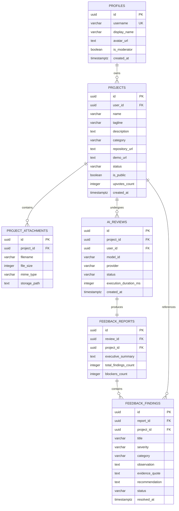

# Data Model Specification

> **Document Type**: Phase 0 Core Deliverable  
> **Status**: `CONFIRMED / ARCHITECTURAL SPECIFICATION`  
> **Version**: 1.0.0  
> **Date**: November 2, 2026  
> **Audience**: Database Administrators, Backend Engineers, Security Architects  

---

## 1. Entity Evaluation & Selection

We evaluate each candidate entity against approved product requirements to prevent schema bloat and premature optimization:

| Candidate Entity | Requirement Justification | Status | Decision |
|---|---|---|---|
| **User / Profile** | Identity, authentication, project ownership, role storage. | `CONFIRMED` | **APPROVED** |
| **Account** | Redundant with `User/Profile` in current single-tenant model. | `PROPOSED` | **MERGED into `Profile`** |
| **Space** | Purely a client-side routing & view context filter; not a persistent database entity. | `CONFIRMED` | **CLIENT-ONLY (No DB table)** |
| **Project** | Central entity of the product: name, description, repository, state, visibility. | `CONFIRMED` | **APPROVED** |
| **Project Attachment** | File metadata for uploaded documentation, architecture specs. | `CONFIRMED` | **APPROVED** |
| **Project Version** | Version history for comparing iterations. | `CONDITIONAL` | **DEFERRED to Phase 5** |
| **AI Review** | Execution run record: prompt used, model, latency, status, timestamps. | `CONFIRMED` | **APPROVED** |
| **Feedback Report** | Synthesized report container holding high-level summary and observations. | `CONFIRMED` | **APPROVED** |
| **Feedback Finding** | Individual categorized finding: severity, category, observation, recommendation, evidence quote, status. | `CONFIRMED` | **APPROVED** |
| **Improvement Item** | Redundant with `Feedback Finding` resolution tracking. | `PROPOSED` | **INTEGRATED into `Feedback Finding`** |
| **Project Activity** | Audit log for tracking project state transitions and review timestamps. | `PROPOSED` | **APPROVED** |
| **Visibility Setting** | Explicit boolean and publication metadata on `Project`. | `CONFIRMED` | **FIELD on `Project`** |

---

## 2. Approved Entity Schema Specifications

### 1. `profiles` (User Entity)
- **Purpose**: Extends authentication identity with display info, avatar, role, and maker bio.
- **Ownership**: 1-to-1 relationship with `auth.users.id`.
- **Fields**:
  - `id`: `UUID` (PK, references `auth.users.id` ON DELETE CASCADE)
  - `username`: `VARCHAR(50)` (UNIQUE, NOT NULL, format: `^[a-zA-Z0-9_]{3,30}$`)
  - `display_name`: `VARCHAR(100)` (NOT NULL)
  - `avatar_url`: `TEXT` (NULLABLE)
  - `bio`: `TEXT` (NULLABLE, max 500 chars)
  - `is_moderator`: `BOOLEAN` (NOT NULL, DEFAULT `false`)
  - `created_at`: `TIMESTAMPTZ` (NOT NULL, DEFAULT `now()`)
  - `updated_at`: `TIMESTAMPTZ` (NOT NULL, DEFAULT `now()`)
- **Permissions**: Publicly readable; updateable only by the user (`auth.uid() = id`).
- **Deletion Behavior**: Cascade delete when auth user is deleted.

---

### 2. `projects` (Project Entity)
- **Purpose**: Primary unit of work; stores project context, repository links, and visibility state.
- **Ownership**: Owned by `user_id` (foreign key to `profiles.id`).
- **Fields**:
  - `id`: `UUID` (PK, DEFAULT `gen_random_uuid()`)
  - `user_id`: `UUID` (FK to `profiles.id`, NOT NULL, ON DELETE CASCADE)
  - `name`: `VARCHAR(120)` (NOT NULL, min 3 chars)
  - `tagline`: `VARCHAR(200)` (NOT NULL, min 10 chars)
  - `description`: `TEXT` (NOT NULL, min 20 chars)
  - `category`: `VARCHAR(50)` (NOT NULL, enum: `developer-tools`, `productivity`, `ai-ml`, `design-ux`, `saas-b2b`, `mobile`, `infrastructure`)
  - `repository_url`: `TEXT` (NULLABLE, valid URL format)
  - `demo_url`: `TEXT` (NULLABLE, valid URL format)
  - `status`: `VARCHAR(30)` (NOT NULL, DEFAULT `'draft'`, enum: `'draft'`, `'ready'`, `'in_review'`, `'reviewed'`, `'archived'`)
  - `is_public`: `BOOLEAN` (NOT NULL, DEFAULT `false`)
  - `upvotes_count`: `INTEGER` (NOT NULL, DEFAULT `0`)
  - `reviews_count`: `INTEGER` (NOT NULL, DEFAULT `0`)
  - `created_at`: `TIMESTAMPTZ` (NOT NULL, DEFAULT `now()`)
  - `updated_at`: `TIMESTAMPTZ` (NOT NULL, DEFAULT `now()`)
- **Permissions**: Owner has full CRUD; public can read if `is_public = true`.
- **Deletion Behavior**: Cascade deletes associated reviews, findings, and attachments.

---

### 3. `project_attachments` (Documentation & Spec Entity)
- **Purpose**: Stores uploaded supporting documents used by the AI review engine.
- **Ownership**: Owned by `project_id`.
- **Fields**:
  - `id`: `UUID` (PK, DEFAULT `gen_random_uuid()`)
  - `project_id`: `UUID` (FK to `projects.id`, NOT NULL, ON DELETE CASCADE)
  - `filename`: `VARCHAR(255)` (NOT NULL)
  - `file_size`: `INTEGER` (NOT NULL, max 10,485,760 bytes / 10MB)
  - `mime_type`: `VARCHAR(100)` (NOT NULL, enum: `text/plain`, `text/markdown`, `application/pdf`)
  - `storage_path`: `TEXT` (NOT NULL)
  - `content_excerpt`: `TEXT` (NULLABLE, extracted text for AI context)
  - `created_at`: `TIMESTAMPTZ` (NOT NULL, DEFAULT `now()`)
- **Permissions**: Accessible only by project owner.

---

### 4. `ai_reviews` (Review Run Entity)
- **Purpose**: Audit trail of an AI review execution; tracks model, latency, tokens, and status.
- **Ownership**: Owned by `project_id` and triggered by `user_id`.
- **Fields**:
  - `id`: `UUID` (PK, DEFAULT `gen_random_uuid()`)
  - `project_id`: `UUID` (FK to `projects.id`, NOT NULL, ON DELETE CASCADE)
  - `user_id`: `UUID` (FK to `profiles.id`, NOT NULL)
  - `model_id`: `VARCHAR(80)` (NOT NULL, e.g. `'gemini-2.5-flash'`, `'llama-3.3-70b-versatile'`)
  - `provider`: `VARCHAR(50)` (NOT NULL, e.g. `'gemini'`, `'groq'`)
  - `status`: `VARCHAR(30)` (NOT NULL, DEFAULT `'queued'`, enum: `'queued'`, `'processing'`, `'completed'`, `'failed'`)
  - `error_message`: `TEXT` (NULLABLE)
  - `execution_duration_ms`: `INTEGER` (NULLABLE)
  - `input_token_count`: `INTEGER` (NULLABLE)
  - `output_token_count`: `INTEGER` (NULLABLE)
  - `created_at`: `TIMESTAMPTZ` (NOT NULL, DEFAULT `now()`)
  - `completed_at`: `TIMESTAMPTZ` (NULLABLE)
- **Permissions**: Owner can read and insert; non-owners have no direct access.

---

### 5. `feedback_reports` (Report Container Entity)
- **Purpose**: High-level synthesis of an AI review; contains summary, strengths, and risk overview.
- **Ownership**: 1-to-1 with `ai_reviews.id`.
- **Fields**:
  - `id`: `UUID` (PK, DEFAULT `gen_random_uuid()`)
  - `review_id`: `UUID` (FK to `ai_reviews.id`, NOT NULL, UNIQUE, ON DELETE CASCADE)
  - `project_id`: `UUID` (FK to `projects.id`, NOT NULL, ON DELETE CASCADE)
  - `executive_summary`: `TEXT` (NOT NULL)
  - `strengths_summary`: `TEXT` (NOT NULL)
  - `total_findings_count`: `INTEGER` (NOT NULL, DEFAULT `0`)
  - `blockers_count`: `INTEGER` (NOT NULL, DEFAULT `0`)
  - `high_count`: `INTEGER` (NOT NULL, DEFAULT `0`)
  - `medium_count`: `INTEGER` (NOT NULL, DEFAULT `0`)
  - `low_count`: `INTEGER` (NOT NULL, DEFAULT `0`)
  - `created_at`: `TIMESTAMPTZ` (NOT NULL, DEFAULT `now()`)
- **Permissions**: Inherits project access permissions.

---

### 6. `feedback_findings` (Actionable Finding Entity)
- **Purpose**: Individual, granular observation with cited evidence, severity, and resolution status.
- **Ownership**: Belongs to `feedback_reports.id` and `projects.id`.
- **Fields**:
  - `id`: `UUID` (PK, DEFAULT `gen_random_uuid()`)
  - `report_id`: `UUID` (FK to `feedback_reports.id`, NOT NULL, ON DELETE CASCADE)
  - `project_id`: `UUID` (FK to `projects.id`, NOT NULL, ON DELETE CASCADE)
  - `title`: `VARCHAR(200)` (NOT NULL)
  - `severity`: `VARCHAR(30)` (NOT NULL, enum: `'blocker'`, `'high'`, `'medium'`, `'low'`)
  - `category`: `VARCHAR(50)` (NOT NULL, enum: `'ux'`, `'performance'`, `'security'`, `'bug'`, `'architecture'`, `'accessibility'`)
  - `observation`: `TEXT` (NOT NULL)
  - `evidence_quote`: `TEXT` (NOT NULL, exact text or code excerpt cited from user context)
  - `recommendation`: `TEXT` (NOT NULL, actionable technical guidance)
  - `status`: `VARCHAR(30)` (NOT NULL, DEFAULT `'open'`, enum: `'open'`, `'in_progress'`, `'addressed'`)
  - `resolved_at`: `TIMESTAMPTZ` (NULLABLE)
  - `created_at`: `TIMESTAMPTZ` (NOT NULL, DEFAULT `now()`)
  - `updated_at`: `TIMESTAMPTZ` (NOT NULL, DEFAULT `now()`)
- **Permissions**: Owner can read and update status (`status`, `resolved_at`); read-only to public if project is published.

---

## 3. Entity-Relationship Diagram

