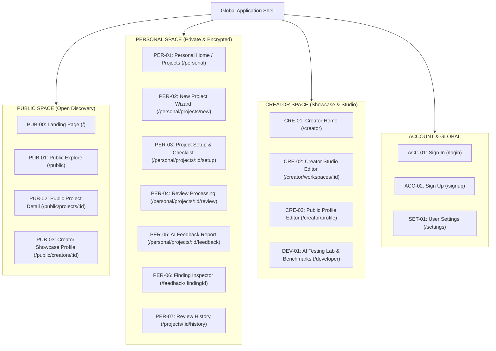
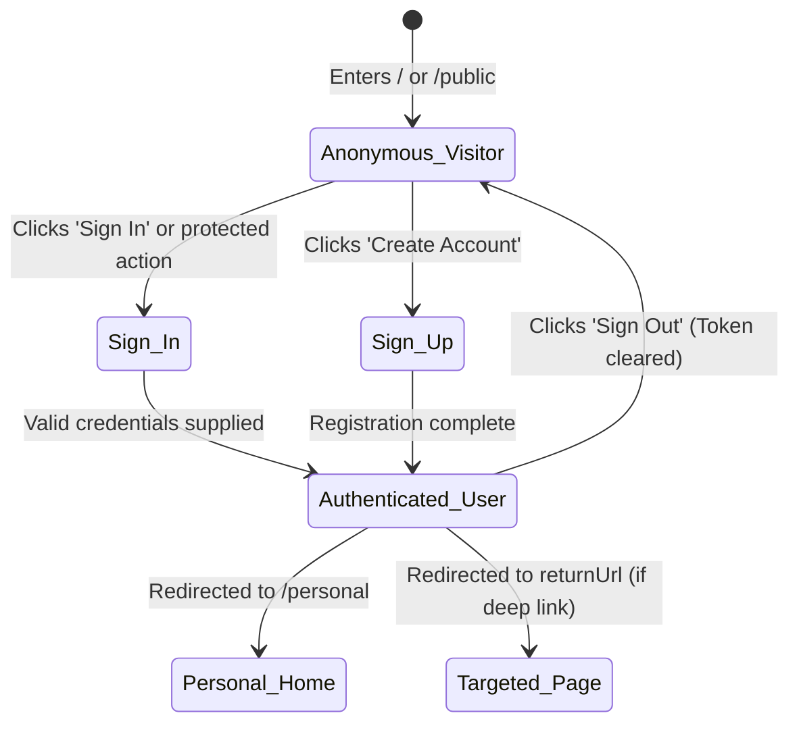

# UX Architecture Specification

> **Document Type**: Phase 1 Core Deliverable  
> **Status**: `CONFIRMED / APPROVED FOR DESIGN`  
> **Version**: 1.0.0  
> **Date**: November 2, 2026  
> **Audience**: Product Designers, Frontend Engineers, QA Architects  

---

## 1. Information Architecture Overview

The application is structured into a unified, coherent information architecture governed by the foundational constitution:
> **"ONE SCREEN = ONE MEANING = ONE GOAL = ONE DOMINANT ACTION."**

The platform organizes user tasks across three strictly segregated spaces (**Public**, **Personal**, **Creator**) wrapped inside a responsive global shell.



---

## 2. Main Application Shell

The shell provides stable orientation, navigation controls, and contextual tools without competing with the primary work surface.

### Shell Anatomy (Desktop: >= 1024px)
```
+-----------------------------------------------------------------------------------------------+
| Header: [Space Badge] > [Breadcrumbs]          [ Search ⌘K ]          [Theme] [Bell] [Avatar] |
+------------------+------------------------------------------------------------+---------------+
| Sidebar (250px)  | Main Work Surface (1fr)                                    | Inspector     |
| - Brand & Logo   |                                                            | (320px)       |
| - Space Switcher | [ Page Title & Context ]                                   |               |
|   [Pub|Per|Cre]  |                                                            | Contextual    |
| - Dominant CTA   | [ Dominant Action Area ]                                   | Details,      |
| - Space Nav Items|                                                            | Citations,    |
| - General Nav    | [ Task Work Canvas ]                                       | Finding Deep  |
| - User / Collapse|                                                            | Dive          |
+------------------+------------------------------------------------------------+---------------+
| Footer (Collapsible on wide canvas; visible on public/landing)                                |
+-----------------------------------------------------------------------------------------------+
```

---

## 3. Space-Switching Behavior & Inviolable Privacy Rules

1. **Context-Only Switching**:
   - Switching between `Public`, `Personal`, and `Creator` modifies the visible navigation tree, active filter scope, and default route.
   - **Zero Side-Effects**: Switching spaces **never** alters the privacy state of any project, does not publish draft work, and does not alter account credentials.
2. **Visual Space Identification**:
   - The active space is reinforced by:
     - Distinct section pill in the sidebar (`Open Discovery`, `Private & Encrypted`, `Portfolio Studio`).
     - Explicit space indicator badge in the header breadcrumb.
     - Contextual accent coloring (Sky for Public, Indigo for Personal, Amber for Creator).
3. **Draft Preservation on Switch**:
   - If a user has unsaved text in `PER-03 Project Setup` and clicks the space switcher, local draft state is retained in `localStorage` and a non-blocking toast confirms: *"Draft saved locally"*.

---

## 4. Navigation Hierarchy & Breadcrumb Rules

### Breadcrumb Rules
- Format: `[Space Label] > [Page Title] > [Optional Item Identifier]`
- Examples:
  - `Personal > My Projects`
  - `Personal > Projects > ReflectFlow > Setup`
  - `Personal > Projects > ReflectFlow > AI Feedback`
  - `Public > Explore > QueryLite`
- Clicking on a parent breadcrumb node navigates back to that section while preserving prior list filters and scroll state.

### Keyboard Navigation & Command Palette (`⌘K` / `Ctrl+K`)
- Hitting `⌘K` or `/` opens the global command palette modal.
- Provides immediate searchable shortcuts:
  - Switch Space (`Go to Personal`, `Go to Public`, `Go to Creator`).
  - Actions (`New Project`, `Explore Projects`, `Open Settings`).
  - Recent Projects list.
  - Theme switching (`Switch to Dark Mode`, `Switch to Light Mode`).

---

## 5. Mobile Navigation Architecture (< 640px)

On mobile viewports, the desktop sidebar transforms into an ergonomic, thumb-accessible two-tier system:

```
+-----------------------------------------------------------+
| [Menu ☰] [Brand Logo]             [Search] [Theme] [User] |
+-----------------------------------------------------------+
|                                                           |
| Main Content Canvas (Single Column)                       |
|                                                           |
+-----------------------------------------------------------+
| Mobile Bottom Navigation Bar (48-56px):                   |
|   [ Home/Projects ]  [ Explore ]  ( + New )  [ Saved ]    |
+-----------------------------------------------------------+
```

1. **Bottom Navigation Bar**:
   - Pinned to viewport bottom with backdrop blur.
   - Adapts to active space:
     - In **Personal**: `Projects`, `New (+)` (elevated dominant CTA), `Activity`, `Saved`.
     - In **Public**: `Overview`, `Explore`, `Post (+)` (elevated), `Saved`.
     - In **Creator**: `Studio`, `Profile`, `Lab (+)` (elevated), `Saved`.
2. **Slide-Over Mobile Drawer**:
   - Triggered via header hamburger icon (`☰`) or bottom bar `Menu` button.
   - Slides from left (width: 80%, max 320px).
   - Houses the full **Space Switcher**, secondary navigation links (`Settings`, `Moderation`, `Help`), and user account sign-out.

---

## 6. Authentication Transitions



- When an unauthenticated visitor attempts an owner action (e.g. clicking "New Project"), they are redirected to `/login?returnUrl=/personal/projects/new`.
- Upon successful login, they are routed directly to their requested destination with zero dead-ends.

---

## 7. Screen Purpose & Dominant Action Directory

| Screen ID | Screen Name | Single Primary Goal | One Dominant Action |
|---|---|---|---|
| `ACC-01` | Sign In | Authenticate existing user | **Sign In** |
| `ACC-02` | Sign Up | Create new verified account | **Create Account** |
| `PER-01` | Personal Home | View existing work or start project | **New Project** |
| `PER-02` | New Project Wizard | Establish project record | **Continue to Setup** |
| `PER-03` | Project Setup & Context | Supply context & validate readiness | **Start AI review** |
| `PER-04` | Review Processing | Display truthful progress | **View Feedback** (on complete) |
| `PER-05` | AI Feedback Report | Understand findings & choose improvement | **Select Next Improvement** |
| `PER-06` | Finding Inspector | Scrutinize evidence & plan fix | **Mark as Addressed** |
| `PUB-00` | Landing Page | Understand value proposition | **Get Started** |
| `PUB-01` | Public Explore | Discover community projects | **Open Project Card** |
| `PUB-02` | Public Project Detail | Read project summary & reviews | **Submit Feedback** |

