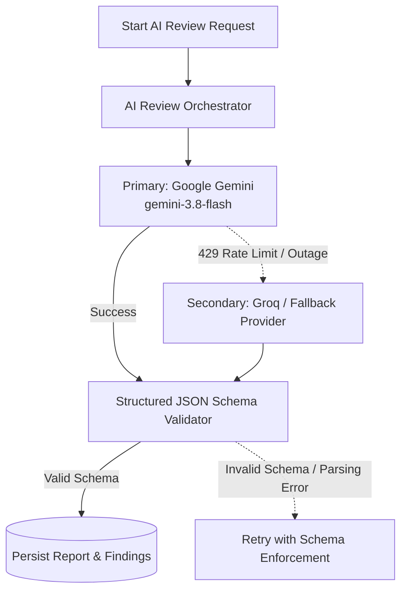

# Phase 10: AI Operations, Orchestration & Cost Governance

## 1. Multi-Provider Architecture

The AI Review Engine operates with primary and secondary provider resilience:

---

## 2. Strict Persistence Invariant

> [!IMPORTANT]
> **Constitutional Accuracy Rule**:
> The application will **never** claim an AI review succeeded unless the complete, schema-validated report and findings are atomically persisted into the database.
> If validation fails or the process is interrupted, the session is marked `failed` with an explicit reason, allowing the creator to retry.

---

## 3. Usage & Cost Monitoring

### Token Tracking
Each completed review run records:
- `input_token_count`
- `output_token_count`
- `execution_duration_ms`

### Budget & Quota Thresholds
1. **Per-Project Review Cooldown**: 15 seconds minimum between review submissions to prevent infinite-loop scripts.
2. **Maximum Daily Reviews Per User**: Rate-limited to 20 reviews/day on free accounts.
3. **Estimated Cost Per Review**:
   - Average Input: ~2,500 tokens ($0.0001875 on Gemini 1.5/2.5/3.8 Flash).
   - Average Output: ~1,800 tokens ($0.00054).
   - Total Cost per In-Depth Review: **~$0.00073 USD**.

---

## 4. Model Drift & Prompt Versioning
- Review system prompts are versioned under `backend/app/services/prompts/` and tagged by semantic version (`v1.0.0`).
- Prompt changes require offline benchmark evaluation in `/developer` (AI Lab) before production rollout.

