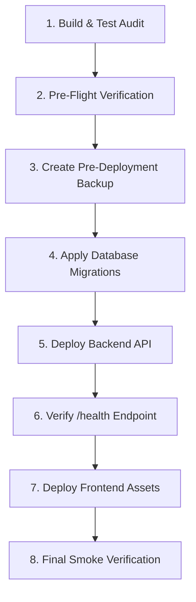

# Phase 10: Production Deployment Runbook

## 1. Staged Deployment Overview



---

## 2. Step-by-Step Release Procedure

### Step 1: Automated Test Suite Execution
Execute the full test suite across Phases 2 through 9 to verify zero regressions:
```bash
python -m pytest backend/tests/test_phase_2_engineering_foundation.py backend/tests/test_phase_3_security_and_auth.py backend/tests/test_phase_4_personal_projects.py backend/tests/test_phase_5_ai_review_engine.py backend/tests/test_phase_6_feedback_report.py backend/tests/test_phase_7_e2e_journey.py backend/tests/test_phase_8_public_space.py backend/tests/test_phase_9_creator_space.py
```
*Gate: 100% of tests must pass (41/41).*

### Step 2: Frontend Production Build
Compile TypeScript and bundle production assets:
```bash
npm.cmd --prefix frontend run build
```
*Gate: Vite bundle must succeed with 0 compilation errors.*

### Step 3: Pre-Deployment Database Snapshot
```bash
python scripts/database_backup_and_restore.py backup
```

### Step 4: Database Migration Execution
Apply new additive migrations:
```bash
# For Supabase / PostgreSQL:
supabase db push
# For SQLite (applied automatically via DatabaseManager migrations during startup)
```

### Step 5: Backend Daemon Deployment
Start or reload the Uvicorn worker process behind systemd / supervisor:
```bash
python -m uvicorn backend.app.main:app --host 0.0.0.0 --port 8000 --workers 4
```

### Step 6: Health Verification
Query the health check endpoint:
```bash
curl -f https://api.aiprojectfeedback.com/api/v1/health
```
Expected response:
```json
{
  "status": "healthy",
  "version": "0.1.0",
  "environment": "production",
  "services": {
    "api": "operational",
    "cors": "configured"
  }
}
```

### Step 7: Frontend Asset Deployment
Sync the contents of `frontend/dist/` to the CDN or static web host (Cloudflare Pages, S3/CloudFront, or Nginx).

---

## 3. Rollback Procedure

If severe regression or service disruption is detected post-deployment:
1. **Frontend Rollback**: Point CDN or DNS to the previous build artifact / git tag commit immediately.
2. **Backend API Rollback**: Revert git HEAD to prior release tag and restart daemon.
3. **Database Rollback**:
   ```bash
   python scripts/database_backup_and_restore.py restore --file data/backups/db_backup_pre_deploy.db
   ```
4. **Post-Rollback Verification**: Confirm `/api/v1/health` status and test core user login.

