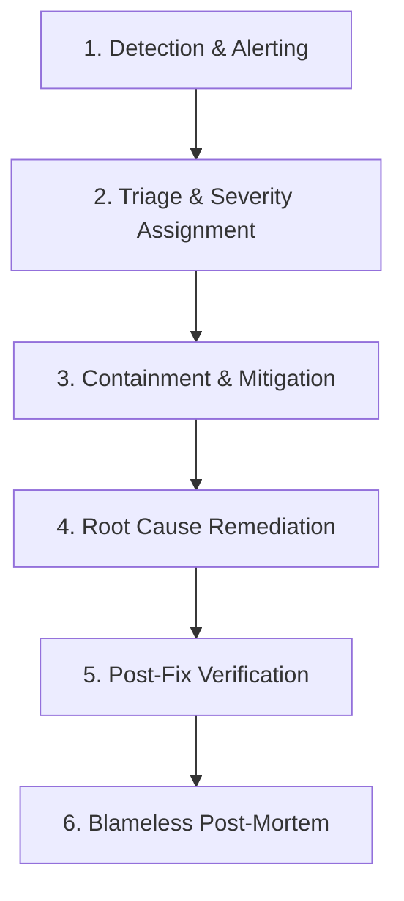

# Phase 10: Incident Response Plan & Severity Playbooks

## 1. Incident Severity Classification

| Severity Level | Definition | Response SLA | Examples |
| :--- | :--- | :--- | :--- |
| **SEV-1 (Critical)** | Core service completely unavailable. Data integrity or security breach. | Immediate (< 15 mins) | Database corruption; complete API downtime; unauthorized private data exposure. |
| **SEV-2 (Major)** | Major functionality impaired with no workaround. | < 1 hour | All AI reviews failing; users unable to sign in or save projects. |
| **SEV-3 (Moderate)** | Core service operational, but secondary features degraded. | < 4 hours | Upvoting failing; export to markdown timing out; UI theme toggle glitch. |
| **SEV-4 (Minor)** | Minor cosmetic or documentation issues. | Next business day | Typos in labels; slight alignment defect on specific mobile viewport. |

---

## 2. Incident Response Workflow



---

## 3. Playbook: AI Review Engine Outage (SEV-2)

1. **Symptom**: Reviews stuck in `processing` or failing with `503 Service Unavailable` / `429 RESOURCE_EXHAUSTED`.
2. **Immediate Diagnostics**:
   - Inspect backend logs for upstream errors: `grep "AI review failed" logs/app.log`.
   - Check upstream provider status dashboards (Google Cloud Status / Groq Status).
3. **Mitigation Actions**:
   - If quota exhausted on primary provider (`gemini`), switch runtime configuration to secondary fallback (`groq`):
     ```bash
     export AI_PROVIDER=groq
     systemctl reload aiprojectfeedback-backend
     ```
   - Notify users via client status banner in Personal Space.
4. **Resolution**:
   - Re-enable primary provider once quota window resets or billing tier upgraded.
   - Clean up orphan `processing` reviews:
     ```sql
     UPDATE ai_reviews SET status = 'failed', error_message = 'Session timed out due to upstream service disruption' WHERE status = 'processing' AND datetime(created_at) < datetime('now', '-30 minutes');
     ```

---

## 4. Playbook: Data Isolation Violation / Security Incident (SEV-1)

1. **Immediate Containment**:
   - Temporarily disable public endpoints by enabling maintenance mode at reverse proxy (Nginx).
   - Terminate active compromised sessions.
2. **Investigation**:
   - Audit `logs/access.log` to determine scope of accessed records.
3. **Remediation**:
   - Deploy code fix to sanitize server projections.
   - Run security regression test suite (`test_phase_8_public_space.py`).
4. **Post-Mortem**:
   - Issue security disclosure to affected users within 72 hours per regulatory guidelines.

