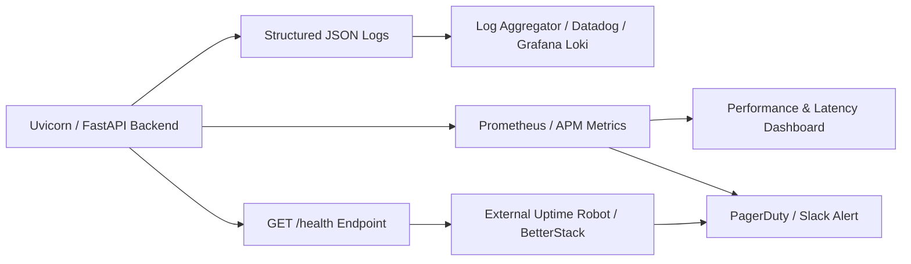

# Phase 10: Monitoring, Observability & Alerting Guide

## 1. Observability Architecture



---

## 2. Core Metrics & Thresholds

| Metric | Target / SLA | Alert Threshold (Warning) | Alert Threshold (Critical) |
| :--- | :--- | :--- | :--- |
| **API Availability** | 99.9% uptime | < 99.5% over 5m | < 99.0% over 1m |
| **HTTP 5xx Error Rate** | < 0.1% | > 1.0% of requests | > 5.0% of requests |
| **API Latency (p95)** | < 300ms | > 800ms | > 2000ms |
| **AI Review Synthesis Duration** | < 15s | > 25s | > 45s (Timeout) |
| **AI Provider Failure Rate** | < 1.0% | > 5.0% over 15m | > 15.0% over 5m |
| **Database Connection Pool** | < 60% capacity | > 75% utilized | > 90% utilized |
| **Server Disk Space** | > 25% free | < 15% free | < 5% free |

---

## 3. Privacy-Preserving Logging Standard

> [!CAUTION]
> **Zero User Content Leakage in Logs**:
> Production logs must never log raw project code repositories, confidential architectural descriptions, or user passwords.

### Compliant Log Format:
```json
{
  "timestamp": "2026-11-02T17:05:22.184Z",
  "level": "INFO",
  "trace_id": "req_8f192bca7e",
  "method": "POST",
  "path": "/api/v1/projects/proj_912/review/start",
  "status_code": 200,
  "duration_ms": 312,
  "user_id_hash": "e3b0c44298fc",
  "ai_provider": "gemini",
  "model": "gemini-3.8-flash",
  "tokens_in": 1420,
  "tokens_out": 890
}
```

### Prohibited Log Contents:
- ❌ Raw passwords or bearer tokens.
- ❌ Project repository code or scratch notes.
- ❌ Prompt text containing private customer code.
- ❌ Personal email addresses in log message strings.

