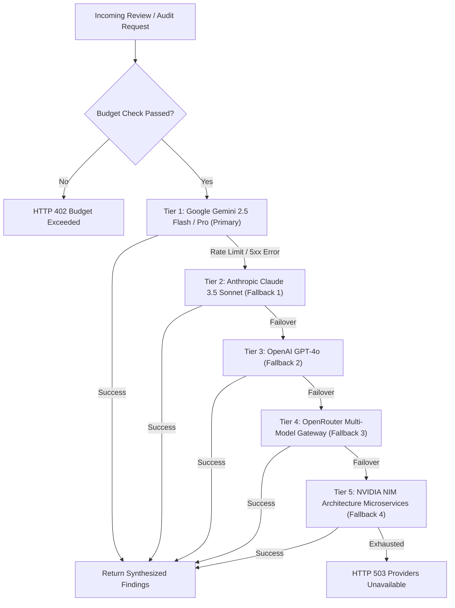
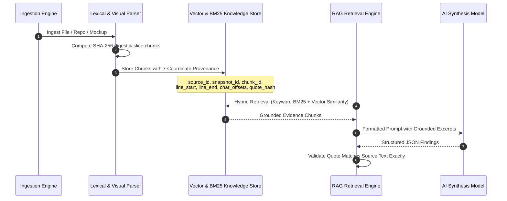

# FINAL AI PIPELINE ARCHITECTURE
**Project:** AI Project Feedback  
**Milestone:** Phase 14 — Final System Completion & Permanent Engineering Closure  
**Version:** 1.0.0 (Production Release)  
**Status:** AUTHORITATIVE AI PIPELINE SPECIFICATION

---

## 1. AI Pipeline Overview & Design Philosophy

The AI Pipeline provides automated, deterministic, and evidence-grounded evaluation of software codebases, architectural designs, UI mockups, and product specifications. 

The pipeline strictly guarantees:
1. **Zero Hallucination Tolerance**: Every technical finding must be substantiated by verbatim quote evidence and concrete line/offset coordinates.
2. **Deterministic Fallback Cascade**: Vendor outages, quota exhaustion, or rate limits automatically trigger multi-tier failovers across 5 distinct AI infrastructure providers.
3. **Hard Budget Enforcement**: Spending caps are evaluated pre-flight to prevent runaway billing or unexpected charges.

---

## 2. Multi-Provider Fallback Cascade

### Cascade Tier Configuration & SLAs
- **Tier 1 (Google Gemini 2.5 Flash / Pro)**: Default review model. High token window (1M+ tokens), fast inference (<2.5s p90).
- **Tier 2 (Anthropic Claude 3.5 Sonnet)**: Secondary evaluation engine for deep architectural and security analysis.
- **Tier 3 (OpenAI GPT-4o)**: General purpose fallback with high reasoning benchmark accuracy.
- **Tier 4 (OpenRouter)**: Distributed model aggregation router querying redundant open-weights and proprietary model endpoints.
- **Tier 5 (NVIDIA NIM)**: Dedicated microservice execution specializing in architectural patterns and latency audits.

---

## 3. Grounding & RAG Architecture

### Grounding Extraction & Coordinate Mapping
- **Chunking Strategy**: 500-1000 character windows with 100-character overlap. Retains line numbering and byte offsets relative to source origin.
- **Clean Retrieval**: Prompts sanitize extraneous markdown artifacts and strip confusing code block delimiters to eliminate generation glitches.
- **7-Coordinate Provenance Tuple**:
  $$\text{Citation} = \langle \text{source\_id}, \text{snapshot\_id}, \text{chunk\_id}, \text{page}, \text{line\_start..end}, \text{char\_offset\_start..end}, \text{sha256(quote)} \rangle$$

---

## 4. Visual Understanding & Multimodal Ingestion

The pipeline integrates native multimodal vision processing for:
1. **Figma & Canva Design Tokens**: Ingests design URLs, pulls frame previews and node metadata, and checks contrast, spacing, and font scale.
2. **UI Screenshots & Mockups**: Runs OCR and layout recognition to detect missing labels, broken visual hierarchy, and tap-target violations (<48x48px).
3. **Architectural Diagrams**: Analyzes cloud topology diagrams, sequence diagrams, and ERDs to verify database clustering, single points of failure, and encryption barriers.

---

## 5. Budgeting & Spending Controls

- **Scopes**: Account-level, Project-level, and Task-level monthly caps.
- **Pre-Flight Estimation**: Tokens are estimated prior to provider dispatch. If current spend + estimated reservation exceeds the monthly limit, request is immediately rejected.
- **Hard Stop**: When `hard_stop_enabled = True`, requests halt immediately upon budget breach without provider invocation.
- **Warning Threshold**: Automated alert triggered when period spend crosses `warning_threshold_pct` (default 80%).
