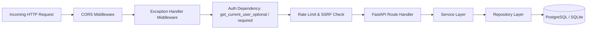
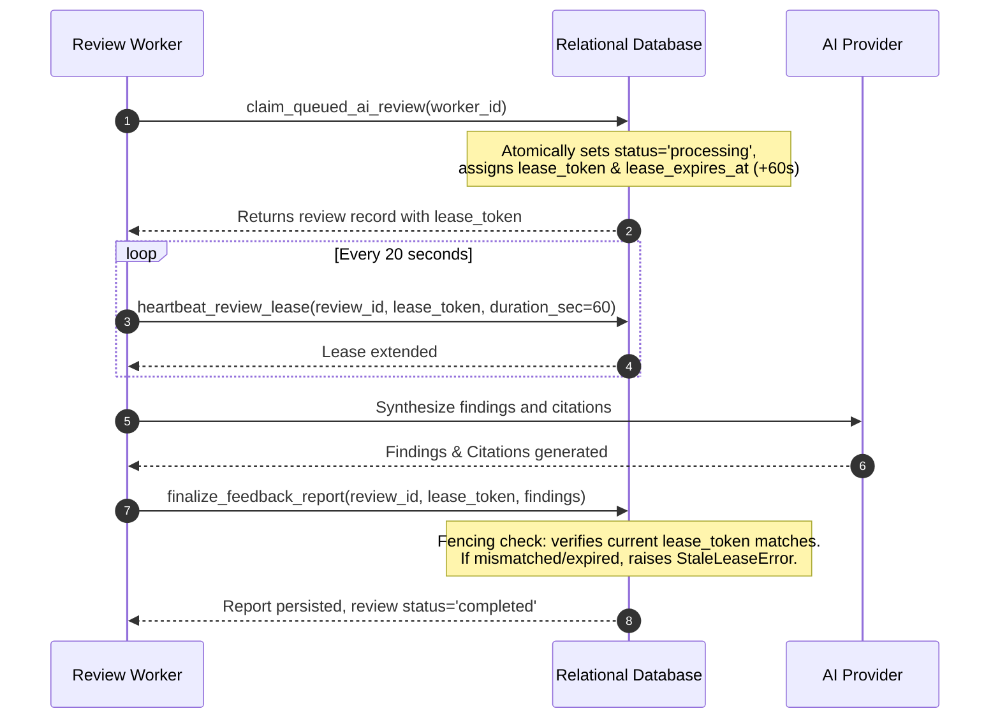

# FINAL BACKEND ARCHITECTURE
**Project:** AI Project Feedback  
**Milestone:** Phase 14 — Final System Completion & Permanent Engineering Closure  
**Version:** 1.0.0 (Production Release)  
**Status:** AUTHORITATIVE BACKEND SPECIFICATION

---

## 1. Backend Technology Stack & Directory Layout

### Core Technologies
- **Runtime Environment:** Python 3.11+ / Python 3.15
- **Web Framework:** FastAPI with Starlette and AnyIO asynchronous runner
- **Data Validation & Schemas:** Pydantic 2.x with strict type aliases and populate-by-name configuration
- **Authentication & Cryptography:** Passlib (PBKDF2/bcrypt), PyJWT (HMAC-SHA256), Cryptography Fernet (AES-256), PyOTP (TOTP MFA)
- **Database Access:** Context-managed `DatabaseManager` with connection pooling, transactional isolation, and schema parity

### Directory Structure
```
backend/
├── app/
│   ├── api/
│   │   └── v1/
│   │       ├── ai.py               # PRD and chat session research routes
│   │       ├── auth.py             # Login, signup, MFA, profile routes
│   │       ├── budgets.py          # AI budget & spending limits routes
│   │       ├── comments.py         # Community comments and threads
│   │       ├── creator.py          # Creator workspace & analytics routes
│   │       ├── credentials.py      # BYOK encrypted vault routes
│   │       ├── dev.py              # Developer evaluation & benchmark routes
│   │       ├── health.py           # Liveness (/health) and Readiness (/health/ready)
│   │       ├── notifications.py    # Notification inbox & dispatch
│   │       ├── posts.py            # Project discussion posts & attachments
│   │       ├── projects.py         # Core projects, reviews, findings, citations, snapshots
│   │       ├── reports.py          # Feedback report exports and comparisons
│   │       ├── router.py           # Master V1 APIRouter registration
│   │       └── users.py            # User identity, badges, and roles
│   ├── config.py                   # Pydantic BaseSettings environment manager
│   ├── db/
│   │   ├── connection.py           # Dual-mode DatabaseManager (SQLite WAL & Supabase PG)
│   │   ├── project_repository.py   # Relational repository for reviews, findings, snapshots
│   │   └── repository.py           # Community, discussion, and user repository
│   ├── main.py                     # Application entry point, CORS, lifespan startup/shutdown
│   ├── schemas/                    # Pydantic 2 request and response contracts
│   └── services/                   # Domain business logic & external integrations
│       ├── ai_orchestrator.py      # 5-tier fallback cascade orchestrator
│       ├── auth_service.py         # Password hashing, JWT issuance, TOTP verification
│       ├── budget_service.py       # Account, project, task spending limits
│       ├── gemini_service.py       # Google Gemini SDK & failover router
│       ├── groq_service.py         # Groq ultra-low-latency fallback
│       ├── nvidia_service.py       # NVIDIA NIM enterprise architecture auditor
│       ├── openrouter_service.py   # OpenRouter multi-model router
│       ├── rag_engine.py           # Chunking, indexing, hybrid lexical/vector search
│       ├── review_worker.py        # Background worker pool with lease heartbeat fencing
│       ├── source_ingestion_service.py # ZIP, Git, design, visual mockups ingestion
│       ├── vault_service.py        # AES-256 encrypted BYOK credential store
│       └── visual_understanding_service.py # OCR, UI mockups, layout analyzer
└── tests/                          # 210 automated unit, integration, and security tests
```

---

## 2. API Routing & Middleware Pipeline



### Key Request Validation Protocols
1. **Authentication Dependencies**:
   - `get_current_user_required`: Enforces valid Bearer JWT. Injects decoded principal dictionary (`sub`, `email`, `username`, `role`).
   - `get_current_user_optional`: Allows public access while injecting authenticated context if a valid token is provided.
2. **Exception Handling**:
   - `HTTPException`: Standardized JSON error response `{ "detail": "message", "status_code": code }`.
   - `StaleLeaseError`: Returns HTTP 409 Conflict preventing write race conditions on stale reviews.
   - `BudgetExceededError`: Returns HTTP 402 Payment Required when budget limits are breached.

---

## 3. Worker Concurrency & Fencing Architecture



### Stale Review Recovery Sweep
If a worker container crashes or experiences network isolation, `recover_stale_reviews()` executes on worker startup and scheduled sweeps:
- Queries reviews where `status = 'processing' AND lease_expires_at < utc_now_iso()`.
- Increments `attempt_count`. If `attempt_count >= max_attempts`, sets `status = 'failed'`. Otherwise resets to `status = 'queued'`.

---

## 4. Security & Cryptographic Standards

1. **Password Hashing**: PBKDF2-HMAC-SHA256 with 100,000 iterations and per-user cryptographic salts.
2. **Access Tokens**: Short-lived JWTs (typically 1 hour expiration) signed with HMAC-SHA256 using server secret `JWT_SECRET_KEY`.
3. **MFA Verification**: RFC 6238 TOTP using 160-bit Base32 secret keys.
4. **BYOK Credential Vault**: 256-bit AES encryption via Fernet symmetric encryption. Encryption keys are derived from server master secret `AI_VAULT_ENCRYPTION_KEY` and never stored with credential ciphertext.
5. **SSRF Guard**: `validate_external_url()` resolves target hosts before making outbound connections and aborts if the destination resolves to private ranges (10.0.0.0/8, 172.16.0.0/12, 192.168.0.0/16, 127.0.0.0/8).
