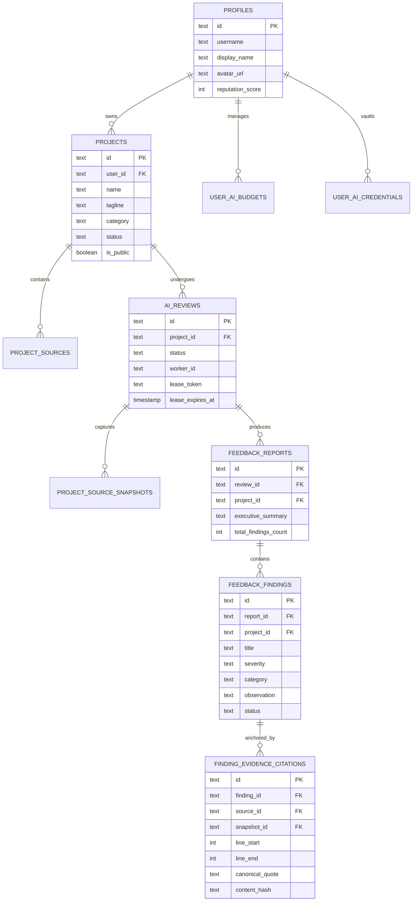

# FINAL DATABASE ARCHITECTURE
**Project:** AI Project Feedback  
**Milestone:** Phase 14 — Final System Completion & Permanent Engineering Closure  
**Version:** 1.0.0 (Production Release)  
**Status:** AUTHORITATIVE DATABASE ARCHITECTURE SPECIFICATION

---

## 1. Persistence Philosophy & Dual-Engine Strategy

The persistence tier is engineered to support seamless parity across two distinct operating environments:
1. **Production Engine**: **Supabase PostgreSQL** via `DATABASE_URL` with connection pooling (PgBouncer), native Row-Level Security (RLS), and schema migrations managed through SQL manifests.
2. **Local / Testing Engine**: **SQLite** configured with `PRAGMA foreign_keys = ON` and `PRAGMA journal_mode = WAL`, ensuring rapid, deterministic, zero-dependency local development and CI execution.

---

## 2. Entity-Relationship Model (Core Tables)



---

## 3. Complete Migration Manifest (Supabase PostgreSQL)

All database schema evolutions are version-controlled under `supabase/migrations/`:

| Migration File | Description & Purpose | Core Tables Introduced / Modified |
| :--- | :--- | :--- |
| `00001_initial_schema.sql` | Base system schema, profiles, posts, comments | `profiles`, `posts`, `comments`, `upvotes` |
| `00002_post_documents.sql` | Document attachments for discussions | `post_documents` |
| `00003_research_sessions.sql`| Multi-turn research sessions & messages | `research_sessions`, `research_messages` |
| `00004_research_reports.sql` | PRD and automated research reports | `research_reports` |
| `00005_moderation.sql` | Moderation queue and notification dispatch | `notifications`, `moderation_reports` |
| `00006_user_credentials.sql`| AES-256 BYOK credential vault & MFA | `user_ai_credentials`, `mfa_factors` |
| `00007_projects_and_sources.sql`| Personal & Creator projects and sources | `projects`, `project_sources` |
| `00008_reviews_and_findings.sql`| AI reviews, feedback reports, and findings | `ai_reviews`, `feedback_reports`, `feedback_findings` |
| `00009_snapshots_and_leases.sql`| Monotonic worker leases & review snapshots | `project_source_snapshots`, lease columns |
| `00010_grounding_and_rag.sql`| Knowledge chunks with coordinate indexing | `project_knowledge_chunks` |
| `00011_creator_studio.sql` | Creator profiles, metrics, and showcase | `creator_profiles`, `creator_metrics` |
| `00012_task_verification_and_budgets.sql`| Improvement tasks, citations, spending caps | `improvement_tasks`, `finding_evidence_citations`, `user_ai_budgets` |

---

## 4. Indexing & Query Optimization Strategy

1. **Partial Unique Indexes for Concurrency**:
   - `CREATE UNIQUE INDEX idx_ai_reviews_active_project ON ai_reviews (project_id) WHERE status IN ('queued', 'processing');`
   - Guarantees database-enforced protection against duplicate active review executions per project.
2. **Worker Polling Index**:
   - `CREATE INDEX idx_ai_reviews_queue_claim ON ai_reviews (status, scheduled_at, created_at) WHERE status = 'queued';`
   - Enables constant-time FIFO job acquisition without full table scans.
3. **RAG Coordinate Lookup**:
   - `CREATE INDEX idx_citations_finding ON finding_evidence_citations (finding_id);`
   - `CREATE INDEX idx_citations_snapshot ON finding_evidence_citations (snapshot_id);`
4. **Tenant Isolation Indexes**:
   - All queryable tables feature compound indexes prefixed by `user_id` or `project_id`.

---

## 5. Row-Level Security (RLS) Policies

All Supabase PostgreSQL tables enforce RLS:
- **Private Project Access**:
  ```sql
  CREATE POLICY "Projects private read" ON projects
      FOR SELECT USING (auth.uid() = user_id OR is_public = true);
  ```
- **Project Mutation Isolation**:
  ```sql
  CREATE POLICY "Projects mutation owner only" ON projects
      FOR ALL USING (auth.uid() = user_id);
  ```
- **Vault Credential Isolation**:
  ```sql
  CREATE POLICY "Credentials strictly tenant isolated" ON user_ai_credentials
      FOR ALL USING (auth.uid() = user_id);
  ```
- **Public Read-Only Invariance**: Public access policies permit only `SELECT`; mutations by anonymous or non-owner principals are rejected.
