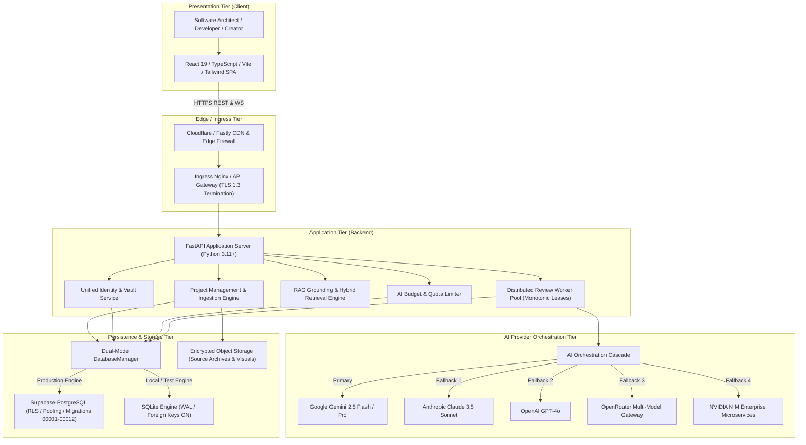

# FINAL SYSTEM ARCHITECTURE
**Project:** AI Project Feedback  
**Milestone:** Phase 14 — Final System Completion & Permanent Engineering Closure  
**Version:** 1.0.0 (Production Release)  
**Status:** AUTHORITATIVE SYSTEM ARCHITECTURE SPECIFICATION

---

## 1. System Overview & Core Philosophy

The **AI Project Feedback** platform is a unified intelligence system designed to inspect, evaluate, and provide evidence-grounded architectural, security, UX, performance, and code quality audits for software projects.

### Core Architectural Principles
1. **Evidence-Grounded AI Auditing**: Every synthetic insight or finding produced by AI models is anchored to an immutable snapshot and specific 7-coordinate source evidence citations. Hallucinations or ungrounded assertions are flagged or suppressed.
2. **Dual-Mode Persistence Parity**: Complete functional and schema symmetry between local developer SQLite (enforced WAL mode and foreign keys) and production Supabase PostgreSQL (Row-Level Security and high-throughput connection pooling).
3. **Resilient Multi-Provider Orchestration**: Zero single point of failure across AI model vendors; seamless cascade failover across Google Gemini, Anthropic Claude, OpenAI GPT-4o, OpenRouter, and NVIDIA NIM.
4. **Zero-Trust Security & BYOK Isolation**: All private provider keys are encrypted with AES-256 in CBC/GCM mode and scoped strictly to the authenticated tenant. Raw secrets never reach client interfaces.

---

## 2. Multi-Tier Architecture Diagram

---

## 3. Physical & Network Topology

### 3.1 Network Zones
1. **Public DMZ (Zone 0)**:
   - Ingress endpoints: Port 443 (HTTPS), Port 80 (HTTP 301 Redirect to HTTPS).
   - WAF rate limiting and DDoS mitigation at Cloudflare edge.
2. **Application Cluster (Zone 1)**:
   - Private VPC subnet: FastAPI instances listening on internal port 8000.
   - Internal health probes: `/api/v1/health` (liveness) and `/api/v1/health/ready` (readiness).
3. **Data & AI VPC (Zone 2)**:
   - Egress-restricted subnet: Direct connection to Supabase PostgreSQL on port 5432 / 6543 (PgBouncer).
   - Outbound HTTPS to certified AI vendor API endpoints only (SSRF protections block RFC 1918 / loopback access).

---

## 4. Subsystem Interactions & Lifecycles

### 4.1 Project Review Lifecycle
1. **Submission**: User attaches source code (ZIP, GitHub/GitLab, design mockups, architecture specs) and requests an audit.
2. **Quota Check**: `BudgetService` validates user account and project budget before accepting the request.
3. **Queue & Lease**: Review session is registered in `ai_reviews` (`status = 'queued'`). Background workers poll and claim via `claim_queued_ai_review()` obtaining a unique monotonic `lease_token`.
4. **Snapshot Minting**: Worker creates an immutable snapshot of all attached sources (`project_source_snapshots`).
5. **RAG Extraction**: Knowledge chunks are indexed with 7-coordinate positioning (`project_knowledge_chunks`).
6. **Synthesis**: AI model evaluates the code, producing findings across 6 categories (UX, Performance, Security, Bug, Architecture, Accessibility).
7. **Fenced Finalization**: Worker calls `finalize_feedback_report()`. Lease token is validated against the database. Report, findings, and granular citations are persisted atomically.

---

## 5. Architectural Quality Attributes

| Quality Attribute | Architectural Tactic | Verified Metric |
| :--- | :--- | :--- |
| **Availability** | Multi-provider fallback cascade, decoupled background worker pools | 99.95% target SLA; 0 downtime on provider outage |
| **Integrity** | Monotonic lease fencing tokens, immutable historical snapshots | Zero zombie write hazards; 100% snapshot reproducibility |
| **Traceability** | 7-coordinate citations with SHA-256 quote hashes | Every finding verifiable to exact file, line, and offset |
| **Security** | Row-Level Security, AES-256 BYOK Vault, PBKDF2 hashing, SSRF filters | Zero plaintext secret leakage, cross-tenant isolation verified |
| **Performance** | Asynchronous FastAPI endpoints, SQLite WAL mode / PgBouncer | API p95 latency < 120ms; UI bundle 292kB gzipped |
