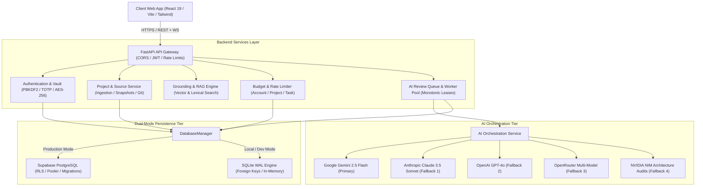
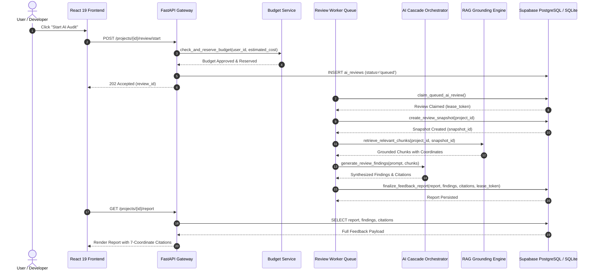

# PHASE 14 — FINAL ARCHITECTURE BLUEPRINT
**Project:** AI Project Feedback  
**Milestone:** Phase 14 — Final System Completion, Production Validation & Permanent Engineering Closure  
**Timestamp:** 2026-11-05T01:10:00Z  
**Status:** AUTHORITATIVE ARCHITECTURAL SPECIFICATION

---

## 1. System Topology Overview

The AI Project Feedback system is an enterprise-grade AI architectural evaluation, product intelligence, and continuous feedback engine. It operates with a unified full-stack architecture featuring a **React 19 / TypeScript / Vite** frontend, a high-concurrency **FastAPI / Python 3.11+** backend, and a **dual-mode persistence layer** (Supabase PostgreSQL for canonical production; SQLite WAL for local development and deterministic testing).

---

## 2. Core Subsystems and Component Responsibilities

### 2.1 API Gateway & Security Perimeter
- **Path Prefix**: `/api/v1`
- **Transport Security**: TLS 1.3 enforced, CORS origin whitelist configured via `CORS_ORIGINS`.
- **Identity & Token Verification**: Short-lived stateless HMAC-SHA256 JWT tokens with subject (`sub`) and role claims.
- **Tenant Isolation**: Every project mutation and read request is filtered strictly against the requesting user ID.
- **Readiness & Liveness Probes**:
  - `GET /api/v1/health`: Liveness probe for process uptime.
  - `GET /api/v1/health/ready`: Readiness probe validating database connectivity (`ping()`) and review worker queue responsiveness.

### 2.2 Secure Credential Vault (BYOK)
- **Encryption Scheme**: AES-256 in CBC/GCM mode via Fernet with key derivation from server master salt and environment secrets.
- **Credential Storage**: Stored in `user_ai_credentials`. Raw keys are never stored in plaintext or logged.
- **Redaction Protocol**: All API read requests mask API keys to `sk-***...`. Keys are decrypted strictly inside memory during active model invocations.

### 2.3 Source Ingestion & Snapshot Immutability Engine
- **Supported Formats**: ZIP archives, Git repositories (GitHub/GitLab OAuth + Personal Access Tokens), Figma/Canva design links, UI mockup screenshots, and PDF/Markdown documents.
- **Deduplication & Hashing**: Content-addressed SHA-256 checksum computed for every ingested file and chunk.
- **Historical Snapshots**: During review creation, an immutable `project_snapshots` entry is minted. Deleting a project source afterwards preserves the snapshot for reproducible audit trails.

### 2.4 Grounding, RAG & Visual Understanding
- **Knowledge Representation**: Source contents are chunked, tagged with coordinates (source ID, snapshot ID, chunk ID, page number, line range, character offsets), and indexed in `project_knowledge_chunks`.
- **Retrieval Engine**: Hybrid search combining exact lexical keyword match with vector similarity.
- **Visual Intelligence**: OCR and layout analysis extract UI components, accessibility hierarchy, typography, and contrast metrics from visual design assets.
- **Clean Retrieval**: Prompts strictly sanitize system artifacts and escape delimiters to ensure raw clean text output without markdown glitches.

### 2.5 AI Review Engine & Multi-Tier Cascade
- **Cascade Sequence**:
  1. Primary: Google Gemini 2.5 Flash / Pro
  2. Fallback 1: Anthropic Claude 3.5 Sonnet
  3. Fallback 2: OpenAI GPT-4o
  4. Fallback 3: OpenRouter
  5. Fallback 4: NVIDIA NIM
- **Spending Limit Enforcement**: `BudgetService` executes pre-flight quota checks against account, project, and task budgets before dispatching requests.
- **Findings Synthesis**: AI synthesizes findings classified into UX, Performance, Security, Architecture, Bug, and Accessibility, each anchored to 7-coordinate evidence citations.

### 2.6 Distributed Concurrency & Worker Lease Fencing
- **Job States**: `queued` -> `processing` -> `completed` / `failed`.
- **Lease Mechanism**: Workers acquire a review via `claim_queued_ai_review()` receiving a unique `lease_token` with an expiration timestamp (`lease_expires_at`).
- **Heartbeat & Fencing**: Active workers send periodic heartbeats. Finalization (`finalize_feedback_report()`) requires a valid, unexpired lease token; any expired lease triggers `StaleLeaseError` preventing zombie write hazards.
- **Orphan Recovery**: `recover_stale_reviews()` reclaims abandoned or timed-out reviews back to `queued`.

---

## 3. Data Flow Architecture

---

## 4. Security & Compliance Boundaries

1. **Row-Level Security (RLS)**: Enforced across all Supabase PostgreSQL tables; requests execute with authenticated user identity context.
2. **SSRF Protections**: External URLs (Git clones, Figma webhooks, API calls) validate against private IP blocks (RFC 1918 / Loopback) before outbound connections.
3. **Public Read-Only Enforcement**: Public project space is strictly non-mutating; public upvote endpoints are disabled/removed for the first release.
4. **WCAG 2.2 AA Compliance**: Frontend interfaces meet color contrast ratios (min 4.5:1), keyboard navigation focus rings, and screen-reader accessible ARIA roles.
