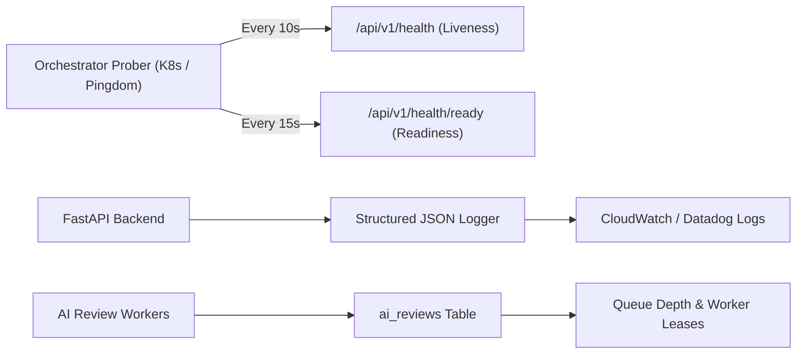

# PRODUCTION MONITORING AND INCIDENT RUNBOOK
**Project:** AI Project Feedback  
**Milestone:** Phase 14 — Final System Completion & Permanent Engineering Closure  
**Version:** 1.0.0 (Production Release)  
**Status:** AUTHORITATIVE OPERATIONAL RUNBOOK

---

## 1. Monitoring Topology & Observability Architecture

The application exposes unified health, readiness, and metrics endpoints for continuous telemetry collection via Prometheus, Datadog, or Grafana Agent.



---

## 2. Health & Readiness Probe Contracts

### 2.1 Liveness Probe (`GET /api/v1/health`)
- **Purpose**: Evaluates whether the FastAPI process is responsive.
- **Success Criteria**: HTTP 200 with `status: "healthy"`.
- **Failure Action**: Orchestrator restarts the unresponsive pod after 3 consecutive failures.

### 2.2 Readiness Probe (`GET /api/v1/health/ready`)
- **Purpose**: Evaluates whether the application can safely accept user traffic.
- **Internal Checks**:
  1. Relational Database connectivity (`db_manager.ping()`).
  2. Review queue state (`SELECT COUNT(*) FROM ai_reviews WHERE status = 'queued'`).
- **Success Criteria**: HTTP 200 with `status: "healthy"`, `services.database: "operational"`.
- **Degraded Criteria**: HTTP 503 with `status: "degraded"`.
- **Failure Action**: Ingress router halts incoming traffic to the degraded container while background workers attempt connection recovery.

---

## 3. Alerting Thresholds & SLI/SLO Matrix

| Metric Name | Warning Threshold | Critical Threshold | Automated Action |
| :--- | :--- | :--- | :--- |
| **API Error Rate (5xx)** | > 1.0% over 5m | > 3.0% over 2m | Trigger P1 on-call page; inspect logs |
| **API Latency (p95)** | > 500ms over 5m | > 1500ms over 2m | Scale out backend API pods |
| **Database Connectivity** | 1 failed ping | 3 consecutive failures | Alert DBA; reroute to read replica |
| **Review Queue Lag** | > 20 queued reviews | > 50 queued reviews | Auto-scale worker pool from 2 to 6 |
| **Stale Review Leases** | > 2 expired leases | > 5 expired leases | Trigger `recover_stale_reviews()` sweep |
| **AI Budget Warnings** | > 80% monthly quota | > 95% monthly quota | Send warning email to project owner |

---

## 4. Incident Response Playbooks

### Playbook 1: Database Connectivity Loss (503 Degraded)
1. **Symptom**: `/health/ready` returns HTTP 503; logs show `Database ping failed`.
2. **Diagnosis**:
   - Check Supabase status page and network connectivity to PostgreSQL pooler.
   - Verify connection pool exhaustion (`SHOW max_connections;` / check PgBouncer clients).
3. **Mitigation**:
   - If pooler exhausted, increase max client connections in Supabase dashboard.
   - Restart backend pods to reset stuck connections:
     ```bash
     kubectl rollout restart deployment/aifeedback-backend
     ```

### Playbook 2: AI Review Worker Deadlocks or Stale Leases
1. **Symptom**: Reviews remain stuck in `status = 'processing'` indefinitely.
2. **Diagnosis**:
   - Query stale reviews:
     ```sql
     SELECT id, project_id, worker_id, lease_token, lease_expires_at
     FROM ai_reviews
     WHERE status = 'processing' AND lease_expires_at < NOW();
     ```
3. **Mitigation**:
   - Trigger automated recovery sweep:
     ```python
     from backend.app.db.project_repository import project_repo
     reclaimed = project_repo.recover_stale_reviews()
     print(f"Reclaimed {len(reclaimed)} orphaned reviews.")
     ```
   - Scaled worker pool will immediately claim reclaimed jobs.

### Playbook 3: Primary AI Model Quota Exhaustion
1. **Symptom**: Warnings in logs showing Gemini 429 quota exhaustion.
2. **Observation**: Verify that `ai_orchestrator.py` automatically cascades to Anthropic, OpenAI, OpenRouter, and NVIDIA NIM without user-facing failures.
3. **Mitigation**:
   - Check billing quota in Google Cloud Console.
   - If necessary, adjust default provider priority in `AIOrchestrationService`.
