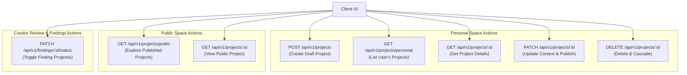

# Phase 2 — API Architecture Specification

**Status**: APPROVED & LOCKED  
**Architect**: Senior Full-Stack Architect & API Platform Engineer  
**Date**: November 2, 2026  
**Scope**: REST API Contracts, Route Topology, Pydantic Schemas, Error Envelopes & Auth Guards  

---

## 1. REST API Design Principles

1. **Explicit Resource Hierarchy**: All endpoints are versioned under `/api/v1` and follow standard RESTful semantics.
2. **Dual-Format Key Compatibility**: To bridge the gap between React/TypeScript camelCase conventions and Python/Postgres snake_case conventions, all request and response schemas support dual validation and serialization using Pydantic `AliasChoices` and `populate_by_name=True`.
3. **Strict Server-Side Validation**: Never rely on client-side validation. All constraints (string lengths, URL schemes, category enums, status transitions) are validated by Pydantic before reaching repository logic.
4. **Deterministic Error Formats**: All errors return uniform JSON envelopes with RFC 7807 problem details or standard `{"detail": "..."}` error structures.
5. **No Blind Trust**: Route dependencies (`get_current_user_required`, `get_current_user_optional`) extract caller identity from the JWT signature; client-supplied user IDs in request bodies are ignored.

---

## 2. API Routing Catalog

### 2.1 Project Management Endpoints (`/api/v1/projects`)



| Method | Route | Auth Required | Description |
|---|---|---|---|
| `POST` | `/api/v1/projects` | **Yes** (Bearer JWT) | Creates a new private draft project in Personal Space |
| `GET` | `/api/v1/projects/personal` | **Yes** (Bearer JWT) | Returns paginated list of projects owned by caller |
| `GET` | `/api/v1/projects/public` | **No** (Optional) | Returns public explore feed with optional category & search filter |
| `GET` | `/api/v1/projects/{project_id}` | **Optional** | Returns project detail if public or owned by caller (403 otherwise) |
| `PATCH` | `/api/v1/projects/{project_id}` | **Yes** (Owner only) | Updates project context, setup fields, or toggle publish state |
| `DELETE` | `/api/v1/projects/{project_id}` | **Yes** (Owner only) | Deletes project and cascades to attachments, reviews, and findings |
| `PATCH` | `/api/v1/findings/{finding_id}/status` | **Yes** (Owner only) | Updates finding resolution state (`open`, `in_progress`, `addressed`) |

---

## 3. Request & Response Contracts

### 3.1 Project Creation (`POST /api/v1/projects`)

#### Request Body (`ProjectCreate`)
```json
{
  "name": "CRDT Sync Engine",
  "tagline": "Offline-first sync engine for distributed workspaces",
  "category": "developer-tools",
  "description": "Comprehensive explanation of conflict-free replicated data types and multi-device state convergence.",
  "repositoryUrl": "https://github.com/example/crdt-sync",
  "demoUrl": "https://crdt-demo.dev"
}
```

#### Validation Rules
- `name`: String, 3 to 120 characters, trimmed.
- `tagline`: String, 10 to 200 characters, trimmed.
- `category`: Must be one of `developer-tools`, `productivity`, `ai-ml`, `design-ux`, `saas-b2b`, `mobile`, `infrastructure`.
- `repositoryUrl`: Optional string. Must be a valid HTTP/HTTPS URL if provided.
- `demoUrl`: Optional string. Must be a valid HTTP/HTTPS URL if provided.

#### Response (`ProjectRead` — 201 Created)
```json
{
  "id": "7c1e556e-dfd1-443b-ba2c-55e1bf5c8d0a",
  "userId": "usr_78a9c21b",
  "name": "CRDT Sync Engine",
  "tagline": "Offline-first sync engine for distributed workspaces",
  "description": "Comprehensive explanation of conflict-free replicated data types and multi-device state convergence.",
  "category": "developer-tools",
  "repositoryUrl": "https://github.com/example/crdt-sync",
  "demoUrl": "https://crdt-demo.dev",
  "status": "draft",
  "isPublic": false,
  "upvotesCount": 0,
  "reviewsCount": 0,
  "createdAt": "2026-11-02T15:20:00+00:00",
  "updatedAt": "2026-11-02T15:20:00+00:00"
}
```

### 3.2 Finding Status Update (`PATCH /api/v1/findings/{id}/status`)

#### Request Body (`FindingStatusUpdate`)
```json
{
  "status": "addressed"
}
```

#### Response (`FindingRead` — 200 OK)
```json
{
  "id": "fnd_09a8bc43",
  "reportId": "rpt_99881122",
  "projectId": "7c1e556e-dfd1-443b-ba2c-55e1bf5c8d0a",
  "title": "Unbounded WebSocket reconnect retry storms",
  "severity": "high",
  "category": "performance",
  "observation": "During cellular network drops, reconnect attempts fire on a fixed 500ms loop without exponential backoff or jitter.",
  "evidenceQuote": "Client immediately calls socket.connect() inside the onclose handler.",
  "recommendation": "Implement exponential backoff with full jitter formula min(cap, base * 2 ** attempt).",
  "status": "addressed",
  "resolvedAt": "2026-11-02T15:24:10+00:00",
  "createdAt": "2026-11-02T15:21:00+00:00"
}
```

---

## 4. Standard HTTP Status Codes & Error Envelopes

### 4.1 Status Code Mapping
- `200 OK`: Request succeeded, returning requested resource or confirmation.
- `201 Created`: New resource successfully created (e.g., project, review).
- `400 Bad Request`: Business rule violation or illegal operation.
- `401 Unauthorized`: Missing or expired Bearer JWT token.
- `403 Forbidden`: Authenticated user does not possess required ownership or role permissions.
- `404 Not Found`: Target entity ID does not exist.
- `422 Unprocessable Entity`: Request body failed Pydantic schema validation.
- `429 Too Many Requests`: Rate limit exceeded.
- `500 Internal Server Error`: Unhandled backend exception (sanitized in production).

### 4.2 Standard Error Response Payload
```json
{
  "detail": "Access denied: This project is private"
}
```

### 4.3 Pydantic Validation Error Payload (422)
```json
{
  "detail": [
    {
      "type": "string_too_short",
      "loc": ["body", "tagline"],
      "msg": "String should have at least 10 characters",
      "input": "Short"
    }
  ]
}
```

---

## 5. Security & Rate Limiting Controls

1. **Authentication Interceptor**:
   - `get_current_user_required` validates JWT tokens signed with `JWT_SECRET_KEY` using `HS256`.
   - Rejects expired tokens (`exp` claim) and malformed signatures with `401 Unauthorized`.
2. **Access Isolation Guard**:
   - Repository queries for single-item updates or private reads enforce `user_id == requesting_user_id`. Non-matching users receive `403 Forbidden` without leaking metadata.
3. **CORS Whitelist**:
   - Configured via `CORS_ORIGINS` environment variable. Defaults to `http://localhost:5173` and `http://127.0.0.1:5173`.

