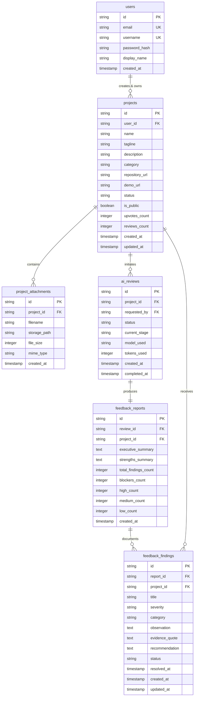

# Phase 2 — Database Architecture Specification

**Status**: APPROVED & LOCKED  
**Architect**: Senior Database Architect & Backend DevOps Engineer  
**Date**: November 2, 2026  
**Scope**: Schema Models, Indexes, Constraints, RLS Security Policies & Migrations  

---

## 1. Dual-Target Database Strategy

To balance developer velocity and cloud production scalability, the platform employs a dual-target relational database architecture:
1. **Local Development & Offline Testing**: Embedded SQLite 3 with Write-Ahead Logging (`WAL`), strict Foreign Keys enabled (`PRAGMA foreign_keys = ON`), and connection pooling with timeout protection.
2. **Staging & Production**: Managed PostgreSQL 15+ hosted on Supabase, featuring native Row Level Security (RLS), connection pooling via Supavisor, and automated point-in-time recovery.

All schemas and migrations are maintained in lockstep:
- PostgreSQL migration definitions reside in `supabase/migrations/00007_projects_and_ai_feedback_foundation.sql`.
- SQLite initializers in `backend/app/db/connection.py` implement identical tables, constraints, and indexes.

---

## 2. Entity-Relationship Model (ERD)



---

## 3. Detailed Table Specifications

### 3.1 `projects` Table
Primary entity representing user prototypes, tools, and applications.

| Column | Type | Constraints | Description |
|---|---|---|---|
| `id` | `VARCHAR(36)` / `TEXT` | `PRIMARY KEY` | UUID v4 unique identifier |
| `user_id` | `VARCHAR(36)` / `TEXT` | `NOT NULL`, `REFERENCES users(id) ON DELETE CASCADE` | Creator owner |
| `name` | `VARCHAR(120)` / `TEXT` | `NOT NULL`, `CHECK(length(name) >= 3)` | Project title |
| `tagline` | `VARCHAR(200)` / `TEXT` | `NOT NULL`, `CHECK(length(tagline) >= 10)` | Single sentence summary |
| `description` | `TEXT` | `NOT NULL DEFAULT ''` | Comprehensive project background |
| `category` | `VARCHAR(30)` / `TEXT` | `NOT NULL`, `CHECK(category IN ('developer-tools', 'productivity', 'ai-ml', 'design-ux', 'saas-b2b', 'mobile', 'infrastructure'))` | Curated domain taxonomy |
| `repository_url` | `VARCHAR(500)` / `TEXT` | `NULL` | Public/private code repository URL |
| `demo_url` | `VARCHAR(500)` / `TEXT` | `NULL` | Public live demonstration URL |
| `status` | `VARCHAR(20)` / `TEXT` | `NOT NULL DEFAULT 'draft'`, `CHECK(status IN ('draft', 'ready', 'in_review', 'reviewed', 'archived'))` | Lifecycle stage |
| `is_public` | `BOOLEAN` / `INTEGER` | `NOT NULL DEFAULT 0` | 0 = Private to Personal/Creator, 1 = Public Explore |
| `upvotes_count` | `INTEGER` | `NOT NULL DEFAULT 0` | Community appreciation counter |
| `reviews_count` | `INTEGER` | `NOT NULL DEFAULT 0` | Total AI reviews conducted |
| `created_at` | `TIMESTAMP` / `TEXT` | `NOT NULL` | ISO 8601 creation timestamp |
| `updated_at` | `TIMESTAMP` / `TEXT` | `NOT NULL` | ISO 8601 last modification timestamp |

### 3.2 `project_attachments` Table
Context documents (specs, user stories, architecture diagrams, readmes).

| Column | Type | Constraints | Description |
|---|---|---|---|
| `id` | `VARCHAR(36)` / `TEXT` | `PRIMARY KEY` | UUID v4 |
| `project_id` | `VARCHAR(36)` / `TEXT` | `NOT NULL`, `REFERENCES projects(id) ON DELETE CASCADE` | Target project |
| `filename` | `VARCHAR(255)` / `TEXT` | `NOT NULL` | Original user filename |
| `storage_path` | `VARCHAR(500)` / `TEXT` | `NOT NULL` | Local filesystem path or Supabase Storage key |
| `file_size` | `INTEGER` | `NOT NULL` | Byte count |
| `mime_type` | `VARCHAR(100)` / `TEXT` | `NOT NULL` | `text/markdown`, `application/pdf`, `image/png`, etc. |
| `created_at` | `TIMESTAMP` / `TEXT` | `NOT NULL` | Upload timestamp |

### 3.3 `ai_reviews` Table
Audit ledger of AI evaluation sessions and processing states.

| Column | Type | Constraints | Description |
|---|---|---|---|
| `id` | `VARCHAR(36)` / `TEXT` | `PRIMARY KEY` | UUID v4 |
| `project_id` | `VARCHAR(36)` / `TEXT` | `NOT NULL`, `REFERENCES projects(id) ON DELETE CASCADE` | Target project |
| `requested_by` | `VARCHAR(36)` / `TEXT` | `NOT NULL`, `REFERENCES users(id) ON DELETE CASCADE` | Initiating user |
| `status` | `VARCHAR(20)` / `TEXT` | `NOT NULL DEFAULT 'queued'`, `CHECK(status IN ('queued', 'processing', 'completed', 'failed'))` | Evaluation status |
| `current_stage` | `VARCHAR(50)` / `TEXT` | `NOT NULL DEFAULT 'context_assembly'` | Real-time stage for progress stepper |
| `model_used` | `VARCHAR(50)` / `TEXT` | `NOT NULL DEFAULT 'gemini-2.5-flash'` | Model employed |
| `tokens_used` | `INTEGER` | `NOT NULL DEFAULT 0` | Token usage telemetry |
| `created_at` | `TIMESTAMP` / `TEXT` | `NOT NULL` | Start timestamp |
| `completed_at` | `TIMESTAMP` / `TEXT` | `NULL` | Completion timestamp |

### 3.4 `feedback_reports` Table
Synthesized aggregate feedback summary.

| Column | Type | Constraints | Description |
|---|---|---|---|
| `id` | `VARCHAR(36)` / `TEXT` | `PRIMARY KEY` | UUID v4 |
| `review_id` | `VARCHAR(36)` / `TEXT` | `NOT NULL`, `REFERENCES ai_reviews(id) ON DELETE CASCADE` | Associated review run |
| `project_id` | `VARCHAR(36)` / `TEXT` | `NOT NULL`, `REFERENCES projects(id) ON DELETE CASCADE` | Associated project |
| `executive_summary`| `TEXT` | `NOT NULL` | High-level synthesis |
| `strengths_summary`| `TEXT` | `NOT NULL` | What the project does exceptionally well |
| `total_findings_count`| `INTEGER` | `NOT NULL DEFAULT 0` | Total actionable points |
| `blockers_count` | `INTEGER` | `NOT NULL DEFAULT 0` | Blocker severity count |
| `high_count` | `INTEGER` | `NOT NULL DEFAULT 0` | High severity count |
| `medium_count` | `INTEGER` | `NOT NULL DEFAULT 0` | Medium severity count |
| `low_count` | `INTEGER` | `NOT NULL DEFAULT 0` | Low severity count |
| `created_at` | `TIMESTAMP` / `TEXT` | `NOT NULL` | Generation timestamp |

### 3.5 `feedback_findings` Table
Granular, categorized findings with evidence and recommendations.

| Column | Type | Constraints | Description |
|---|---|---|---|
| `id` | `VARCHAR(36)` / `TEXT` | `PRIMARY KEY` | UUID v4 |
| `report_id` | `VARCHAR(36)` / `TEXT` | `NOT NULL`, `REFERENCES feedback_reports(id) ON DELETE CASCADE` | Parent report |
| `project_id` | `VARCHAR(36)` / `TEXT` | `NOT NULL`, `REFERENCES projects(id) ON DELETE CASCADE` | Associated project |
| `title` | `VARCHAR(255)` / `TEXT` | `NOT NULL` | Concise finding description |
| `severity` | `VARCHAR(20)` / `TEXT` | `NOT NULL`, `CHECK(severity IN ('blocker', 'high', 'medium', 'low'))` | Priority level |
| `category` | `VARCHAR(30)` / `TEXT` | `NOT NULL`, `CHECK(category IN ('ux', 'performance', 'security', 'bug', 'architecture', 'accessibility'))` | Domain category |
| `observation` | `TEXT` | `NOT NULL` | Technical critique |
| `evidence_quote` | `TEXT` | `NOT NULL` | Exact citation from project context/spec |
| `recommendation` | `TEXT` | `NOT NULL` | Step-by-step resolution guidance |
| `status` | `VARCHAR(20)` / `TEXT` | `NOT NULL DEFAULT 'open'`, `CHECK(status IN ('open', 'in_progress', 'addressed'))` | Progress state |
| `resolved_at` | `TIMESTAMP` / `TEXT` | `NULL` | Timestamp when marked addressed |
| `created_at` | `TIMESTAMP` / `TEXT` | `NOT NULL` | Creation timestamp |
| `updated_at` | `TIMESTAMP` / `TEXT` | `NOT NULL` | Last status update |

---

## 4. Query Performance & Indexes

The following indexes are established to guarantee sub-millisecond query execution:

```sql
-- Project query performance
CREATE INDEX IF NOT EXISTS idx_projects_user_id ON projects(user_id);
CREATE INDEX IF NOT EXISTS idx_projects_status ON projects(status);
CREATE INDEX IF NOT EXISTS idx_projects_category ON projects(category);
CREATE INDEX IF NOT EXISTS idx_projects_public ON projects(is_public);
CREATE INDEX IF NOT EXISTS idx_projects_updated_at ON projects(updated_at DESC);

-- Attachment lookups
CREATE INDEX IF NOT EXISTS idx_project_attachments_project_id ON project_attachments(project_id);

-- Review lookups
CREATE INDEX IF NOT EXISTS idx_ai_reviews_project_id ON ai_reviews(project_id);
CREATE INDEX IF NOT EXISTS idx_ai_reviews_status ON ai_reviews(status);

-- Findings filtering and status tracking
CREATE INDEX IF NOT EXISTS idx_feedback_findings_report_id ON feedback_findings(report_id);
CREATE INDEX IF NOT EXISTS idx_feedback_findings_project_id ON feedback_findings(project_id);
CREATE INDEX IF NOT EXISTS idx_feedback_findings_status ON feedback_findings(status);
CREATE INDEX IF NOT EXISTS idx_feedback_findings_severity ON feedback_findings(severity);
```

---

## 5. Security & Row Level Security (RLS) Policies

On PostgreSQL / Supabase, Row Level Security is strictly enabled on all newly provisioned tables:

```sql
ALTER TABLE projects ENABLE ROW LEVEL SECURITY;
ALTER TABLE project_attachments ENABLE ROW LEVEL SECURITY;
ALTER TABLE ai_reviews ENABLE ROW LEVEL SECURITY;
ALTER TABLE feedback_reports ENABLE ROW LEVEL SECURITY;
ALTER TABLE feedback_findings ENABLE ROW LEVEL SECURITY;

-- 1. Projects: Public items readable by anyone; private items only by owner
CREATE POLICY "Public projects are viewable by everyone" 
  ON projects FOR SELECT 
  USING (is_public = TRUE OR auth.uid()::text = user_id);

CREATE POLICY "Users can create their own projects" 
  ON projects FOR INSERT 
  WITH CHECK (auth.uid()::text = user_id);

CREATE POLICY "Users can update their own projects" 
  ON projects FOR UPDATE 
  USING (auth.uid()::text = user_id);

CREATE POLICY "Users can delete their own projects" 
  ON projects FOR DELETE 
  USING (auth.uid()::text = user_id);

-- 2. Findings: Visible to owner, or anyone if project is public
CREATE POLICY "Findings viewable by project access" 
  ON feedback_findings FOR SELECT 
  USING (
    EXISTS (
      SELECT 1 FROM projects 
      WHERE projects.id = feedback_findings.project_id 
      AND (projects.is_public = TRUE OR projects.user_id = auth.uid()::text)
    )
  );

CREATE POLICY "Owners can update finding status" 
  ON feedback_findings FOR UPDATE 
  USING (
    EXISTS (
      SELECT 1 FROM projects 
      WHERE projects.id = feedback_findings.project_id 
      AND projects.user_id = auth.uid()::text
    )
  );
```

---

## 6. Data Retention & Deletion Behavior

- **Cascade Deletions**: Deleting a `projects` record cascades automatically through foreign key constraints to delete all associated `project_attachments`, `ai_reviews`, `feedback_reports`, and `feedback_findings`.
- **Finding Status Transitions**:
  - `open` -> `in_progress` -> `addressed`.
  - When marked `addressed`, `resolved_at` is stamped with the current UTC timestamp. If reverted to `open`, `resolved_at` is cleared to `NULL`.

