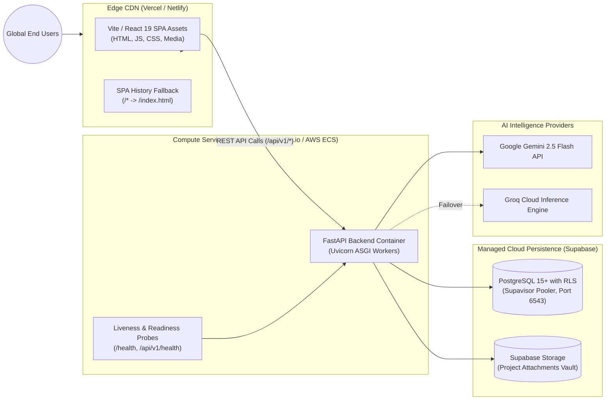

# Phase 2 — Deployment & Infrastructure Architecture

**Status**: APPROVED & LOCKED  
**Architect**: Senior Full-Stack Architect & Cloud DevOps Engineer  
**Date**: November 2, 2026  
**Scope**: Production Hosting Topology, Containerization, CI/CD Pipelines, Zero-Downtime Migrations & Health Telemetry  

---

## 1. Production Hosting Topology

The platform is designed for scalable, multi-cloud or decoupled serverless deployment:



---

## 2. Containerization Specification (Backend)

For container-based hosting platforms, the backend is packaged using a multi-stage, hardened Dockerfile:

```dockerfile
# Multi-stage Dockerfile for FastAPI Backend
FROM python:3.11-slim AS builder

WORKDIR /app
RUN apt-get update && apt-get install -y --no-install-recommends gcc libpq-dev && rm -rf /var/lib/apt/lists/*
COPY requirements.txt .
RUN pip install --no-cache-dir --user -r requirements.txt

FROM python:3.11-slim AS runner

WORKDIR /app
RUN apt-get update && apt-get install -y --no-install-recommends libpq5 curl && rm -rf /var/lib/apt/lists/*

# Non-root security user
RUN addgroup --system appgroup && adduser --system --ingroup appgroup appuser
COPY --from=builder /root/.local /home/appuser/.local
COPY --chown=appuser:appgroup backend /app/backend
COPY --chown=appuser:appgroup supabase /app/supabase

USER appuser
ENV PATH=/home/appuser/.local/bin:$PATH
ENV PYTHONUNBUFFERED=1
ENV ENVIRONMENT=production

EXPOSE 8000
HEALTHCHECK --interval=30s --timeout=5s --start-period=10s --retries=3 \
  CMD curl -f http://localhost:8000/health || exit 1

CMD ["uvicorn", "backend.app.main:app", "--host", "0.0.0.0", "--port", "8000", "--workers", "4"]
```

---

## 3. Frontend Build & Static Distribution

The frontend is compiled to a static Single-Page Application:
1. **Compilation Command**:
   ```bash
   cd frontend
   npm run build
   ```
2. **Artifact Directory**: `frontend/dist/`
3. **SPA History Fallback**:
   On Vercel, `vercel.json` ensures all client-side routes (`/personal`, `/creator`, `/projects/:id`) resolve cleanly:
   ```json
   {
     "rewrites": [{ "source": "/(.*)", "destination": "/index.html" }]
   }
   ```
4. **Environment Injection**:
   Client configuration is passed at build time via `VITE_API_BASE_URL`.

---

## 4. Zero-Downtime Migration Strategy

To guarantee continuous availability during releases:
1. **Additive Migrations Only**:
   - New columns must be added as `NULL` or with explicit safe defaults.
   - Never rename or drop active columns in the same release as application code changes.
2. **Backward-Compatible Rollouts**:
   - Step 1: Deploy additive database migration (e.g., `00007_projects_and_ai_feedback_foundation.sql`).
   - Step 2: Deploy new backend instances utilizing the new schema fields.
   - Step 3: Deploy frontend client bundle.
   - Step 4: Deprecate legacy fields in subsequent releases.

---

## 5. Health Probes & Observability

### 5.1 Liveness & Readiness Probes
- **Route**: `GET /health`
- **Response**: `200 OK`
  ```json
  {
    "status": "healthy",
    "environment": "production",
    "timestamp": "2026-11-02T15:20:00Z"
  }
  ```

### 5.2 Deep Health & Telemetry Probes
- **Route**: `GET /api/v1/health`
- **Checks**:
  - Database connectivity (executes `SELECT 1`).
  - Active worker memory utilization.
  - External AI provider reachability status.

