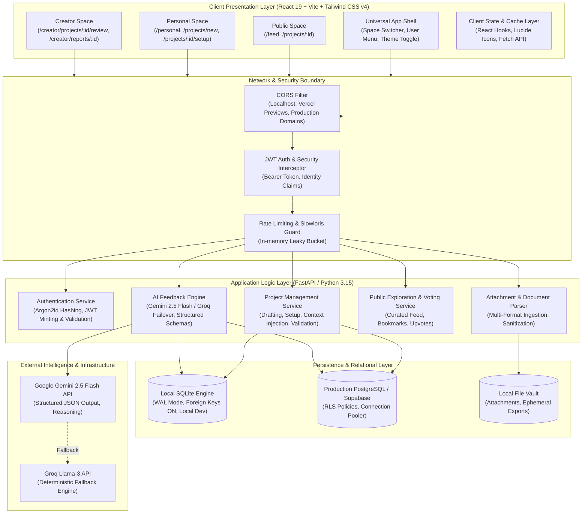
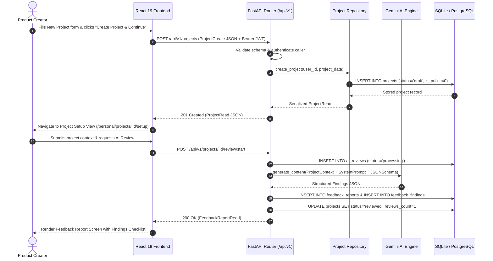

# Phase 2 — System Architecture Specification

**Status**: APPROVED & LOCKED  
**Architect**: Principal Software Architect & Senior Full-Stack Engineer  
**Date**: November 2, 2026  
**Scope**: Engineering Foundation, Module Boundaries, Communication Topologies & Component Interaction  

---

## 1. High-Level Architectural Topology

The AI Project Feedback Platform is engineered as a decoupled, high-performance web application utilizing modern TypeScript/React 19 on the presentation layer, FastAPI (Python 3.15) on the application and AI coordination layer, and a unified relational persistence architecture supporting local SQLite for instant zero-dependency development and PostgreSQL/Supabase for production scale.

---

## 2. Architectural Layer Separation & Strict Boundaries

The system is constructed with explicit boundaries to prevent cyclic dependencies, state bleed, and cognitive fragmentation.

### 2.1 Layer 1: Client Presentation Layer
- **Framework**: React 19 (`@types/react` 19.x), Vite build toolchain, TypeScript in strict mode.
- **Styling**: Tailwind CSS v4 using modern `@theme` CSS variable tokens and CSS color functions.
- **Iconography**: Lucide React.
- **Design Philosophy**: *"One Screen = One Meaning = One Goal = One Dominant Action"*.
- **Responsibilities**:
  1. Render screen layouts according to Phase 1 Wireframes and Design System tokens.
  2. Maintain responsive viewport integrity across Desktop (1280px+), Tablet (768px - 1024px), and Mobile (<768px).
  3. Manage client state (active user session, active theme, space route selection).
  4. Perform immediate client-side syntactic input verification before dispatching network requests.
  5. Never execute business domain rules or rely solely on frontend security.

### 2.2 Layer 2: Network & Gateway Layer
- **Framework**: FastAPI Middleware & ASGI pipeline.
- **Responsibilities**:
  1. **CORS Governance**: Restrict allowed origins to verified domains, supporting pre-flight `OPTIONS` caching.
  2. **Security Headers**: Inject `X-Content-Type-Options: nosniff`, `X-Frame-Options: DENY`, `X-XSS-Protection: 1; mode=block`, and strict `Content-Security-Policy`.
  3. **Identity Extraction**: Inspect `Authorization: Bearer <token>`, parse claims via PyJWT, verify signature and expiration, and populate `current_user` dependency context.

### 2.3 Layer 3: Application & Business Logic Layer
- **Framework**: FastAPI (Pydantic v2 data models).
- **Sub-Modules**:
  - `ProjectService`: Manages project creation, context fields (tagline, description, category, repo URL, demo URL), publishing state, and ownership validation.
  - `AIFeedbackEngine`: Coordinates the 6-stage review pipeline (Context Assembly -> Syntactic Analysis -> Quality Evaluation -> Finding Taxonomy -> Report Synthesis -> Persistence).
  - `AuthService`: Handles user registration, Argon2id password hashing, login token generation, and profile management.
- **Strict Guardrails**:
  - Services never return unvalidated dictionaries or naked database rows to routes; they validate against strict Pydantic schemas.
  - Zero cross-tenant data access: every non-public query mandates an explicit `user_id` equality condition.

### 2.4 Layer 4: Relational Persistence Layer
- **Engine**: Dual-target abstraction (SQLite for local rapid zero-config development, Supabase/PostgreSQL for production).
- **Core Models**:
  - `projects`: Root entity holding metadata, context, public visibility, upvotes, and review count.
  - `project_attachments`: Uploaded context documents, markdown specs, and technical documentation.
  - `ai_reviews`: Execution tracking for AI feedback runs (status, stage, model, token usage).
  - `feedback_reports`: Synthesized audit reports (executive summary, strengths, finding metrics).
  - `feedback_findings`: Actionable granular findings categorized by severity, domain, quote, and status.
- **Data Integrity**:
  - Strict Foreign Key enforcement with `ON DELETE CASCADE`.
  - Check constraints for status, category, and severity enums.
  - RLS (Row Level Security) enabled on production PostgreSQL tables.

### 2.5 Layer 5: External Intelligence Layer
- **Primary Model**: Google Gemini 2.5 Flash via official `@google/genai` / Python `google-genai` SDK.
- **Reliability & Fallbacks**:
  - Exponential backoff with jitter on rate-limits (HTTP 429).
  - Provider failover to Groq Llama-3 if Gemini is unreachable or exhausts quota.
  - Guaranteed structured output through Pydantic JSON schema schemas.

---

## 3. Communication Topologies & Data Flow

---

## 4. Cross-Cutting Engineering Non-Negotiables

1. **Deterministic Contracts**:
   - Both camelCase and snake_case are supported transparently across Pydantic schemas via `AliasChoices` and `populate_by_name=True` to eliminate impedance mismatch between React frontend standards and Python backend conventions.
2. **Never Expose AI Credentials**:
   - `GEMINI_API_KEY` and `GROQ_API_KEY` reside strictly on the backend server environment. No LLM credentials are ever bundled into client-side Vite distributions.
3. **Resilience & Graceful Degradation**:
   - All network failures, rate limits, and parsing anomalies must present human-readable error banners to the user with a single dominant retry action.

