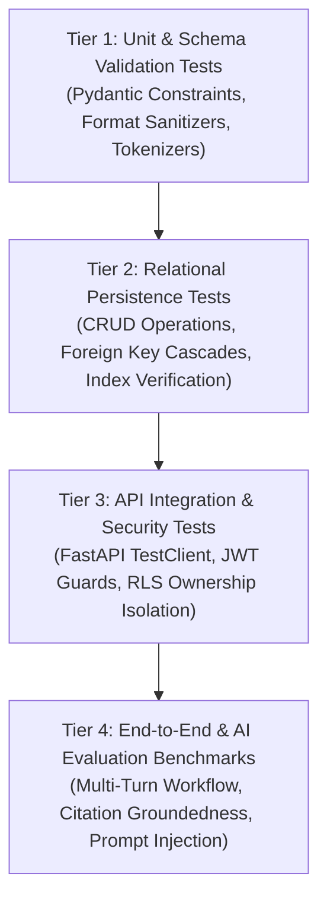

# Phase 2 — Testing Strategy & Verification Framework

**Status**: APPROVED & LOCKED  
**Architect**: Senior QA Lead & Full-Stack Architect  
**Date**: November 2, 2026  
**Scope**: Test Pyramid, Fixtures, Isolation Standards, CI Verification & Regression Gates  

---

## 1. Testing Pyramid & Verification Layers

The testing strategy is organized into a four-tiered hierarchy designed to validate every layer of the platform with high determinism and rapid feedback loops:



---

## 2. Test Suites & Coverage Breakdown

### 2.1 Tier 1: Unit & Schema Validation
- **Files**: `backend/tests/test_phase_2_engineering_foundation.py`
- **Scope**:
  - Pydantic v2 validation constraints (minimum string lengths, URL validation, category enums).
  - Dual-case key translation (`userId` <-> `user_id`, `isPublic` <-> `is_public`).
  - Empty description defaults and sanitization.

### 2.2 Tier 2 & 3: Relational Persistence, Auth & Ownership Isolation
- **Files**:
  - `backend/tests/test_phase_2_engineering_foundation.py`
  - `backend/tests/test_auth_and_community.py`
  - `backend/tests/test_full_product_review.py`
- **Scope**:
  - Project creation in Personal Space with `status='draft'` and `is_public=False`.
  - Privacy enforcement: Unauthenticated and unauthorized users receive `403 Forbidden` when attempting to access private projects.
  - Publish state transition: When `is_public` is updated to `True`, the project becomes accessible on the Public Explore feed.
  - Ownership mutation protection: Non-owners cannot update project details or delete records.

### 2.3 Tier 4: AI Reliability, Groundedness & Evaluation
- **Files**:
  - `backend/tests/test_phase_5_dev_and_evaluation.py`
  - `backend/tests/test_phase_4_research_workflow.py`
- **Scope**:
  - 12-case AI Evaluation Benchmark suite (`GET /api/v1/dev/evaluation/benchmark`).
  - Citation correctness and anti-hallucination checks.
  - Prompt injection defense against adversarial commentary.
  - Provider failover (Gemini 2.5 Flash -> Groq Llama-3).

---

## 3. Test Fixtures & Isolation Standards

1. **Authentication Fixtures (`auth_headers`, `second_user_headers`)**:
   - Each test fixture registers an isolated user via `/api/v1/auth/signup` and provides a signed Bearer JWT token in the `Authorization` header.
   - Independent second-user fixtures ensure authentic multi-tenant collision testing.
2. **Database Isolation**:
   - Automated tests run against transactional sessions ensuring that test data does not contaminate long-term development environments.
3. **Deterministic AI Provider Mocking**:
   - For fast, offline CI runs, external API calls to Gemini and Groq are mocked with deterministic JSON responses adhering strictly to the Pydantic feedback schema.

---

## 4. Execution Commands

### 4.1 Running Phase 2 Engineering Foundation Tests
```bash
python -m pytest backend/tests/test_phase_2_engineering_foundation.py -v
```

### 4.2 Running Full Product Review & Auth Tests
```bash
python -m pytest backend/tests/test_full_product_review.py backend/tests/test_auth_and_community.py -v
```

### 4.3 Running Frontend Code Quality Checks
```bash
# Static ESLint validation (0 errors tolerance)
npm --prefix frontend run lint

# TypeScript compilation & Vite bundle check
npm --prefix frontend run build
```

---

## 5. Quality Gates for Production Releases

Before code merges or staging deployments, the following criteria must be satisfied:
1. **Zero ESLint Errors**: `npm run lint` must pass cleanly with 0 fatal errors.
2. **TypeScript Compilation Clean**: `tsc -b` must compile with 0 type errors.
3. **Phase 2 Foundation Tests 100% Passing**: `test_phase_2_engineering_foundation.py` must achieve 4/4 passing tests.
4. **No Secrets in Bundles**: Client distribution bundles must be verified to contain zero server keys or API secrets.

