# Phase 3 — Application Shell Specification & Architecture

**Status**: IMPLEMENTED & VERIFIED  
**Engineer**: Senior Full-Stack Developer & UI/UX Systems Architect  
**Date**: November 2, 2026  
**Scope**: Universal Layout Shell, Responsive Navigation, Header, Sidebar, Drawer, Command Palette & Inspector Panels  

---

## 1. Application Shell Architecture

The Application Shell establishes a consistent, distraction-free environment that upholds the core design philosophy:  
**"ONE SCREEN = ONE MEANING = ONE GOAL = ONE DOMINANT ACTION."**

The shell is structured into five cohesive regions:
1. **Top Responsive Header** (64px fixed height, sticky, backdrop blur).
2. **Left Collapsible Navigation Sidebar** (250px expanded or 72px icon rail for desktop >= 768px).
3. **Primary Canvas Work Surface** (dynamically width-constrained per task type).
4. **Contextual Right Inspector Panel** (collapsible 280-340px rail for deep analysis without losing scroll position).
5. **Mobile Navigation Suite** (bottom bar < 640px and slide-over modal drawer < 768px).

```mermaid
flowchart TD
    subgraph Viewport ["Application Viewport (100vw x 100vh)"]
        subgraph TopBar ["Sticky Top Header (64px)"]
            MobileToggle["Mobile Menu Button (<768px)"]
            BreadcrumbNav["Space & Task Breadcrumbs"]
            GlobalSearch["Command Bar Trigger (⌘K)"]
            InspectorToggle["Contextual Inspector Toggle"]
            ThemeToggle["Theme Selector (Light/Dark/System)"]
            AccountMenu["User Profile & Dropdown"]
        end

        subgraph BodyGrid ["Shell Body Layout"]
            SidebarRail["Sidebar (250px / 72px Rail)"]
            CenterCanvas["Main Task Work Surface (1fr)"]
            RightRail["Contextual Inspector (280-340px)"]
        end

        subgraph MobileSuite ["Mobile Navigation Suite"]
            BottomBar["Fixed Bottom Bar (<640px)"]
            SlideDrawer["Modal Slide-Over Drawer (<768px)"]
        end
    end

    TopBar --> BodyGrid
    BodyGrid --> MobileSuite
```

---

## 2. Component Specifications

### 2.1 Top Responsive Header (`Header.tsx`)
- **Height & Z-Index**: 64px (`h-16`), `z-30`, sticky positioning with `backdrop-blur-md` and `bg-[var(--surface)]/90`.
- **Breadcrumb Navigation**:
  - Displays the active space pill (`Public`, `Personal`, `Creator`) styled with `bg-[var(--surface-raised)]`.
  - Surfaces a chevron separator and the active screen title truncated to a maximum of 200px.
- **Global Command Palette Trigger**:
  - Centered omnibox (`max-w-md`) with search placeholder and `⌘K` keyboard badge.
  - Global event listeners activate the omnibox on `Cmd+K`, `Ctrl+K`, or `/` when not focused on an input.
- **Contextual Inspector Toggle**:
  - Dynamically renders `PanelRightClose` or `PanelRightOpen` icon button only when contextual inspector content is registered by the active page.
- **User Account Menu**:
  - Authenticated user avatar with status ring.
  - Radix Dropdown menu rendering user display name, handle (`@username`), quick space switching items, link to Settings, and high-visibility red `Sign Out` action.
  - If unauthenticated, displays an explicit `Sign In` button.

### 2.2 Collapsible Navigation Sidebar (`Sidebar.tsx`)
- **Dual-State Geometry**:
  - **Expanded Mode**: 250px width (`w-[250px]`) showing brand logo, space switcher, dominant space action button, icon + text navigation links, theme toggle, and user profile card.
  - **Collapsed Rail Mode**: 72px width (`w-[72px]`) showing tooltips on hover for all icon actions, keeping the work surface uncluttered.
- **State Persistence**:
  - Collapse state is saved to `localStorage` under `pri_sidebar_collapsed`.
- **Space-Adaptive Primary Action**:
  - *Personal Space*: High-contrast dominant button labeled `"New Project"` linking to `/personal/projects/new`.
  - *Creator Space*: Dominant button labeled `"New Showcase"` linking to `/creator`.
  - *Public Space*: Dominant button labeled `"New Post"` linking to `/create`.
- **Space-Specific Navigation Lists**:
  - Navigation links dynamically swap based on `currentSpace` to eliminate visual noise.

### 2.3 Contextual Right Inspector (`RightInspector.tsx`)
- **Width**: Collapsible 280-340px panel.
- **Behavior**:
  - Slides into view from the right margin when opened.
  - Controlled globally via `SpaceContext` (`openInspector`, `closeInspector`, `toggleInspector`).
  - Holds supporting details (e.g. source quotes, evidence metadata, quick metrics) so that users never lose their place on the primary canvas.

### 2.4 Mobile Navigation Suite
- **Bottom Navigation Bar (`MobileNav.tsx`)**:
  - Visible on mobile viewports (< 640px).
  - Provides quick thumb access to 4 primary space destinations.
  - Center element is an elevated circular button (`w-10 h-10`) with `bg-[var(--accent)]` for the dominant action.
  - Includes a dedicated `Menu` button to trigger the full slide-over drawer.
- **Slide-Over Modal Drawer (`MobileDrawer.tsx`)**:
  - Full-height slide-over drawer (80% viewport width, max 320px).
  - Background overlay with `bg-black/60` and `backdrop-blur-xs`.
  - Automatically traps focus, locks body scroll, closes on `Escape` key, and closes on route change.
  - Contains complete space switcher, space navigation, account settings, and theme controls.

---

## 3. Responsive Breakpoints & Layout Matrix

| Breakpoint | Viewport Range | Sidebar Layout | Top Header | Mobile Bottom Bar | Contextual Inspector |
|---|---|---|---|---|---|
| **Mobile** | `< 640px` | Hidden | Compact with hamburger toggle | **Active (fixed bottom)** | Full-screen modal overlay |
| **Tablet** | `640px - 767px` | Hidden | Full header with hamburger | Hidden | Full-screen modal overlay |
| **Desktop Small** | `768px - 1023px` | Collapsed Rail (72px) | Full header with breadcrumbs | Hidden | Right drawer (280px) |
| **Desktop Large** | `>= 1024px` | Expanded (250px) / User choice | Full header with omnibox | Hidden | Right drawer (320px) |

---

## 4. Canvas Width Allocation Rules

To prevent disproportionate, unreadable wide text lines or cramped workspaces, container widths are strictly bounded:
- **Discussion Reading & Composition**: `max-w-4xl px-4 sm:px-6` (optimal typography line length).
- **Public Feed & Explore Grids**: `max-w-6xl px-4 sm:px-6` (balanced 2-to-3 column cards).
- **Feedback Report & Findings Studio**: `max-w-[1400px] px-4 sm:px-6` (wide analytical layout).
- **Research Studio 3-Pane Workspace**: `max-w-[1600px] px-3 sm:px-6` (fluid multi-column intelligence canvas).

