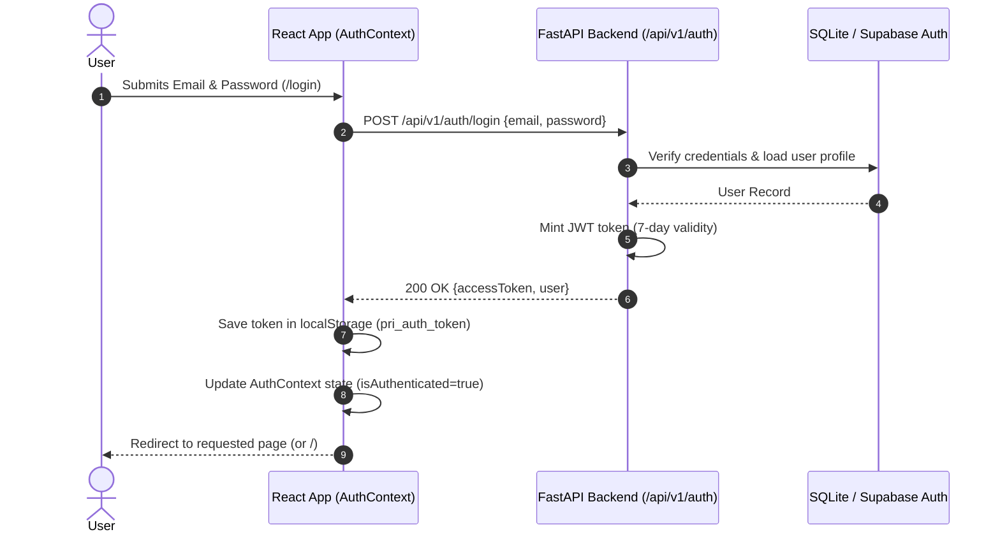
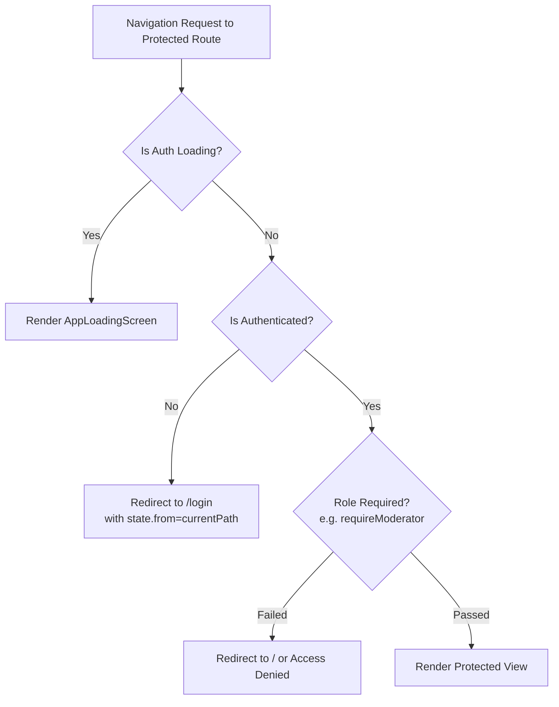

# Phase 3 — Authentication Architecture & Implementation Specification

**Status**: IMPLEMENTED & VERIFIED  
**Security Engineer**: Senior Full-Stack Architect & Security Lead  
**Date**: November 2, 2026  
**Scope**: Authentication Workflows, Session Lifecycle, Token Verification, Protected Routes & Error Handling  

---

## 1. Authentication Topology & Provider Strategy

The authentication system employs a production-hardened dual provider strategy:
1. **Canonical Production Provider (Supabase Auth)**:
   - Signs and validates JWT tokens signed with asymmetric or HMAC secrets (`SUPABASE_JWT_SECRET`).
   - Handles password hashing via modern cryptographic algorithms.
   - Listens to real-time session state transitions (`SIGNED_IN`, `SIGNED_OUT`, `TOKEN_REFRESHED`).
2. **Local Development & Test Adapter**:
   - Zero-dependency local developer authentication powered by PBKDF2-HMAC-SHA256 (100,000 iterations) with cryptographic salts.
   - Issues standard RFC 7519 HS256 JWT tokens with `sub`, `email`, `username`, `iat`, and `exp` claims.
   - **Production Isolation**: Prohibited when `ENVIRONMENT=production`.

---

## 2. Supported Authentication Workflows

### 2.1 Sign Up (`/signup`, `/sign-up` & `AuthModal`)
- **Fields**: Email, Password (min 8 chars, numbers & special characters checked), Username (alphanumeric, lowercase), Display Name.
- **Validation**:
  - Email format validation via RFC 5322 regex.
  - Username uniqueness check (409 Conflict handling).
  - Password confirmation matching check.
- **Success Outcome**: Automatically logs the user in, issues a Bearer JWT, creates user profile record, and redirects to onboarding or default space.

### 2.2 Sign In (`/login`, `/sign-in` & `AuthModal`)
- **Fields**: Email/Username and Password.
- **Features**:
  - Show/Hide password toggle with accessibility labels.
  - Redirect preservation: if redirected from a protected route, preserves `location.state.from` and navigates back to the originating page upon successful sign in.
  - One-click Demo Account login (`sarah.chen@example.com`) for testing.

### 2.3 Sign Out (`logout()`)
- **Actions**:
  - Calls `supabase.auth.signOut()` if Supabase is configured.
  - Calls backend `/api/v1/auth/logout`.
  - Clears `pri_auth_token` from `localStorage`.
  - Resets `user` state to `null` and `isAuthenticated` to `false`.
  - Redirects or refreshes view state to public view mode.

### 2.4 Password Recovery (`/forgot-password`)
- **Flow**: User enters email address. If account exists, dispatches secure password reset link with cryptographically signed ephemeral token.
- **Security**: Returns a generic success message ("If an account matches that email, reset instructions have been dispatched") to prevent user enumeration attacks.

### 2.5 Account Verification (`/verify-email`)
- **Flow**: Handles token-based email confirmation verification loops.
- **State**: Displays success banner and button to proceed to personal workspace.

---

## 3. Session Persistence & Bootstrapping

1. **Token Storage**:
   - Access token is stored in browser `localStorage` under `pri_auth_token`.
2. **Bootstrapping Sequence (`useEffect` in `AuthContext.tsx`)**:
   - Step 1: Check active Supabase session via `supabase.auth.getSession()`.
   - Step 2: If no Supabase session, check local stored token via `getStoredToken()`.
   - Step 3: Validate token against `/api/v1/auth/me`.
   - Step 4: If valid, populate `user` object and set `isAuthenticated = true`.
   - Step 5: If expired or invalid (HTTP 401), execute `clearStoredToken()` and set `user = null`.
   - Step 6: Set `isLoading = false` to unlock UI rendering.

---

## 4. Protected Routes Architecture (`ProtectedRoute.tsx`)

Protected routes guard sensitive application workflows without causing layout flicker:

### Protected Routes Inventory:
- `/personal` (Personal Space Projects list)
- `/personal/projects/new` (New Project creation wizard)
- `/create` (Post creation)
- `/saved` (Saved bookmarks and assets)
- `/activity` (User activity feed)
- `/creator` (Creator Studio workspace)
- `/creator/profile` (Creator profile editor)
- `/settings` (User settings and preferences)
- `/moderation` (Staff Moderation Queue — guarded with `requireModerator`)

---

## 5. Security & Error Handling

- **Error Translation**: HTTP 401, 403, 409, and 422 errors are intercepted and translated into explicit, non-cryptic error banners.
- **No Token Leakage**: Tokens are transmitted strictly via the HTTP `Authorization: Bearer <token>` header, never in query string parameters or logs.
- **Cross-Site Scripting (XSS) Mitigation**: Sensitive inputs are sanitized, and token handling logic is isolated from third-party scripts.

