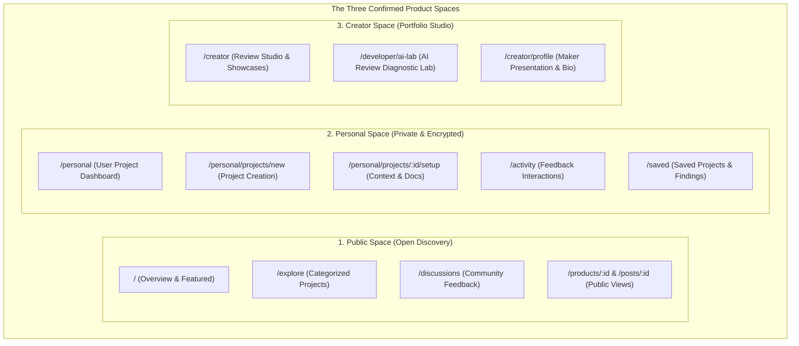

# Phase 3 — Space Navigation & Structural Specification

**Status**: IMPLEMENTED & VERIFIED  
**UI/UX Architect**: Principal Product Designer & Design Systems Engineer  
**Date**: November 2, 2026  
**Scope**: Public, Personal, and Creator Spaces, Space Switcher UI, Route Synchronization & Privacy Boundaries  

---

## 1. The Three Spaces Model

The platform structures user tasks into three dedicated operational spaces, each designed around a singular purpose and dominant action:

---

## 2. Space Profiles & Specifications

### 2.1 Public Space
- **Identifier**: `public`
- **Badge**: `Open Discovery`
- **Icon**: `Globe` (Sky Blue `#0284c7`)
- **Default Route**: `/public` / `/explore`
- **Target Audience**: Anyone (visitors, developers, exploratory contributors).
- **Core Purpose**: Discover launched products, inspect community discussions, vote on innovative features, and provide authentic feedback.
- **Privacy Model**: Only projects with `is_public = 1` are accessible.
- **Dominant Action**: `"New Post"` or `"Explore Projects"`.

### 2.2 Personal Space
- **Identifier**: `personal`
- **Badge**: `Private & Encrypted`
- **Icon**: `ShieldCheck` (Indigo `#6366f1`)
- **Default Route**: `/personal`
- **Target Audience**: Product creators working on private prototypes, tools, and ideas.
- **Core Purpose**: Manage project lifecycles, attach technical specifications, track AI feedback findings checklist, and prepare for public launch.
- **Privacy Model**: Strictly private to the owning user. Enforced via database RLS and token verification.
- **Dominant Action**: High-contrast `"New Project"` button linking to `/personal/projects/new`.

### 2.3 Creator Space
- **Identifier**: `creator`
- **Badge**: `Portfolio Studio`
- **Icon**: `Sparkles` (Amber `#f59e0b`)
- **Default Route**: `/creator`
- **Target Audience**: Verified creators and makers conducting in-depth AI reviews.
- **Core Purpose**: AI Review Studio, evidence analysis, deep diagnostic testing, and public maker showcase management.
- **Privacy Model**: Creator-owned assets with studio collaboration tools.
- **Dominant Action**: `"New Showcase"` or `"Launch AI Review"`.

---

## 3. Space Navigation & Switching Component (`SpaceSwitcher.tsx`)

The `SpaceSwitcher` is integrated into both the Desktop Sidebar and Mobile Navigation Drawer:

1. **Visual Indicators**:
   - Displays the active space icon, human-readable name, and security badge.
   - Distinct color themes: Sky (Public), Indigo (Personal), Amber (Creator).
2. **Behavior & State**:
   - Managed centrally via `SpaceContext` (`useSpace()`).
   - Persists selected space to `localStorage` under `pri_active_space`.
   - Automatically synchronizes with route changes: navigating to `/personal/*` automatically switches context to Personal; navigating to `/creator/*` switches to Creator; all other routes default to Public.
3. **Collapsed Rail Mode**:
   - In collapsed mode (72px), renders a clean 40x40px icon button that opens a Radix dropdown menu with full space explanations.
4. **Data Protection Invariant**:
   - Switching spaces is purely a presentation lens. It never modifies database records, alters ownership, or exposes private items.

---

## 4. Space Switching Behavior Matrix

| Action | Current Route | Target Space | Resulting Route | Data State Change |
|---|---|---|---|---|
| User clicks Public | `/personal` | `public` | `/public` (or `/explore`) | None. Personal projects remain securely private. |
| User clicks Personal | `/explore` | `personal` | `/personal` (User projects list) | None. Requires authentication via `ProtectedRoute`. |
| User clicks Creator | `/personal` | `creator` | `/creator` (Creator studio) | None. Studio workspace initialized. |
| User navigates directly | N/A | URL `/personal/projects/new` | Swapped to `personal` automatically | Auth verified; form rendered. |

