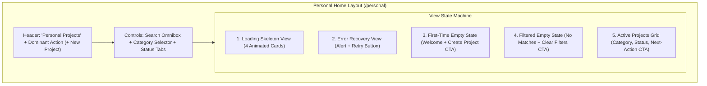

# Phase 4 — Personal Home Specification & Implementation

**Status**: IMPLEMENTED & VERIFIED  
**Role**: Senior Product Engineer & UI/UX Systems Architect  
**Date**: November 2, 2026  
**Scope**: Personal Home (`/personal`), State Machine, Filter Architecture & Project Inventory  

---

## 1. Product Purpose & UX Philosophy

The Personal Home screen (`/personal`) is the central operating surface of **Personal Space**. Its singular purpose is to help the creator understand the status of their existing prototypes and identify the next meaningful action in their feedback lifecycle.

### Non-Negotiable Design Standards:
1. **ONE SCREEN = ONE MEANING = ONE GOAL = ONE DOMINANT ACTION**:
   - Primary Goal: Survey projects and advance setup or review.
   - Dominant Action: High-contrast `+ New Project` button linking to `/personal/projects/new`.
2. **Zero Clutter Guarantee**:
   - Strictly no decorative charts, fake engagement activity, speculative health scores, or unnecessary metrics cards.
3. **Task-Centric Information Priority**:
   - Each project card surfaces only actionable metadata: Title, Tagline, Category, Lifecycle Status Badge, Privacy Mode, Review Count, and a status-dependent dominant button.

---

## 2. Complete State Machine Specifications

### 2.1 First-Time Empty State
- **Trigger**: Authenticated user has zero projects in the database.
- **Visuals**:
  - Centered card with dashed border (`border-dashed border-[var(--border-default)]`).
  - Elevated folder icon in indigo accent (`FolderKanban`).
  - Clear heading: *"No Projects Created Yet"*.
  - Explanatory body: *"Create your first project to organize technical specifications, generate structured AI reviews, and track actionable findings."*
  - Dominant Action: `"Create Your First Project"` (`/personal/projects/new`).

### 2.2 Active Projects Grid
- **Trigger**: 1 or more projects exist matching current filters.
- **Card Anatomy**:
  1. **Top Meta**: Category badge (`[var(--surface-raised)]`), Privacy indicator (`Lock Private` vs `Globe Public`), and Semantic Status Badge.
  2. **Title**: Linked heading with hover accent color (`line-clamp-1`).
  3. **Tagline**: Truncated 2-line summary providing immediate context.
  4. **Links Preview**: Inline icons for GitHub repository and Live Demo if configured.
  5. **Footer Action Bar**: Total AI reviews conducted count, secondary trash icon (delete with modal confirmation), and Status-Adaptive Dominant Action button.

### 2.3 Status-Adaptive Dominant Action
The dominant button on each card dynamically guides the creator to the next logical workflow step:

| Project Status | Semantic Badge Style | Dominant Button Label | Target Destination |
|---|---|---|---|
| `draft` | Amber (`bg-amber-500/10 text-amber-500`) | **Continue Setup** | `/personal/projects/:id/setup` |
| `ready` | Sky Blue (`bg-sky-500/10 text-sky-500`) | **Start AI Review** | `/personal/projects/:id/setup` |
| `in_review` | Purple (`bg-purple-500/10 animate-pulse`) | **View Progress** | `/creator` |
| `reviewed` | Emerald (`bg-emerald-500/10 text-emerald-500`) | **View Feedback** | `/personal/projects/:id/setup` |
| `archived` | Slate (`bg-slate-500/10 text-slate-500`) | **Open Project** | `/personal/projects/:id/setup` |

### 2.4 Loading State
- Displays 4 pulse-animated skeleton cards matching the exact layout of project cards to prevent layout shifts.

### 2.5 Error State
- Displays a rose-tinted banner explaining the network or database error with a prominent `"Retry"` button calling `fetchProjects()`.

### 2.6 Filtered Empty State
- Surfaces when active search query or filters yield 0 results. Provides an immediate `"Clear Filters"` button that resets search and category/status selectors to `'all'`.

---

## 3. Search & Filter Architecture

1. **Omnibox Search**:
   - Filters projects client-side in real time across `name`, `tagline`, and `category`.
   - Includes a quick `"Clear"` button when text is present.
2. **Category Filter**:
   - Dropdown selector covering all 7 approved categories: Developer Tools, Productivity, AI & ML, Design & UX, SaaS & B2B, Mobile Apps, Infrastructure.
3. **Status Filter Tabs**:
   - Horizontal tab bar allowing one-click filtering by lifecycle stage (`all`, `draft`, `ready`, `in_review`, `reviewed`, `archived`).

---

## 4. Destructive Actions & Confirmation Dialog

To prevent accidental data loss:
- Clicking the trash icon on any project opens an accessible modal dialog (`role="dialog"`, `aria-modal="true"`).
- Explains that deletion permanently removes the project and cascades to all technical specifications, review logs, and findings checklist items.
- Provides `"Cancel"` (outline) and `"Delete Permanently"` (danger red) actions with an active loading spinner while the delete API call executes.

