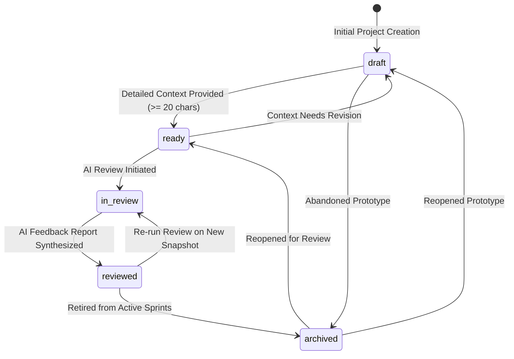

# Phase 4 — Project Lifecycle Specification

**Status**: IMPLEMENTED & VERIFIED  
**Role**: Principal Product Architect & Systems Engineer  
**Date**: November 2, 2026  
**Scope**: Project Status State Machine, Transition Guards, Audit Checklists & Archival Lifecycles  

---

## 1. Project Lifecycle Overview

The project lifecycle structures a prototype from its initial inception to completed AI feedback and long-term iteration.

Every project exists in exactly one of the five approved states:

---

## 2. Approved Lifecycle Statuses & Rules

### 2.1 `draft` (Initial Intake)
- **Definition**: Project has been registered, but its technical specifications, architecture notes, or context requirements are still incomplete.
- **Entry Condition**: Default state assigned upon creation (`POST /api/v1/projects`).
- **Permitted Next Actions**:
  - Continue editing specifications in `ProjectSetupPage`.
  - Delete project.
  - Transition to `ready` once minimum context requirements are met.
- **UI Presentation**: Amber status pill (`bg-amber-500/10 text-amber-500`) with Clock icon. Dominant card CTA: `"Continue Setup"`.

### 2.2 `ready` (Review Ready)
- **Definition**: The project has sufficient technical context (description >= 20 characters) and is ready for the creator to trigger an AI review.
- **Transition Guard**:
  - Client-side and server-side checks verify that `description` is not empty or trivially short.
- **Permitted Next Actions**:
  - Launch AI Review (`POST /api/v1/projects/:id/review/start`).
  - Toggle public visibility (`is_public = true`) to enable peer community discovery.
  - Revert to `draft` if specifications need major rework.
- **UI Presentation**: Sky blue status pill (`bg-sky-500/10 text-sky-500`) with CheckCircle icon. Dominant card CTA: `"Start AI Review"`.

### 2.3 `in_review` (Audit in Progress)
- **Definition**: The AI Feedback Engine is actively generating structured findings, parsing technical specifications, and synthesizing audit reports.
- **Entry Condition**: Triggered when the creator initiates an AI review.
- **Lock Behavior**:
  - Core specification fields are locked against concurrent edits while the LLM analysis executes.
- **UI Presentation**: Purple pulse status pill (`bg-purple-500/10 text-purple-500 animate-pulse`) with Sparkles icon. Dominant card CTA: `"View Progress"`.

### 2.4 `reviewed` (Audit Complete)
- **Definition**: An AI Feedback Report has been generated and persisted. Granular findings (`feedback_findings`) are open for the creator to address.
- **Entry Condition**: Set automatically when report synthesis finishes.
- **Permitted Next Actions**:
  - Work through the actionable findings checklist (`open` -> `in_progress` -> `addressed`).
  - Re-run an AI review when substantial new code or specifications are added.
  - Archive project.
- **UI Presentation**: Emerald status pill (`bg-emerald-500/10 text-emerald-500`) with CheckCircle icon. Dominant card CTA: `"View Feedback"`.

### 2.5 `archived` (Retired Prototype)
- **Definition**: Project is no longer in active development or review.
- **Behavior**:
  - Preserved in the database and accessible under the `"Archived"` filter tab.
  - Automatically hidden from public explore feeds if previously public.
  - Can be reopened and restored to `draft` or `ready` at any time.
- **UI Presentation**: Slate status pill (`bg-slate-500/10 text-slate-500`). Dominant card CTA: `"Open Project"`.

---

## 3. Permitted Transition Matrix

| Current Status | Target Status | Transition Requirement | Enforcement Point |
|---|---|---|---|
| `draft` | `ready` | `description.length >= 20` | `ProjectSetupPage.tsx` & API update |
| `draft` | `archived` | None | Direct status update |
| `ready` | `draft` | None | Direct status update |
| `ready` | `in_review` | Creator clicks "Start AI Review" | Review Engine trigger |
| `in_review` | `reviewed` | Feedback synthesis completes | AI Review Service |
| `in_review` | `ready` | Review fails or cancelled | AI Review Service exception handler |
| `reviewed` | `archived` | None | Direct status update |
| `archived` | `draft` | Creator reopens project | Direct status update |
| `archived` | `ready` | `description.length >= 20` | Direct status update |

---

## 4. Test Verification Evidence

The full status progression was tested and verified in `backend/tests/test_phase_4_personal_projects.py::test_lifecycle_status_progression`:
- Project created as `draft`.
- Transitioned `draft` -> `ready` -> `in_review` -> `reviewed` -> `archived`.
- All transitions persisted and verified against server state.

