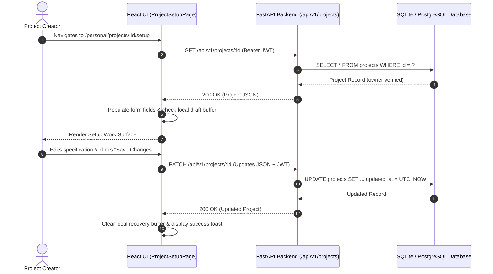

# Phase 4 — Project Management Architecture & Operations

**Status**: IMPLEMENTED & VERIFIED  
**Role**: Senior Full-Stack Developer & Database Platform Lead  
**Date**: November 2, 2026  
**Scope**: Project CRUD Operations, Reopening Lifecycles, Ownership Validation & Cascade Policies  

---

## 1. Project Management CRUD Lifecycle

The project management subsystem provides complete lifecycle operations over project entities:

---

## 2. CRUD Operations Specifications

### 2.1 Project Creation (`POST /api/v1/projects`)
- **Route**: `POST /api/v1/projects`
- **Authentication**: Required (`get_current_user_required`).
- **Initial Values**:
  - `status`: `'draft'`
  - `is_public`: `false`
  - `upvotes_count`: `0`
  - `reviews_count`: `0`
- **Response**: `201 Created` returning the serialized `ProjectRead` object.

### 2.2 Reopening Existing Projects (`GET /api/v1/projects/{id}`)
- **Route**: `GET /api/v1/projects/{project_id}`
- **Authentication**: Optional for public items, strictly required for private items.
- **Ownership Verification**:
  - If `is_public == False` and caller is unauthenticated or not the project owner: returns `403 Forbidden` (`"Access denied: This project is private"`).
- **Client Form Hydration**:
  - `ProjectSetupPage` populates all state fields (`name`, `tagline`, `category`, `description`, `repositoryUrl`, `demoUrl`, `status`, `isPublic`).
  - Checks if an unsaved local draft exists with a timestamp newer than the server's `updatedAt`. If so, prompts the user to restore the unsaved local buffer.

### 2.3 Project Updates (`PATCH /api/v1/projects/{id}`)
- **Route**: `PATCH /api/v1/projects/{project_id}`
- **Authentication**: Required (`get_current_user_required`).
- **Authorization**: Strict equality check: `project.user_id == current_user["sub"]`. Non-owners receive `403 Forbidden`.
- **Supported Fields**: `name`, `tagline`, `category`, `description`, `repository_url`, `demo_url`, `status`, `is_public`.
- **Timestamping**: Server automatically updates `updated_at = UTC_NOW`.

### 2.4 Project Deletion (`DELETE /api/v1/projects/{id}`)
- **Route**: `DELETE /api/v1/projects/{project_id}`
- **Authentication**: Required (`get_current_user_required`).
- **Authorization**: Owner only. Non-owners receive `403 Forbidden`.
- **Cascade Behavior**:
  - Database foreign keys enforce `ON DELETE CASCADE`.
  - Deleting a project cascades automatically to all child records:
    - `project_attachments`
    - `ai_reviews`
    - `feedback_reports`
    - `feedback_findings`
- **Response**: `204 No Content`.

---

## 3. Unsaved Changes & Fault-Tolerant Persistence

To prevent data loss through network interruptions, accidental tab closures, or power loss:

1. **Auto-Save Recovery Buffer**:
   - Every keystroke on `NewProjectPage` and `ProjectSetupPage` debounces to `localStorage` under `pri_new_project_draft` or `pri_project_draft_${id}`.
   - Contains all form fields plus an ISO timestamp `savedAt`.
2. **In-Flight Navigation Protection**:
   - `beforeunload` event listeners prompt the user with a browser confirmation dialog if `isDirty == true` when closing or refreshing the tab.
3. **Draft Cleanup on Commit**:
   - Upon successful HTTP 200/201 response, the corresponding `localStorage` buffer is automatically deleted.
4. **Discard Changes Option**:
   - A dedicated `"Discard Changes"` button reverts local state to the pristine server baseline with confirmation.

