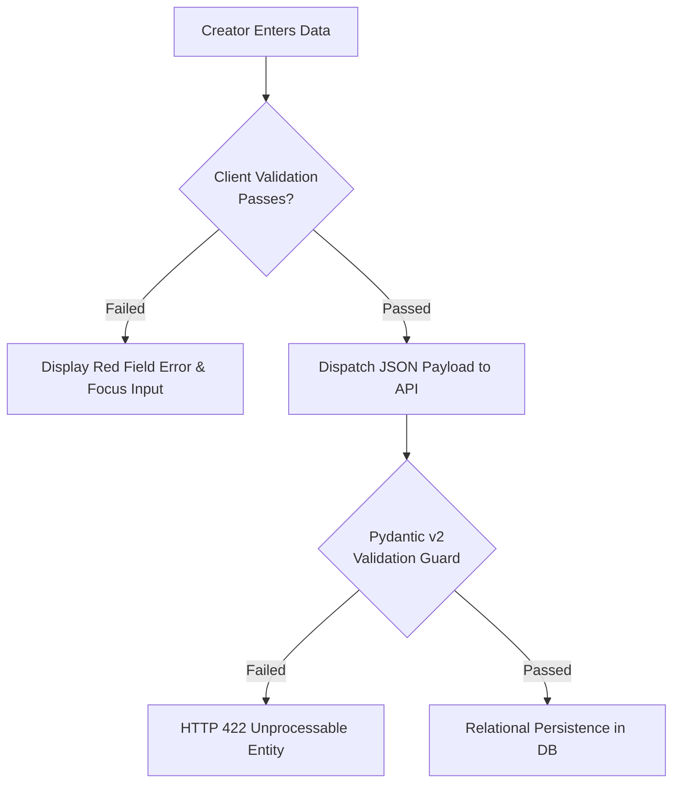

# Phase 4 — Project Validation Rules & Integrity Standards

**Status**: IMPLEMENTED & VERIFIED  
**Role**: Senior Software Architect & Security Engineer  
**Date**: November 2, 2026  
**Scope**: Client-Side Validation, Pydantic Schema Guards, HTTP 422 Contracts & Sanitization  

---

## 1. Dual-Layer Validation Architecture

To deliver immediate user feedback while maintaining uncompromising backend security, all validation rules are enforced at two distinct layers:
1. **Client Presentation Layer (React)**:
   - Validates inputs on change and form submission.
   - Surfaces real-time character counters and field-level error messages directly adjacent to the input.
2. **Server-Side API Layer (FastAPI & Pydantic v2)**:
   - Evaluates incoming request payloads before invoking business logic or repository queries.
   - Never trusts client validation alone.
   - Emits standardized RFC-compliant HTTP `422 Unprocessable Entity` responses when rules are violated.



---

## 2. Definitive Field Validation Specifications

### 2.1 Project Name (`name`)
- **Required**: Yes.
- **Type**: String.
- **Minimum Length**: 3 characters (after leading/trailing whitespace trim).
- **Maximum Length**: 120 characters.
- **Failure Message**: `"Project name must be between 3 and 120 characters."`
- **Pydantic Constraint**: `Field(..., min_length=3, max_length=120)`.

### 2.2 Tagline (`tagline`)
- **Required**: Yes.
- **Type**: String.
- **Minimum Length**: 10 characters (guarantees substantive context).
- **Maximum Length**: 200 characters.
- **Failure Message**: `"Tagline must be between 10 and 200 characters."`
- **Pydantic Constraint**: `Field(..., min_length=10, max_length=200)`.

### 2.3 Category (`category`)
- **Required**: Yes.
- **Type**: Enum literal.
- **Permitted Values**:
  1. `developer-tools`
  2. `productivity`
  3. `ai-ml`
  4. `design-ux`
  5. `saas-b2b`
  6. `mobile`
  7. `infrastructure`
- **Failure Message**: `"Category must be one of the approved categories."`
- **Pydantic Constraint**: `category: ProjectCategory` (Pydantic `Literal`).

### 2.4 Technical Specification Context (`description`)
- **Required**: Optional on draft creation; minimum 20 characters required before transitioning status to `ready`.
- **Type**: String (Markdown supported).
- **Maximum Length**: 50,000 characters.
- **Pydantic Constraint**: `Optional[str] = Field("", description="Project description or specifications")`.

### 2.5 Repository URL (`repository_url` / `repositoryUrl`)
- **Required**: Optional.
- **Type**: URL String.
- **Protocol Constraint**: Must explicitly start with `http://` or `https://`.
- **Maximum Length**: 500 characters.
- **Failure Message**: `"Repository URL must begin with http:// or https://"`

### 2.6 Demo URL (`demo_url` / `demoUrl`)
- **Required**: Optional.
- **Type**: URL String.
- **Protocol Constraint**: Must explicitly start with `http://` or `https://`.
- **Maximum Length**: 500 characters.
- **Failure Message**: `"Demo URL must begin with http:// or https://"`

---

## 3. Pydantic Error Response Envelope (HTTP 422)

When an invalid request is received by the backend, FastAPI returns a detailed schema error:

```json
{
  "detail": [
    {
      "type": "string_too_short",
      "loc": ["body", "name"],
      "msg": "String should have at least 3 characters",
      "input": "AB",
      "ctx": { "min_length": 3 }
    },
    {
      "type": "literal_error",
      "loc": ["body", "category"],
      "msg": "Input should be 'developer-tools', 'productivity', 'ai-ml', 'design-ux', 'saas-b2b', 'mobile' or 'infrastructure'",
      "input": "custom-category"
    }
  ]
}
```

---

## 4. Test Verification Evidence

All validation constraints are validated in `backend/tests/test_phase_4_personal_projects.py::test_field_validation_boundaries`:
- Submitting `name < 3` -> **422 Unprocessable Entity**.
- Submitting `name > 120` -> **422 Unprocessable Entity**.
- Submitting `tagline < 10` -> **422 Unprocessable Entity**.
- Submitting `tagline > 200` -> **422 Unprocessable Entity**.
- Submitting unapproved `category` -> **422 Unprocessable Entity**.
- Submitting missing required fields -> **422 Unprocessable Entity**.

