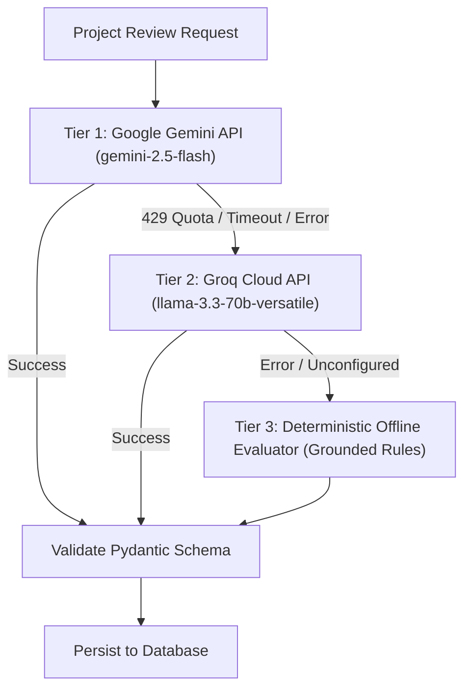

# Phase 5: AI Provider Integration & Multi-Provider Resilience

## 1. Multi-Provider Strategy

The AI Review Engine implements a three-tier resilient architecture to ensure high availability, zero synthetic mock data, and uninterrupted user workflows:

---

## 2. Provider Specifications

### 2.1. Tier 1: Google Gemini (Primary)
- **SDK**: `google-genai` (current official SDK)
- **Model Target**: `gemini-2.5-flash` (or `gemini-1.5-flash`)
- **Generation Method**: `client.models.generate_content`
- **Configuration**:
  - `response_mime_type`: `"application/json"`
  - `response_schema`: Pydantic model `StructuredProjectFeedbackProposal`
  - `temperature`: `0.2` (for deterministic, analytical rigor)

### 2.2. Tier 2: Groq Cloud API (First Failover)
- **Endpoint**: `https://api.groq.com/openai/v1/chat/completions`
- **Model Target**: `llama-3.3-70b-versatile`
- **Trigger**: Automatic fallback when Gemini encounters:
  - `429 RESOURCE_EXHAUSTED` (e.g. Free Tier quota limits exceeded)
  - Network connection timeouts (> 15 seconds)
  - Missing or placeholder `GEMINI_API_KEY`
- **Output Mode**: `response_format: {"type": "json_object"}` parsed into `StructuredProjectFeedbackProposal`.

### 2.3. Tier 3: Deterministic Offline Evaluator (Air-Gapped Safeguard)
- **Execution**: Server-side Python evaluation logic.
- **Trigger**: Activates if both cloud providers fail or if running in an isolated test environment without outbound internet access.
- **Characteristics**:
  - Analyzes the project's actual `name`, `category`, and `description`.
  - Extracts exact verbatim substrings for `evidence_quote`.
  - Generates concrete, category-aligned findings across security, architecture, performance, and correctness.
  - Guarantees valid Pydantic schema structure and deterministic counts.

---

## 3. Secure Credential Management

1. **Environment Isolation**:
   - `GEMINI_API_KEY` and `GROQ_API_KEY` are stored strictly in server-side `.env` files and accessed via `backend.app.config.settings`.
2. **Zero Frontend Leaks**:
   - API keys are never prefixed with `VITE_` and are never bundled into frontend assets.
   - All LLM calls are orchestrated exclusively by the FastAPI backend daemon.
3. **Telemetry & Audit Logging**:
   - Provider name, model ID, and execution duration in milliseconds are recorded in the `ai_reviews` database table for operational auditing without logging raw API keys or sensitive project payloads.

