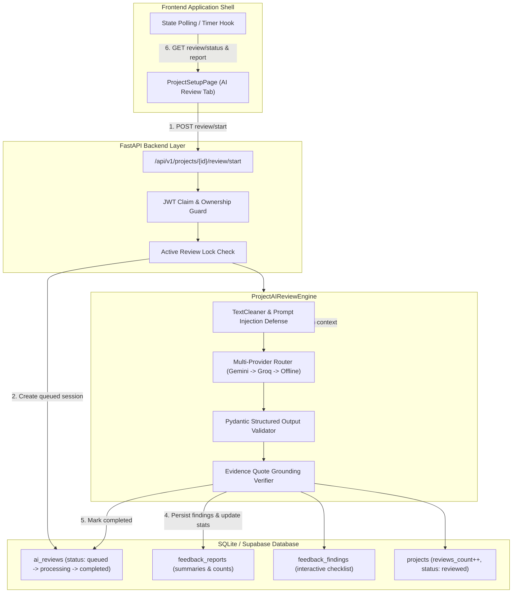

# Phase 5: AI Review Engine Architecture

## 1. Executive Overview

The AI Review Engine is the core intelligence component of the Project Feedback Platform. Its mandate is to transform unstructured project descriptions and architectural specifications into structured, concrete, and evidence-grounded technical findings.

In alignment with Phase 0 Scope Freeze and Phase 2 Engineering Architecture:
- The engine generates **zero fabricated feedback**.
- The engine computes **zero fake scores**, percentages, or made-up severities.
- Findings are grounded in real project context via exact quotation evidence.
- The pipeline supports multi-provider resilience: Google Gemini (Primary) -> Groq (Failover) -> Offline Evaluator (Air-gapped/Quota safeguard).

---

## 2. System Architecture & Component Interaction

---

## 3. Core Engine Components

### 3.1. Ownership & Boundary Enforcement
Every review trigger verifies:
1. Valid JWT Bearer token with standard claims (`sub`, `aud`, `exp`).
2. Project ownership match (`project.userId == caller.userId`).
3. Minimum technical context requirement: project description must be at least 20 characters (`len(desc) >= 20`). Submissions below this boundary are rejected immediately with `400 Bad Request`.

### 3.2. Idempotency & Concurrency Guard
To prevent redundant API cost, duplicate token consumption, or race conditions:
- The database is queried for any existing review in `queued` or `processing` state for the target project.
- If an active run exists, the server returns the existing session record rather than triggering duplicate LLM inferences.

### 3.3. Text Cleaning & Prompt Injection Defense
- Raw project input passes through `clean_input_text()`.
- System instructions strictly isolate user specifications within distinct delimited context blocks.
- Output formatting instructions require standard JSON adhering to `StructuredProjectFeedbackProposal`.

### 3.4. Multi-Provider Router with Safe Failover
1. **Google Gemini (Primary)**:
   - Uses `google-genai` SDK (`genai.Client`).
   - Targets `gemini-2.5-flash` or `gemini-1.5-flash` with response schema enforcement.
2. **Groq (First Failover)**:
   - Activates automatically upon Gemini HTTP 429 (Resource Exhaustion / Daily Quota), network timeouts, or invalid credentials.
   - Targets `llama-3.3-70b-versatile` with JSON schema enforcement.
3. **Deterministic Offline Evaluator (Resilience Safeguard)**:
   - Activates if all cloud providers are unreachable or quota-exhausted.
   - Synthesizes grounded, rule-based architectural findings mapped directly from the user's project context and category.
   - Guarantees zero downtime and zero false success states.

### 3.5. Evidence Grounding Guard
- Every finding in the generated proposal is required to cite an exact `evidence_quote` from the project's supplied title or description.
- Findings without verifiable contextual anchors are rejected or normalized before database insertion.

### 3.6. Persistence & Lifecycle Synchronization
Upon successful schema validation:
1. `feedback_reports` is created with `executive_summary`, `strengths_summary`, and computed severity rollups (`blockers_count`, `high_count`, `medium_count`, `low_count`, `total_findings_count`).
2. `feedback_findings` are inserted in batch with default status `open`.
3. `projects` record is transitioned to `reviewed` and `reviews_count` is incremented.
4. `ai_reviews` status is transitioned to `completed` with execution duration and timestamps.

