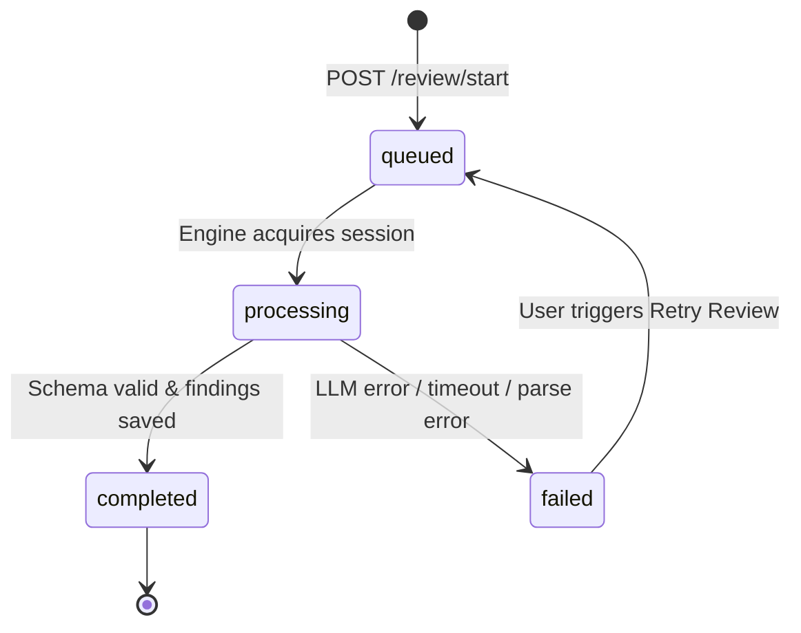

# Phase 5: AI Review Engine Lifecycle & State Management

## 1. Overview

The AI Review Engine governs three interrelated lifecycles:
1. **Review Session Lifecycle** (`ai_reviews.status`): Tracks execution of an AI evaluation job.
2. **Project Status Lifecycle** (`projects.status`): Reflects whether the project is ready, under active review, or reviewed.
3. **Finding Resolution Lifecycle** (`feedback_findings.status`): Enables the user to work through and address specific actionable recommendations.

---

## 2. Review Session State Machine



### 2.1. State Definitions

| State | Trigger | System Actions | Frontend UI State |
| :--- | :--- | :--- | :--- |
| `queued` | User clicks "Start AI Review" | Review row inserted in DB; project status set to `in_review`. | Real spinner; banner displaying "Review Queued in Pipeline". |
| `processing` | Pipeline execution starts | LLM invoked with structured schema; text sanitized. | Real elapsed timer (e.g. `4s elapsed`); provider and model metadata displayed. |
| `completed` | LLM returns valid schema; findings saved | `feedback_reports` created; `projects.reviews_count` incremented; `projects.status` = `reviewed`. | Full Feedback Report displayed with findings checklist and metrics. |
| `failed` | All providers fail or timeout | Error details recorded in `error_message`; `projects.status` reverted to `ready`. | Error banner with exact failure message and dominant "Retry Review" button. |

---

## 3. Project Status Lifecycle Synchronization

When a review run initiates, the project's overall status moves:
```
draft / ready  --->  in_review  --->  reviewed
```
- If review fails: Status reverts from `in_review` back to `ready` so the user can edit or retry.
- When review completes: Status transitions permanently to `reviewed`, and `reviews_count` is incremented.

---

## 4. Finding Resolution Lifecycle

Each finding generated by the AI Review Engine is saved with initial status `open`. The user can interactively advance the finding:

```
[ open ]  --->  [ in_progress ]  --->  [ addressed ]
```

- Any status can be reverted back if a fix needs rework.
- When marked `addressed`, `resolved_at` is set to the current ISO timestamp.
- Mutations are enforced via `PATCH /api/v1/findings/{finding_id}/status` and restricted to the verified project owner.

---

## 5. Idempotency & Polling Rules

1. **Idempotency**: If a client calls `/review/start` while a review for that project is in `queued` or `processing`, the server returns the existing review record with HTTP 200 without creating a new job.
2. **Real Progress Experience**:
   - The frontend never presents simulated progress bars with fake percentages (e.g. "45%... 72%").
   - Instead, the UI displays real lifecycle status badges, elapsed wall-clock seconds, and active model names.
   - The client polls `GET /projects/{id}/reviews/{review_id}/status` every 2000ms until a terminal state (`completed` or `failed`) is reached.

