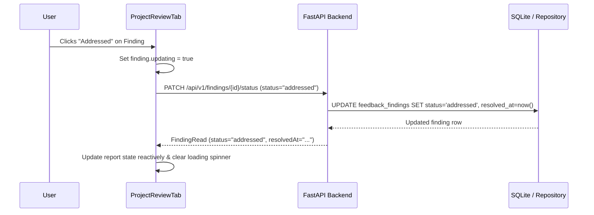

# Phase 6: Feedback Report Implementation

## 1. Frontend Implementation Structure

The Feedback Report experience is implemented using a modular, decoupled architecture:

### 1.1. Components & Pages
1. **`FeedbackReportPage.tsx`** ([`frontend/src/pages/personal/FeedbackReportPage.tsx`](file:///c:/Users/OMEN/.gemini/antigravity-ide/scratch/ai%20web%20application/frontend/src/pages/personal/FeedbackReportPage.tsx)):
   - Serves dedicated routes `/personal/projects/:id/report` and `/projects/:id/report`.
   - Handles route parameter validation, initial project fetching, 404/403 boundary handling, and navigation back to Personal Home.
2. **`ProjectReviewTab.tsx`** ([`frontend/src/components/product/ProjectReviewTab.tsx`](file:///c:/Users/OMEN/.gemini/antigravity-ide/scratch/ai%20web%20application/frontend/src/components/product/ProjectReviewTab.tsx)):
   - Reusable review work surface shared between `ProjectSetupPage` and `FeedbackReportPage`.
   - Manages review preparation, in-flight execution polling, report version switching, multi-iteration comparison, export/copy, and finding status mutation.
3. **`api.ts`** ([`frontend/src/services/api.ts`](file:///c:/Users/OMEN/.gemini/antigravity-ide/scratch/ai%20web%20application/frontend/src/services/api.ts)):
   - Type-safe HTTP client wrapping all Phase 5 and Phase 6 REST endpoints.

---

## 2. Backend Implementation Structure

### 2.1. REST API Routing ([`backend/app/api/v1/projects.py`](file:///c:/Users/OMEN/.gemini/antigravity-ide/scratch/ai%20web%20application/backend/app/api/v1/projects.py))

| Method | Endpoint | Description | Auth Required |
| :--- | :--- | :--- | :--- |
| `POST` | `/projects/{id}/review/start` | Initiates new AI review run | Owner Only |
| `GET` | `/projects/{id}/reviews/{review_id}/status` | Polls in-flight review status | Authenticated |
| `GET` | `/projects/{id}/report` | Fetches latest synthesized report | Authenticated |
| `GET` | `/projects/{id}/reports` | Lists all historical reports | Authenticated |
| `GET` | `/projects/{id}/reports/compare` | Compares two historical reports | Authenticated |
| `GET` | `/projects/{id}/reports/{report_id}` | Retrieves specific historical report | Authenticated |
| `GET` | `/projects/{id}/reviews/{review_id}/report` | Retrieves report by review ID | Authenticated |
| `GET` | `/projects/{id}/report/export` | Exports sanitized Markdown report | Authenticated |
| `PATCH` | `/findings/{finding_id}/status` | Updates finding resolution status | Owner Only |

### 2.2. Repository Operations ([`backend/app/db/project_repository.py`](file:///c:/Users/OMEN/.gemini/antigravity-ide/scratch/ai%20web%20application/backend/app/db/project_repository.py))
- `get_feedback_report_for_project`: Enforces project ownership and reports existence.
- `list_feedback_reports_for_project`: Ordered by `created_at DESC` with findings eager-loaded.
- `generate_report_markdown_export`: Sanitizes and outputs formatted Markdown with zero secret leakage.
- `update_finding_status`: Updates status (`open`, `in_progress`, `addressed`) and sets `resolved_at`.

---

## 3. Data Flow & Reactive State Lifecycle

