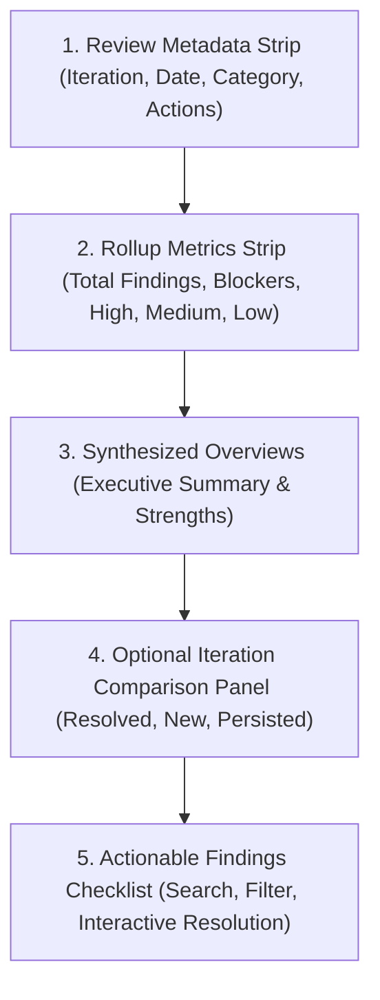

# Phase 6: Feedback Report Specification

## 1. Executive Intent & Product Purpose

The **Feedback Report** is the primary decision-making and work surface in the Project Feedback Platform. Its mission is to transform raw AI review outputs into an actionable, evidence-grounded technical review that helps creators understand their project's technical standing and prioritize engineering improvements.

### 1.1. Core Design Axioms
1. **One Screen = One Meaning = One Goal = One Dominant Action**:
   - The feedback report is dedicated to technical comprehension and finding resolution.
   - The dominant action is working through the findings checklist (`Open` $\rightarrow$ `In Progress` $\rightarrow$ `Addressed`).
2. **Grounding Over Hallucination**:
   - Every finding is anchored by a verifiable `evidenceQuote` directly from the user's project context.
   - Zero synthetic numerical scores (e.g. "78/100"), arbitrary confidence percentages, or fake citations.
3. **Actionable Separation**:
   - Observations (what was detected) are strictly separated from Recommendations (concrete remediation steps).

---

## 2. Information Architecture & Hierarchy

### 2.1. Hierarchy Priority Order
1. **Overall Understanding**: Executive summary and identified strengths.
2. **Critical Findings**: Blocker and High severity items with immediate impact.
3. **Evidence & Explanation**: Observation narrative paired with exact grounded quotation.
4. **Actionable Recommendations**: Clear, engineering-focused remediation steps.
5. **Progressive Next Steps**: Interactive status progression buttons on each card.

---

## 3. Approved Section Specifications

| Section | Content | Data Source | Empty/Missing Rule |
| :--- | :--- | :--- | :--- |
| **Header Strip** | Project Name, Category, Iteration #, Audit Date, Status | `feedback_reports` + `projects` | Always present. |
| **Action Toolbar** | Iteration Switcher, Compare Toggle, Export Markdown, Copy to Clipboard, Run New Review | Frontend + `/report/export` + `/reports/compare` | Present when report exists. |
| **Severity Rollup** | Total Findings, Blockers, High, Medium, Low | Computed deterministically from `feedback_findings` | Always derived; zero fake percentages. |
| **Executive Summary** | Synthesized technical audit narrative (min 20 chars) | `feedback_reports.executive_summary` | If missing, honest placeholder alert. |
| **Strengths Summary** | Grounded strengths and domain foundation | `feedback_reports.strengths_summary` | If missing, hidden or noted. |
| **Comparison Panel** | Diff between Base and Target iteration (`resolvedCount`, `newCount`, `persistedCount`) | `/api/v1/projects/{id}/reports/compare` | Collapsed by default; toggled via "Compare". |
| **Findings Checklist** | List of actionable finding cards with filters & status controls | `feedback_findings` | If 0 findings, honest empty state displayed. |

