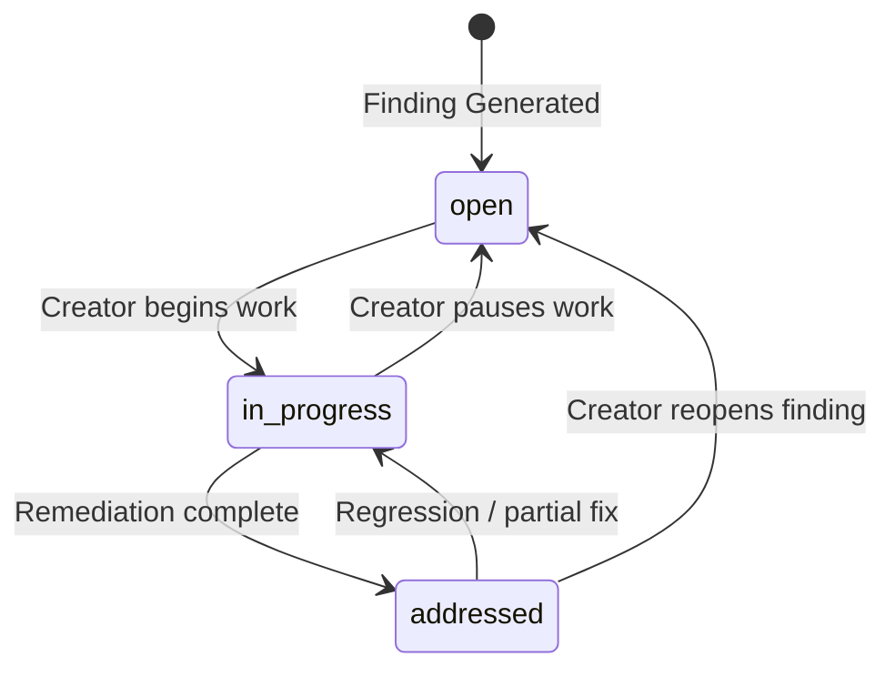

# Phase 6: Project Improvement Workflow Specification

## 1. Scope & System Boundaries

The Improvement Workflow allows project owners to track their resolution progress against actionable AI findings directly within the Feedback Report surface.

> [!IMPORTANT]
> **Product Boundary Notice**:
> In compliance with Phase 0 Scope Freeze, this product does **not** invent an external project management or issue-tracking suite (e.g. Jira/Linear boards, sprint milestones, or team assignees). The improvement workflow is strictly focused on **finding-level lifecycle resolution**.

---

## 2. Finding Resolution State Machine



### 2.1. State Invariants

| State | Semantic Meaning | Database Record | UI Representation |
| :--- | :--- | :--- | :--- |
| **`open`** | Finding is identified and unaddressed. | `status = 'open'`, `resolved_at = NULL` | Neutral badge (`bg-[var(--surface-raised)]`); active "In Progress" and "Addressed" buttons. |
| **`in_progress`** | Creator is actively modifying code/specs. | `status = 'in_progress'`, `resolved_at = NULL` | Blue badge (`bg-blue-500/10 text-blue-600`); active "Open" and "Addressed" buttons. |
| **`addressed`** | Creator has resolved the identified risk. | `status = 'addressed'`, `resolved_at = ISO timestamp` | Emerald badge (`bg-emerald-500/10 text-emerald-600`); "Resolved [Date]" label; active "Open" button. |

---

## 3. Server-Side Permission & Mutation Enforcement

All status mutations must pass through `PATCH /api/v1/findings/{finding_id}/status`:
```python
@router.patch("/findings/{finding_id}/status", response_model=FindingRead)
def update_finding_status(finding_id: str, payload: FindingStatusUpdate, current_user: dict = Depends(get_current_user_required)):
    user_id = get_user_id(current_user)
    return project_repo.update_finding_status(finding_id, user_id, payload.status)
```

1. **Ownership Check**:
   The backend retrieves the finding, traverses `report_id` $\rightarrow$ `project_id` $\rightarrow$ `projects.user_id`, and verifies that `user_id == caller.user_id`.
2. **Unauthorized Rejection**:
   Non-owners attempting to mutate finding statuses receive `HTTP 403 Forbidden`.
3. **Audit Timestamp**:
   Transitioning to `addressed` automatically records the UTC timestamp in `resolved_at`.

