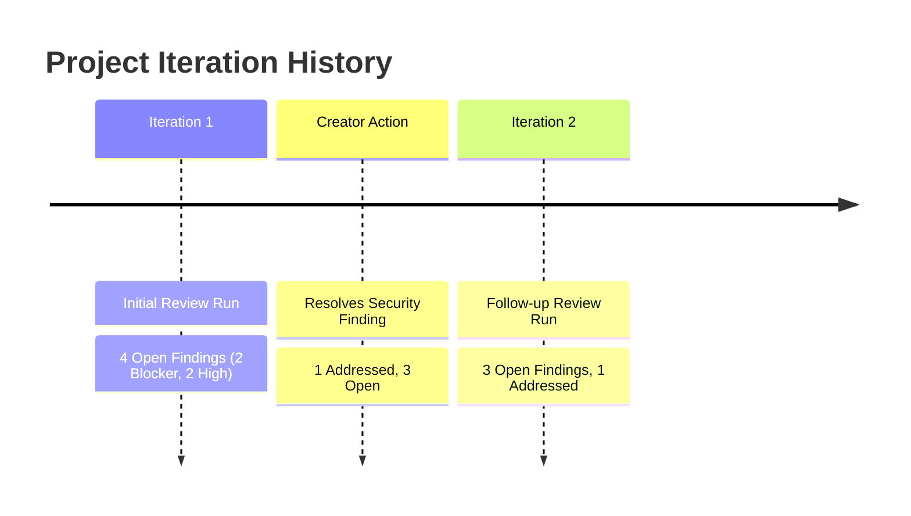

# Phase 6: Review History & Multi-Iteration Comparison Specification

## 1. Multi-Iteration Architecture

As creators iterate on their projects (updating context, resolving findings, and refactoring architecture), the AI Review Engine captures each run as a permanent, versioned historical snapshot.



---

## 2. Historical Iteration Navigation

1. **Iteration Switcher**:
   - If a project has multiple reviews, the action strip displays an iteration dropdown:
     `Iteration 2 (Nov 2, 2026)` vs `Iteration 1 (Oct 28, 2026)`.
   - Selecting an iteration updates the active report view immediately without reloading the page.
2. **Review Session Audit Linking**:
   - Every report references its generating `reviewId` and model provider metadata (`gemini-2.5-flash`, `llama-3.3-70b-versatile`, etc.).

---

## 3. Iteration Comparison Specification

The endpoint `GET /api/v1/projects/{project_id}/reports/compare?base_id={base}&target_id={target}` computes a structured diff between two historical iterations:

### 3.1. Comparison Data Contract (`FeedbackReportComparison`)

```json
{
  "projectId": "proj_12345678",
  "baseReportId": "rep_base_0001",
  "targetReportId": "rep_target_0002",
  "totalFindingsDelta": -1,
  "resolvedCount": 2,
  "newCount": 1,
  "persistedCount": 2,
  "items": [
    {
      "findingId": "fnd_9988",
      "title": "Enforce Cryptographic Authorization & Audience Claim Verification",
      "severity": "medium",
      "category": "security",
      "statusInBase": "open",
      "statusInTarget": "addressed",
      "changeType": "resolved"
    }
  ]
}
```

### 3.2. Change Classification Rules
- **`resolved`**: Present in base report as unaddressed, but marked `addressed` in target report.
- **`new`**: Present in target report but absent in base report.
- **`persisted`**: Present in both reports with unchanged status.
- **`reopened`**: Marked `addressed` in base report, but changed back to `open` or `in_progress`.

