# Phase 7: MVP Functional QA Audit

## 1. Executive Summary

This document records the comprehensive functional verification of the complete **Personal project-to-feedback journey** for the MVP Release. Every primary user action, state transition, validation boundary, and persistence event has been verified.

---

## 2. Unbroken Personal Journey Verification

```mermaid
flowchart LR
    A["1. Sign In / Auth"] --> B["2. Personal Home"]
    B --> C["3. New Project"]
    C --> D["4. Project Setup"]
    D --> E["5. Persistence & Context"]
    E --> F["6. AI Review Engine"]
    F --> G["7. Feedback Report"]
    G --> H["8. Interactive Resolution"]
    H --> I["9. Export & Review History"]
```

### 2.1. Journey Step Matrix

| Step | Action Under Test | Expected Behavior | Actual Verified Result | Status |
| :--- | :--- | :--- | :--- | :--- |
| **1. Sign In** | User authenticates via `/api/v1/auth/login` | JWT access token issued; stored in `localStorage`; session active. | Verified token generated, verified claims (`sub`, `aud`), user state set. | **PASS** |
| **2. Personal Home** | User navigates to `/personal` | Displays personal projects grid; shows empty state if 0 projects. | Verified empty state renders cleanly; real projects list reactively. | **PASS** |
| **3. New Project** | User navigates to `/personal/projects/new` | Intake form validates name (3-120 chars) and tagline (10-200 chars). | Verified boundary validation prevents invalid drafts; valid creates `draft` record. | **PASS** |
| **4. Project Setup** | User updates specifications in `/personal/projects/{id}/setup` | Inputs technical description, category, repository, and demo URL. | Verified form validates inputs; auto-saves draft to localStorage. | **PASS** |
| **5. Save Project** | User clicks "Save Changes" | PATCH `/api/v1/projects/{id}` updates database record; clears dirty flag. | Verified database record updated; success banner displayed. | **PASS** |
| **6. Reopen Project** | User closes and reopens project URL | Database record reloaded with complete fidelity. | Verified exact strings and URLs match previous submission. | **PASS** |
| **7. Context Boundary** | AI Review triggered with < 20 chars | Engine rejects initiation with `HTTP 400 Bad Request`. | Verified context check rejects short descriptions; explains requirement. | **PASS** |
| **8. Start AI Review** | User clicks "Start AI Review" with >= 20 chars | Review session created in `queued`, advances to `processing`. | Verified review lifecycle transitions; elapsed timer updates live. | **PASS** |
| **9. Feedback Report** | LLM completes evaluation | Synthesizes structured report; computes severity counts; records findings. | Verified structured report created; projects `status` set to `reviewed`. | **PASS** |
| **10. Improvement Workflow** | User advances finding status | Clicks "In Progress" or "Addressed"; updates finding via `PATCH`. | Verified finding status toggles and records `resolved_at` timestamp. | **PASS** |
| **11. Multi-Iteration** | User runs follow-up review run | Iteration history tracks both runs; comparison tool computes diffs. | Verified `Iteration 1` vs `Iteration 2` comparison calculates resolved findings. | **PASS** |
| **12. Export Report** | User clicks "Export" or "Copy" | Generates sanitized Markdown; zero tokens or secrets leaked. | Verified clean Markdown file download and clipboard copy. | **PASS** |

---

## 3. Interactive Control Audit

All visible controls across Personal Home, New Project, Project Setup, and Feedback Report were inspected:
- **Buttons**: Every button (`Save Changes`, `Discard`, `Start AI Review`, `Run New Review`, `Compare`, `Export`, `Copy`, `Open`, `In Progress`, `Addressed`) is wired to active business logic. Zero dead buttons.
- **Form Inputs**: Every input enforces character lengths, URL regex schemes, and responsive focus rings.
- **Tabs**: Tab switching (`context`, `review`, `links`, `settings`) preserves state without remount glitches.
- **Modals & Dialogs**: Project deletion modal requires explicit user confirmation before executing cascade deletion.

