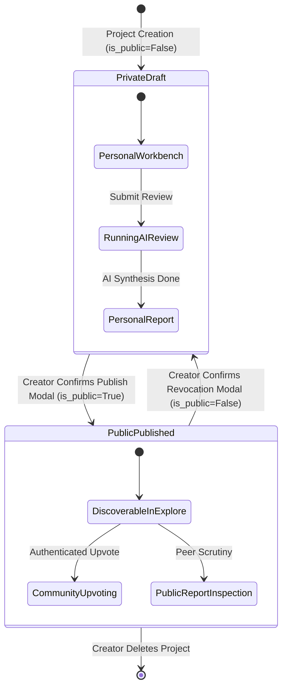

# Phase 8: Public Visibility Rules & State Lifecycle

## 1. Core Visibility Principles

1. **Private by Default**: Every project created in Personal Space begins with `is_public = False` and `status = 'draft'`.
2. **Explicit Consent Required**: Publishing to Public Space requires explicit creator confirmation. The UI presents a modal warning detailing what data becomes public and what remains private.
3. **Immediate Revocation**: When a creator switches `is_public` back to `False`, public visibility is instantly revoked across all public endpoints and discovery feeds.
4. **404 Not Found (Zero Probe Leaks)**: Direct requests to a private project via public endpoints return `404 Not Found` rather than `403 Forbidden`. This prevents attackers or anonymous visitors from probing whether a private UUID exists in the system.

---

## 2. Project Lifecycle Transitions

---

## 3. Detailed Visibility Matrix

| State / Condition | Public Feed (`/projects/public`) | Direct Project URL (`/projects/public/{id}`) | Public Report URL (`/projects/public/{id}/report`) | Upvoting (`/projects/public/{id}/upvote`) | Personal Workspace (`/personal/projects/{id}`) |
| :--- | :--- | :--- | :--- | :--- | :--- |
| **Private Project (`is_public = False`)** | Hidden (omitted from SQL) | `404 Not Found` | `404 Not Found` | `404 Not Found` | Accessible by Owner Only |
| **Published Project (`is_public = True`)** | Visible in Feed & Search | `200 OK` (Public Projection) | `200 OK` (Public Projection) | `200 OK` (Toggle) | Accessible by Owner Only |
| **Revoked Project (`is_public: True -> False`)** | Immediately Removed | `404 Not Found` | `404 Not Found` | `404 Not Found` | Accessible by Owner Only |
| **Nonexistent Project** | Omitted | `404 Not Found` | `404 Not Found` | `404 Not Found` | `404 Not Found` |
| **Anonymous Visitor** | Allowed | Allowed (Public Projection) | Allowed (Public Projection) | `401 Unauthorized` (Prompts Login) | Redirect to Sign In |
| **Authenticated Other User** | Allowed | Allowed (Public Projection) | Allowed (Public Projection) | `200 OK` (Toggles Upvote) | `403 Forbidden` |

---

## 4. Moderation & Abuse Controls
- Any project marked as abusive, spam, or flagged by moderators can have its `is_public` flag programmatically cleared or revoked.
- Community upvoting is strictly rate-limited and idempotent: each authenticated user has exactly 1 toggle vote per project recorded in the `project_upvotes` compound table `(project_id, user_id)`.

