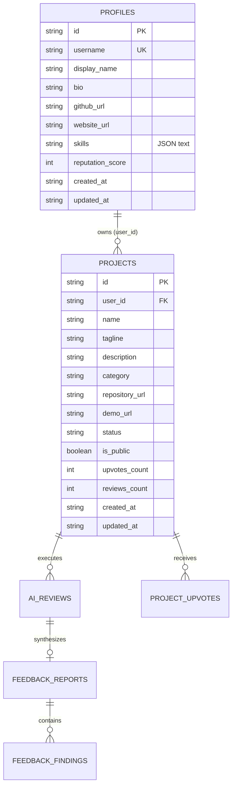

# Phase 9: Creator Data Model & Shared Entities

## 1. Shared Entity Mandate
In strict accordance with Phase 9 instructions:
> "Do not create duplicate project models when an approved shared project model is sufficient."

Creator Space does **not** introduce a separate "showcase", "portfolio_item", or "cms_article" database entity.
It operates directly on the canonical `projects` table created in Phase 2/4 and extended in Phase 8, linking with `profiles`, `feedback_reports`, and `feedback_findings`.

---

## 2. Entity Relationship Diagram



---

## 3. Computed Launch Readiness Model

Launch readiness is computed server-side in `CreatorRepository.get_creator_studio_overview()` to provide grounded, real-time launch metrics without storing redundant state:

```python
class LaunchReadiness(BaseModel):
    hasAiReview: bool        # reviews_count > 0
    hasRepoUrl: bool         # bool(repository_url)
    hasDemoUrl: bool         # bool(demo_url)
    openBlockersCount: int   # COUNT(feedback_findings WHERE status='open' AND severity='blocker')
    isLaunchReady: bool      # hasAiReview AND openBlockersCount == 0 AND (hasRepoUrl OR hasDemoUrl)
```

### Readiness Criteria Explained:
1. **`hasAiReview`**: Project has completed at least one verified automated AI review.
2. **`openBlockersCount == 0`**: All critical architectural or security blockers identified by the AI review engine have been marked resolved or addressed.
3. **`hasRepoUrl` or `hasDemoUrl`**: At least one verifiable destination link is present for reviewers to test.
4. **`isLaunchReady`**: True when all three criteria above are met.

---

## 4. Creator Profile Schema Extension

In `profiles` table:
- `github_url`: Optional public URL to maker's GitHub profile.
- `website_url`: Optional public URL to maker's portfolio or personal website.
- `skills`: JSON-serialized array of technical stack strings (e.g., `["Python", "FastAPI", "React", "TypeScript"]`).

