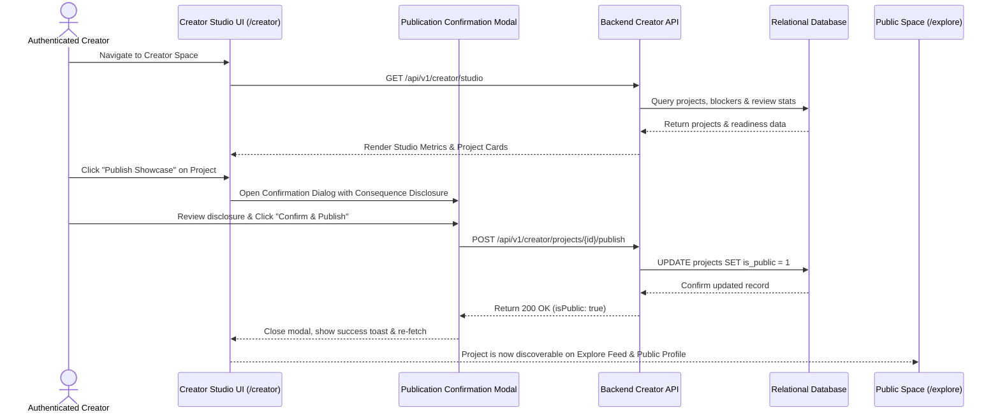
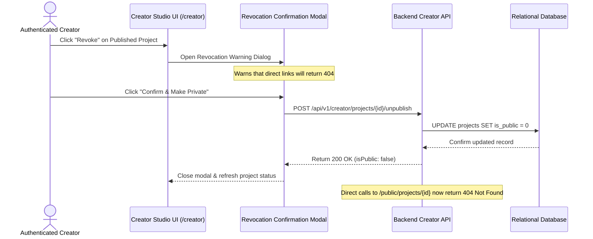

# Phase 9: Creator Workflows

## 1. Workflow Summary
Creator Space provides three core, end-to-end workflows:
1. **Showcase Launch Readiness & Publication Management**
2. **Maker Identity & Profile Configuration**
3. **AI Review Diagnostics & Model Benchmarking**

---

## 2. Showcase Launch & Publication Workflow

---

## 3. Publication Revocation Workflow

---

## 4. Maker Profile Configuration Workflow

1. **Access Profile Editor**:
   - Creator opens `/creator/profile`.
2. **Input Credentials**:
   - Updates Display Name, Biography, Primary Technical Skills tags, GitHub URL, and Website URL.
3. **Live Public Preview**:
   - The right inspector panel provides an instant, pixel-accurate preview of how the maker card will render on public project headers and the standalone maker profile (`/creators/:username`).
4. **Validation & Persistence**:
   - URL prefixes validated (`http://` or `https://`).
   - Changes submitted to `PATCH /api/v1/creator/profile`.
   - On success, toast confirmation displays; form resets dirty tracking.

