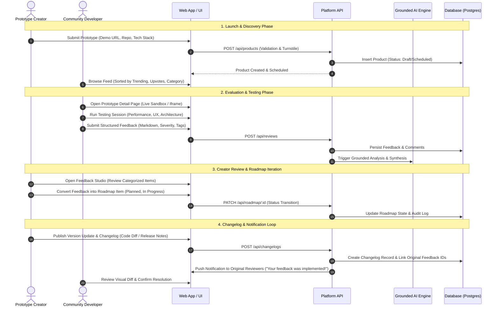

# Reference Architecture & Cross-System Synthesis

This document synthesizes the architectural paradigms, data flows, and design trade-offs discovered across the five reference repositories, establishing a unified reference architecture for our **Developer Community & Prototype Launch Platform**.

---

## 1. System Architectures Across Reference Codebases

```mermaid
flowchart TD
    subgraph OpenLaunch["Open-Launch (Next.js 15 Monolith)"]
        OL_Client["React 19 Client Components"] --> OL_SA["Server Actions & Route Handlers"]
        OL_SA --> OL_Auth["better-auth & Stripe"]
        OL_SA --> OL_Drizzle["Drizzle ORM (PostgreSQL)"]
        OL_Cron["Vercel / CRON Route Handlers"] --> OL_SA
    end

    subgraph Quackback["Quackback (Vite + Bun Monorepo)"]
        QB_Client["Vite + TanStack Router (React 19)"] --> QB_API["API Layer / Server Endpoints"]
        QB_Widget["Embeddable Feedback Widget"] --> QB_API
        QB_API --> QB_Drizzle["Drizzle ORM (300+ Migrations)"]
        QB_API --> QB_Editor["TipTap Rich-Text Engine"]
    end

    subgraph Fider["Fider (Go Modular Monolith)"]
        F_Client["React TypeScript (Webpack SPA)"] --> F_HTTP["Go HTTP Multiplexer"]
        F_HTTP --> F_Bus["In-Memory Event Bus (pkg/bus)"]
        F_Bus --> F_Tasks["Asynchronous Background Tasks"]
        F_HTTP --> F_SQL["PostgreSQL (Raw Versioned SQL)"]
    end

    subgraph Peerlist["Peerlist Clone (Polyrepo Node)"]
        PL_Client["React SPA (Create-React-App)"] --> PL_Express["Express.js REST API"]
        PL_Express --> PL_Prisma["Prisma ORM (MongoDB)"]
        PL_Express --> PL_Socket["Socket.io Realtime Server"]
    end

    subgraph OurPlatform["Our Platform (FastAPI + React 19)"]
        OP_UI["React 19 + Vite (Commercial UI)"] --> OP_API["FastAPI Async REST API"]
        OP_API --> OP_DB["SQLAlchemy / PostgreSQL"]
        OP_API --> OP_AI["Deterministic AI Engine & Audio Briefing"]
        OP_API --> OP_Diff["Product Evolution Diff Engine"]
    end
```

---

## 2. Comparative Architectural Paradigms

| Feature Dimension | Open-Launch | Quackback | Fider | Peerlist-Clone | Our Platform |
|---|---|---|---|---|---|
| **Architecture Style** | SSR + Server Actions Monolith | Multi-package Monorepo (Vite SPA) | Go Clean Architecture Modular Monolith | Monorepo Poly-tier REST | Decoupled Client-Server (FastAPI + React SPA) |
| **Primary Language** | TypeScript / Node 20+ | TypeScript / Bun | Go 1.21 / TypeScript | JavaScript / Node.js | Python 3.11+ / TypeScript |
| **API Protocol** | Next.js RPC / Server Actions | REST + RPC internal client | REST (JSON API v1) | REST + Socket.io Events | REST + Async Background Endpoints |
| **Data Persistence** | Drizzle ORM (PostgreSQL) | Drizzle ORM (PostgreSQL) | Raw SQL migrations (PostgreSQL) | Prisma ORM (MongoDB) | SQLAlchemy / Alembic (SQLite / Postgres) |
| **Authentication** | `better-auth` (Email, OAuth, Session) | Custom Session / SSO / OIDC | Cookie Session + OAuth (GitHub/Google) | JWT with Refresh Tokens in Cookie | Bearer Token / Session State |
| **Background Processing** | Cron Route Handlers (`/api/cron/*`) | In-memory queues & worker scripts | In-memory `tasks/` & `jobs/` runner | Express setInterval (`corn/corn.js`) | FastAPI BackgroundTasks & Workers |
| **Client Rendering** | Hybrid SSR/SSG/ISR | Client-Side SPA (TanStack Router) | Client-Side SPA (Webpack bundle) | Client-Side SPA (React Router) | Client-Side SPA (Vite + React Router) |

---

## 3. End-to-End Prototype Testing & Community Lifecycle

Our platform is organized around a unique 8-stage lifecycle. Below is the data flow mapping this lifecycle against architectural capabilities extracted from the reference repositories:

---

## 4. Key Cross-Cutting Technical Solutions

### A. High-Throughput Upvoting & Concurrency
- **The Challenge**: During a launch spike, hundreds of concurrent users upvote products simultaneously. Naive database reads followed by writes cause race conditions, duplicate counts, and locking contention.
- **Reference Implementations**:
  - *Open-Launch*: Uses a composite primary key table `upvote(user_id, project_id, created_at)`. Counts are derived via joins or aggregated queries.
  - *Quackback*: Implements optimistic client updates with backend validation and atomic row-level increments. A unique index on `(post_id, user_id)` guarantees idempotency.
  - *Fider*: Implements vote limits per user per tenant (voting quota), preventing sybil vote manipulation.
- **Our Architecture**:
  - Unique constraint on `(product_id, user_id)` in the upvote table.
  - Atomic database increment via SQL: `UPDATE products SET upvote_count = upvote_count + 1 WHERE id = :id`.
  - Optimistic client-side cache mutation with rollback on HTTP 4xx/5xx failure.

### B. Threaded Feedback & Discussions
- **The Challenge**: Flat comment feeds fail for technical discussions where developers debate specific implementation details or architecture choices.
- **Reference Implementations**:
  - *Quackback*: Supports rich-text comments via TipTap with user mentions (`@user`), code blocks, and internal status badges. Comments can be pinned or marked as official creator replies.
  - *Open-Launch*: Leverages Fuma Comments (`@fuma-comment/react`), providing clean nested hierarchy with moderation roles.
- **Our Architecture**:
  - Adjacency list model with `parent_id` foreign key referencing `comments(id)`.
  - Markdown editor with live preview, code syntax highlighting, and inline image attachments.
  - Role-based badges (`Creator`, `Top Reviewer`, `Verified Dev`).

### C. Developer Identity & Reputation
- **The Challenge**: Superficial reviews ("Looks great!") destroy platform utility. Feedback must come from developers with verified technical backgrounds.
- **Reference Implementations**:
  - *Peerlist-Clone*: Deep developer profile with GitHub OAuth connection (`GithubAccount`), verifiable work/education milestones, skill badges, and project spotlight weeks.
- **Our Architecture**:
  - Developer profiles displaying GitHub repository stats, verified stack competencies, and a **Community Impact Score** earned by submitting actionable feedback that creators mark as "Implemented".

### D. Grounded AI Feedback Synthesis & Audio Briefings
- **Unique Platform Capability**: Unlike generic feedback portals, our platform leverages local and cloud LLMs to provide deterministic feedback summarization, sentiment extraction, and dual-host NotebookLM-style audio briefings.
- **Architecture**:
  - FastAPI asynchronous background worker fetches feedback batch.
  - Grounding pipeline verifies every claim against reviewer text citations.
  - Generates structured JSON insights and multi-voice audio scripts for creators on the go.

