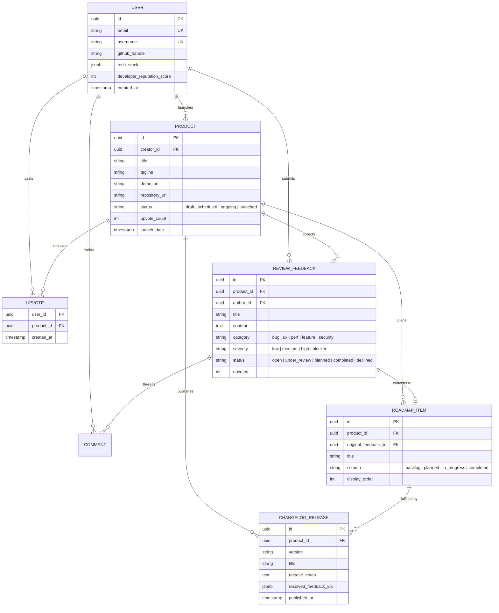

# Database Design, Schema Architecture & Entity Relationships

This report analyzes the database architectures, ORM frameworks, migration strategies, and entity relationships across the reference repositories, establishing optimal schema patterns for our platform.

---

## 1. Database Technologies & ORM Matrix

| Repository | Database Engine | ORM / Abstraction | Migration Engine | Multi-Tenancy Strategy |
|---|---|---|---|---|
| **Open-Launch** | PostgreSQL | Drizzle ORM (`drizzle-orm`) | Drizzle Kit (`drizzle-kit generate`) | Single-tenant community |
| **Quackback** | PostgreSQL | Drizzle ORM (`packages/db`) | Drizzle Kit (303 sequential SQL migrations) | Multi-tenant workspace scoping (`workspace_id`) |
| **Fider** | PostgreSQL | Raw SQL / Custom DBX mapper | Versioned `.up.sql` / `.down.sql` scripts | Multi-tenant single database (`tenant_id`) |
| **Peerlist-Clone** | MongoDB | Prisma ORM (`prisma-client-js`) | Prisma CLI | User-owned document isolation |
| **Our Platform** | PostgreSQL / SQLite | SQLAlchemy 2.0 (Async) | Alembic migrations | Creator / Product / Reviewer relational partitioning |

---

## 2. Core Entity Relationships & Unified ERD

The diagram below synthesizes the relational model required for a developer prototype launch and feedback iteration platform:



---

## 3. Schema Teardown of Reference Repositories

### A. Open-Launch (Drizzle Schema)
- **File Reference**: [`references/repositories/Open-Launch/drizzle/db/schema.ts`](file:///c:/Users/OMEN/.gemini/antigravity-ide/scratch/ai%20web%20application/references/repositories/Open-Launch/drizzle/db/schema.ts)
- **Key Tables**:
  - `user`: Identity, email, stripe customer ID, role, ban status.
  - `project`: Title, description, URL, logo, launch date, `launch_status` (`payment_pending`, `scheduled`, `ongoing`, `launched`), `pricing_type` (`free`, `freemium`, `paid`), `platform_type` (`web`, `mobile`, `api`).
  - `upvote`: Composite primary key `(user_id, project_id)`.
  - `fuma_comments`: Threaded comments linked to projects with author information.
- **Architectural Lesson**: Clean enum separation for launch lifecycles (`scheduled` vs `ongoing` vs `launched`) enables automated daily launch scheduling via cron route handlers.

---

### B. Quackback (Drizzle Monorepo Schema)
- **File Reference**: [`references/repositories/Quackback/packages/db/src/schema/`](file:///c:/Users/OMEN/.gemini/antigravity-ide/scratch/ai%20web%20application/references/repositories/Quackback/packages/db/src/schema)
- **Key Tables & Modules**:
  - `boards.ts`: Feedback collection boards per workspace (e.g., "Feature Requests", "Bugs", "Integrations").
  - `posts.ts`: Core feedback entity with title, rich-text JSON content, state, vote counter, and author ID.
  - `statuses.ts`: Configurable lifecycle stages (e.g., "Under Review", "Planned", "In Development", "Shipped").
  - `changelog.ts`: Product updates linked directly to customer feedback entries, closing the loop when a feature ships.
  - `rbac.ts`: Workspace role memberships and permissions.
- **Architectural Lesson**: Quackback's 300+ migration history shows that decoupling feedback items from static statuses and allowing workspaces to define custom roadmap stages is crucial for flexible developer adoption.

---

### C. Fider (Raw SQL Migrations)
- **File Reference**: [`references/repositories/Fider/migrations/`](file:///c:/Users/OMEN/.gemini/antigravity-ide/scratch/ai%20web%20application/references/repositories/Fider/migrations)
- **Key Migrations**:
  - `201701261850_create_tenants.up.sql`: Multi-tenant boundary.
  - `201702072040_create_ideas.up.sql`: Main suggestion table.
  - `201704181821_add_supporters.up.sql`: Upvoting table (`user_id`, `idea_id`, `created_on`).
  - `201705132054_add_idea_status.up.sql`: Status tracking (`open`, `started`, `completed`, `declined`).
- **Architectural Lesson**: Minimalist schema design with raw SQL constraints is extremely durable, easily portable across database versions, and produces zero ORM overhead.

---

### D. Peerlist-Clone (Prisma MongoDB)
- **File Reference**: [`references/repositories/Peerlist-Clone/backend/prisma/schema.prisma`](file:///c:/Users/OMEN/.gemini/antigravity-ide/scratch/ai%20web%20application/references/repositories/Peerlist-Clone/backend/prisma/schema.prisma)
- **Key Models**:
  - `User`: Profile fields, `skills` JSON, `socialMedia` JSON, GitHub token reference.
  - `Project`: Project showcase with `spotlightLaunchedAt`, `spotlightRank`, and `SpotlightWeek` relation.
  - `Upvote`: Composite unique index on `@@unique([userId, projectId])`.
  - `Notification`: Polymorphic event notification model (`PROFILE_VIEW`, `POST_LIKE`, `POST_COMMENT`, `COMMENT_REPLY`).
- **Architectural Lesson**: Storing skills and social links as JSON documents provides flexible profile customization without complex join tables.

---

## 4. Performance Indexes & Concurrency Controls

To handle launch day traffic spikes, the following indexes and constraints are mandatory:

```sql
-- 1. Enforce strict single-vote idempotency
CREATE UNIQUE INDEX idx_upvotes_user_product ON upvotes(user_id, product_id);

-- 2. Fast retrieval of product upvotes count
CREATE INDEX idx_products_upvote_count ON products(upvote_count DESC);

-- 3. Rapid filtering for launch feed by status and scheduled launch date
CREATE INDEX idx_products_launch_feed ON products(status, launch_date DESC);

-- 4. Fast feedback retrieval by category and status
CREATE INDEX idx_feedback_product_status ON review_feedback(product_id, status);

-- 5. Threaded comments lookup by feedback item and parent
CREATE INDEX idx_comments_feedback_parent ON comments(feedback_id, parent_id);
```

---

## 5. Database Schema Recommendations for Our Platform

1. **Adopt PostgreSQL with Async SQLAlchemy / Alembic**: Provides full relational integrity, JSONB support for technical specs and AI metadata, and robust ACID transactions.
2. **Implement Composite Unique Indexes for Upvoting**: Prevent duplicate votes and race conditions at the database constraint level.
3. **Link Changelog Releases Directly to Resolved Feedback**: Replicate Quackback's pattern of connecting changelog release notes to the original reviewer feedback records.
4. **Partition Roadmap Items by Board Column**: Use an integer `display_order` column per roadmap status to support drag-and-drop Kanban reordering.

