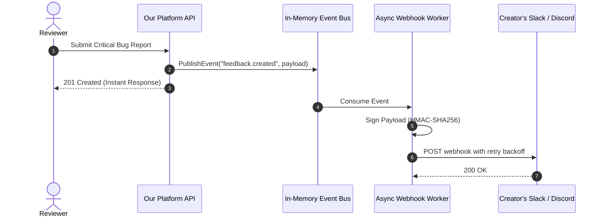

# Integration Patterns, APIs & External Ecosystems

This document analyzes integration architectures, third-party API interactions, webhook designs, and external event synchronization across the reference repositories.

---

## 1. External Integration Overview Across Repositories

| Repository | Primary Integrations | Authentication / Protocols | Inbound / Outbound Mechanics |
|---|---|---|---|
| **Product-Hunt-API** | Product Hunt API v2 | OAuth 2.0 PKCE / Client Credentials | GraphQL queries, rate-limit header inspection |
| **Open-Launch** | Stripe, Cloudflare Turnstile, UploadThing | API Keys, Webhook signatures | Stripe checkout sessions & webhook verification |
| **Quackback** | Slack, Discord, In-app Widget, Custom Webhooks | HMAC SHA256 Webhook Signatures | Outbound event delivery with retry queues |
| **Fider** | GitHub, Google, Facebook, SMTP / Webhooks | OAuth 2.0, HTTP POST Webhooks | Event-bus-triggered HTTP webhooks on new post/vote |
| **Peerlist-Clone** | GitHub OAuth, Socket.io | OAuth 2.0 Access Token exchange | GitHub token stored for repo metadata fetching |
| **Our Platform** | Local LLMs (Ollama/Qwen), Gemini API, GitHub | REST API, OAuth 2.0, Async queues | Grounded AI synthesis, audio briefing generation |

---

## 2. Product Hunt API v2 & GraphQL Integration Pattern

### A. OAuth 2.0 PKCE & Authorization Code Flow
Inspecting `references/repositories/Product-Hunt-API/routes/`:
- **Step 1: Authorization Redirect** ([`routes/authorize.js`](file:///c:/Users/OMEN/.gemini/antigravity-ide/scratch/ai%20web%20application/references/repositories/Product-Hunt-API/routes/authorize.js)):
  ```javascript
  res.redirect(
    `${PH_API_HOST}v2/oauth/authorize?client_id=${PH_APP_API_KEY}&redirect_uri=${PH_APP_REDIRECT_URI}&response_type=code&scope=${PH_APP_REQUESTED_SCOPES}`
  );
  ```
- **Step 2: Token Exchange** ([`routes/callback.js`](file:///c:/Users/OMEN/.gemini/antigravity-ide/scratch/ai%20web%20application/references/repositories/Product-Hunt-API/routes/callback.js)):
  The authorization code is exchanged for an `access_token` via a POST to `/v2/oauth/token`.
- **Step 3: Storing in Encrypted Cookie**:
  The resulting token is encrypted into an HTTP-only cookie (`nekot_htua`), preventing XSS vulnerabilities.

### B. GraphQL Query Design & Pagination
The Product Hunt GraphQL v2 schema (`schema.graphql`) relies on the Relay cursor connection specification:
```graphql
query GetTodaysLaunches($after: String) {
  posts(order: VOTES, after: $after, first: 20) {
    totalCount
    pageInfo {
      hasNextPage
      endCursor
    }
    edges {
      cursor
      node {
        id
        name
        tagline
        votesCount
        thumbnail {
          url
        }
        makers {
          name
          username
        }
      }
    }
  }
}
```
- **Architectural Lesson**: Cursor-based pagination (`after: endCursor`) is far superior to offset-based pagination (`LIMIT / OFFSET`) for real-time launch feeds, preventing duplicate items when new products launch concurrently.

---

## 3. Webhook Architecture & Event Delivery (Quackback & Fider)

When community feedback is submitted or a roadmap status transitions, creators must be notified in their existing communication channels (Slack, Discord, or custom webhooks).



### A. HMAC-SHA256 Webhook Security
Quackback signs outbound webhook deliveries using HMAC-SHA256 headers:
```
X-Signature-256: sha256=52f4454b45fc3d3f...
X-Delivery-Timestamp: 1730485900
```
This enables receiving developer backends to cryptographically verify that payloads originated from our platform.

---

## 4. GitHub Developer Profile & Repository Verification

Both **Fider** and **Peerlist-Clone** integrate with GitHub to verify developer authenticity:
- **Scope Requested**: `read:user`, `repo:status` (minimal read-only scopes).
- **Data Extracted**:
  - Confirmed GitHub username & avatar.
  - Public repository count and primary programming languages.
  - Verification checkmark confirming the user is an active open-source contributor.
- **Platform Application**: Developers who launch prototypes on our platform can link their GitHub repository; our platform automatically pulls repository stars, open issues, and commit activity, building trust with community testers.

---

## 5. Stripe Billing & Paid Launch Tiers (Open-Launch)

Open-Launch provides a blueprint for monetizing product launches:
- **Tiers Supported**: `FREE` vs `PREMIUM` (featured placement on homepage banner) vs `PREMIUM_PLUS` (newsletter mention).
- **Workflow**:
  1. Creator fills in prototype launch details.
  2. If selecting a paid tier, backend initializes a Stripe Checkout session.
  3. Product is persisted in `payment_pending` status.
  4. Stripe webhook `/api/payment/verify` listens for `checkout.session.completed` and upgrades status to `scheduled`.
  5. Prevents unpaid launches from entering the active voting queue.

---

## 6. Integration Recommendations for Our Platform

1. **Implement Outbound Webhooks with HMAC Signatures**: Allow creators to pipe new prototype feedback directly into their private Discord/Slack developer channels.
2. **Add GitHub OAuth for Developer Verification**: Display verified GitHub contributor badges on developer profile cards.
3. **Cursor-Based GraphQL or REST Pagination**: Implement cursor pagination for product feeds and comment streams to avoid pagination drift.
4. **Resilient Retry Queue with Exponential Backoff**: Ensure third-party notification and webhook dispatches never drop on transient HTTP failures.

