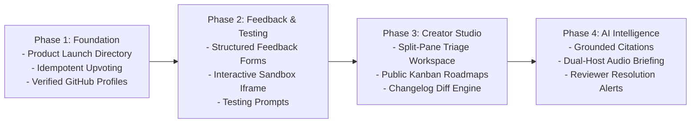

# Opportunities & Unique Advantages for Our Platform

This document synthesizes the strategic market differentiators, architectural breakthroughs, and high-leverage product opportunities that will make our **Developer Community & Prototype Launch Platform** category-defining.

---

## 1. The Core Market Opportunity: Unifying Discovery and Feedback

Existing platforms are fragmented into two disconnected extremes:

```
[ Traditional Launch Sites ]                          [ Traditional Feedback Portals ]
(Product Hunt, Open-Launch)                            (Quackback, Fider, Canny)
- High 24-hour launch spike                            - Deep feedback triage & roadmaps
- Superficial comments & upvotes                       - Zero organic user discovery
- Zero feedback management                             - Creators must recruit their own users
- No ongoing relationship after day 1                  - Siloed, boring enterprise utility
               │                                                      │
               └───────────────────────┬──────────────────────────────┘
                                       ▼
                     [ OUR UNIFIED DEVELOPER PLATFORM ]
                     - Daily prototype discovery & viral voting
                     - Structured technical feedback & testing sessions
                     - Creator roadmaps & verifiable changelog loops
                     - Grounded AI feedback synthesis & audio briefs
                     - Reviewers see their feedback implemented
```

---

## 2. Six High-Leverage Platform Differentiators

### A. Grounded AI Feedback Intelligence (Deterministic Citations)
- **The Problem**: Once a prototype collects 50+ reviews, reading every raw comment is overwhelming. Generic LLM summaries often hallucinate or blend facts.
- **Our Solution**:
  - Implement a **deterministic citation grounding engine**.
  - Every bullet point in the AI feedback summary links directly to the specific reviewer comment that inspired it (`[Citation: Review #14 by @dev_sarah]`).
  - Summarizes technical friction, performance bottlenecks, and UX confusion into prioritized developer tickets.

### B. NotebookLM-Style Dual-Host Audio Briefings
- **The Problem**: Creators and busy developers don't have time to read text dashboards while commuting or resting.
- **Our Solution**:
  - Transform incoming community feedback into a natural, engaging **dual-host podcast-style audio briefing** (similar to Google NotebookLM).
  - Two AI personas discuss the prototype:
    - *Host A (The Product Advocate)*: Highlights what community testers loved about the prototype.
    - *Host B (The Skeptical Engineer)*: Digs into reported bugs, slow API latencies, and edge cases.
  - Makers can listen to an 8-minute briefing summarizing 100 community reviews.

### C. Live Interactive Prototype Sandboxes
- **The Problem**: On Product Hunt, users must leave the site to try a product, usually never returning to leave detailed feedback.
- **Our Solution**:
  - Reviewers can run web prototypes directly in a secure, sandboxed `<iframe>` right on the platform detail page.
  - A side-by-side **Testing Drawer** allows reviewers to record feedback, rate UI ergonomics, and paste error stack traces without ever switching browser tabs.

### D. Verifiable Product Evolution & Code Diffs
- **The Problem**: Feedback portals rarely prove that products actually improved.
- **Our Solution**:
  - Introduce **Version Evolution Diffs**: when a creator releases v1.1, the platform automatically presents a visual diff between the original launch and the update.
  - Displays linked resolved feedback items: *"Fixes Bug #12 reported by @alex_dev"*.
  - When the original reviewer logs in, they see a celebratory alert: *"Your feedback was implemented in v1.1! [Review the update]"*.

### E. Community Testing Sessions with Targeted Prompts
- **The Problem**: Indie developers don't just need general praise; they need specific tests (e.g., *"Does this work on mobile Firefox?"* or *"Can anyone crash our Redis worker?"*).
- **Our Solution**:
  - Creators configure specific **Testing Prompts** with clear acceptance criteria.
  - Reviewers who complete targeted testing sessions earn verified badges and developer reputation.

### F. Verified Developer Reputation & Community Impact Score
- **The Problem**: Upvote manipulation and spam accounts plague anonymous platforms.
- **Our Solution**:
  - Connect GitHub OAuth to verify real commit history and language proficiency.
  - Introduce the **Community Impact Score**: developers earn reputation not by posting memes, but by submitting technical feedback that creators officially mark as `Implemented` in their changelogs.

---

## 3. High-Priority Implementation Roadmap



---

## 4. Conclusion

By combining the strengths of the five reference codebases—**Open-Launch's launch directory energy**, **Quackback's feedback and roadmap rigor**, **Fider's clean event-driven architecture**, and **Peerlist's developer identity**—our platform eliminates existing market fragmentation, delivering the definitive home for developers to launch, test, and iterate on software prototypes.

