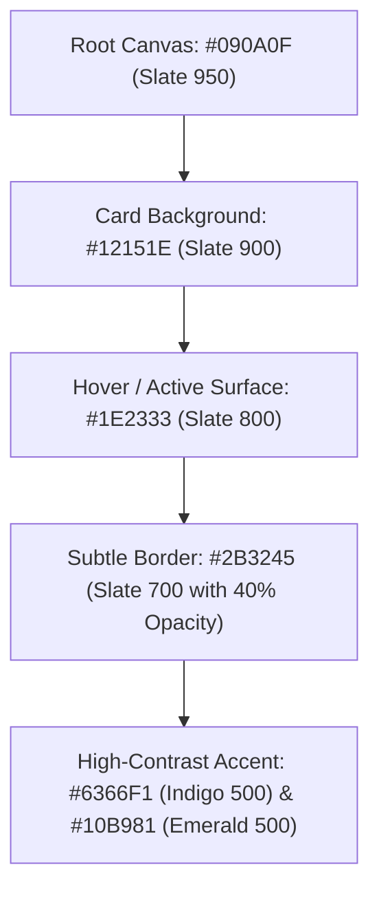

# UI/UX Design Reference Index & Pattern Catalog

This document establishes the master catalog of user interface patterns, visual hierarchies, layout systems, and interaction models reverse-engineered from the five reference repositories.

---

## 1. UI/UX Master Pattern Index

| UI Pattern / Experience | Reference Implementation | Key Component Files | Design Quality & Suitability |
|---|---|---|---|
| **Sticky App Header & Navigation** | Quackback & Open-Launch | `portal-header.tsx`, `components/header.tsx` | Excellent: clean blur backdrop, user avatar dropdown, global search |
| **Command Palette (`Ctrl+K`)** | Quackback | `cmdk` integration | Superior: instant keyboard navigation across products, feedback, and settings |
| **Daily Launch Feed Cards** | Open-Launch & Product Hunt | `components/project-card.tsx` | High-impact: rank badge, thumbnail, tagline, and prominent upvote button |
| **Product Detail & Live Media** | Product Hunt API & Open-Launch | `app/projects/[slug]/page.tsx` | High-conversion: screenshots carousel, maker avatar stack, direct demo link |
| **Kanban Public Roadmap** | Quackback | `components/portal/status/*` | Industry standard: 3-column stage layout (Planned, In Progress, Completed) |
| **Rich-Text Feedback Composer**| Quackback & Fider | `comment-editor-features.ts`, `TipTap` | Exceptional: markdown syntax, code block formatting, inline image paste |
| **Developer Profile & Portfolio**| Peerlist-Clone | `pages/EditProfile.jsx`, `components/profile`| Highly engaging: verified social links, project spotlight badges, experience |
| **Multi-Step Launch Wizard** | Open-Launch | `new-project-dialog.tsx` | Seamless: URL verification, live preview card, launch date scheduler |
| **Mobile Bottom Sheet & Nav** | Quackback & Peerlist | `portal-header-nav.ts`, `components/scroll` | Responsive: thumb-accessible touch targets, smooth drawer sheet transitions |

---

## 2. Visual Design Systems & Token Architecture

### A. Dark Mode First Aesthetic
The modern developer audience overwhelmingly prefers dark interfaces. Both **Open-Launch** and **Quackback** demonstrate state-of-the-art dark mode design token systems:

### B. Typography Hierarchy
1. **Headings**: Modern sans-serif with tight tracking (`font-sans tracking-tight font-semibold`).
2. **Body**: Clean legible high-readability font (`Inter` or `Geist Sans`), 14px–15px base size with `leading-relaxed`.
3. **Monospace Tokens**: Dedicated mono font (`JetBrains Mono` or `Fira Code`) for code snippets, API endpoints, git commit hashes, and keyboard shortcuts (`Kbd` components).

---

## 3. UI/UX Document Navigation

Explore the dedicated research teardowns across each critical experience surface:

- [Navigation & Shell Patterns](file:///c:/Users/OMEN/.gemini/antigravity-ide/scratch/ai%20web%20application/references/ui-ux/navigation-patterns.md)
- [Product Discovery & Feed Sorting](file:///c:/Users/OMEN/.gemini/antigravity-ide/scratch/ai%20web%20application/references/ui-ux/product-discovery.md)
- [Product Detail Pages & Media Presentation](file:///c:/Users/OMEN/.gemini/antigravity-ide/scratch/ai%20web%20application/references/ui-ux/product-detail-pages.md)
- [Feedback Submission & Discussion Threads](file:///c:/Users/OMEN/.gemini/antigravity-ide/scratch/ai%20web%20application/references/ui-ux/feedback-experiences.md)
- [Launch Workflows & Submission Wizards](file:///c:/Users/OMEN/.gemini/antigravity-ide/scratch/ai%20web%20application/references/ui-ux/launch-workflows.md)
- [Responsive Design & Mobile Patterns](file:///c:/Users/OMEN/.gemini/antigravity-ide/scratch/ai%20web%20application/references/ui-ux/responsive-patterns.md)

